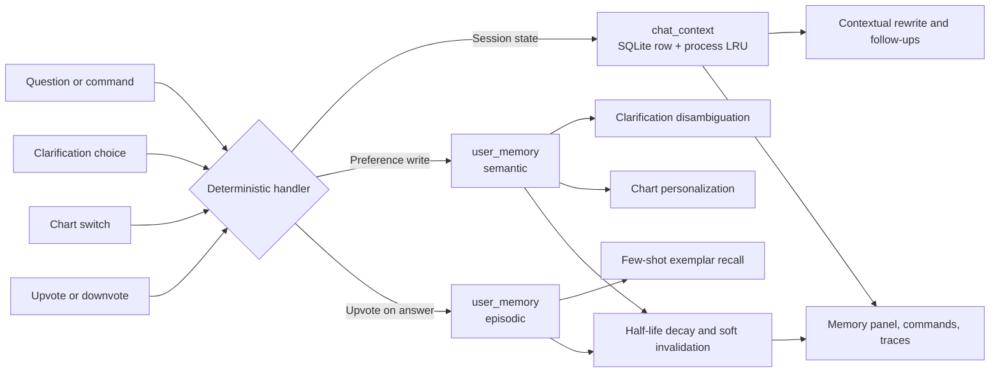

[English](MEMORY_SYSTEM.md) | [简体中文](MEMORY_SYSTEM.zh-CN.md)

# InsightChat Memory System

This is the authoritative public guide to InsightChat's memory subsystem. It describes what is stored, which code paths write and consume it, what users and operators can inspect or remove, and where the boundaries are. The module contract is in [IMPLEMENTATION_SPEC.md](IMPLEMENTATION_SPEC.md); the permission model enforced outside memory is in [PERMISSIONS.md](PERMISSIONS.md); setup and operation are in [RUNBOOK.md](RUNBOOK.md).

InsightChat memory is deliberately small and deterministic. It does not try to remember open-domain facts or model the user's general preferences. It exists to make repeated BI work less repetitive: keeping the thread of the current session, remembering a user's chart and terminology choices, and reusing that user's confirmed question/SemQL pairs as examples.

## 1. Scope and design stance

The subsystem has two tiers:

| Tier | Question it answers | Lifetime |
|---|---|---|
| Short-term session context | What were we just talking about in this session? | 72 hours since the context was last saved, with a process cache |
| Long-term user memory | What has this user preferred or confirmed? | Until superseded, deleted, or decayed below the confidence threshold |

Five design rules shape everything else:

- **BI-scoped, not chat-scoped.** Long-term memory has exactly three categories: chart preferences, terminology mappings, and personal question/SemQL pairs. There is no "remember that I like tea" capability.
- **Deterministic writes.** Memory is written by strict command parsing, clarification choices, chart switches, and 👍 feedback. No LLM extracts memory, and no LLM rewrites a stored value.
- **Per-user isolation.** Every long-term read and write is filtered by `user_id`; session context is checked against the owning session.
- **Enhancement, not bypass.** Memory can change presentation (chart type) and disambiguation (which metric term an ambiguous mention means). It never executes SQL. Every business query still passes SemQL validation, deterministic compilation, the SQL gateway, row/column policies, the execution timeout, and row limits.
- **Visible and logically reversible.** Users can list, delete, and clear their own memory. Supersede and delete are logical: values and events remain in the database for auditing.

There is no vector database, no embedding model, no Redis, and no new Python dependency in this subsystem.

## 2. Architecture



| Component | Location | Role |
|---|---|---|
| Command parser and orchestration | `chatbi/services/chat_service.py` | Detects memory commands, persists context, wires memory into clarification, charts, and answers |
| Memory service | `chatbi/services/memory.py` | Session context, long-term records, promotion, decay, chart switching, personal exemplars |
| Storage schema | `chatbi/semantic/schema.py` | `chat_context`, `user_memory`, `user_memory_event`, plus the current-version index |
| REST endpoints | `chatbi/api/routes_memory.py` | List, explicit save, delete, clear, chart switch |
| Memory panel | `chatbi/api/static/index.html` | List, status labels, per-item delete, clear, chart switch buttons |
| Feedback hook | `chatbi/services/feedback.py` | 👍 creates and 👎 revokes a personal exemplar |

A request uses memory in this order:

1. A strict memory-command check runs before intent classification. A match short-circuits the LLM and the data path.
2. Contextual rewrite reads the recent turns of the session.
3. After schema linking, ambiguity resolution consults this session's clarification choices and the user's active term mappings.
4. SemQL generation receives up to three exemplars, which may include the user's personal Q&A memory.
5. Charts are chosen by the deterministic rule engine and then personalized by long-term chart preferences.
6. The answer snapshot and the session context are persisted, and the answer carries a `memory_trace`.

## 3. Storage model

All three tables live in the metadata database (`META_DB_PATH`, default `./data/meta.db`). They are created idempotently at application startup by `init_schema()`; the full seed and published snapshot are still the responsibility of `scripts/init_db.py`.

### 3.1 `chat_context`

| Column | Meaning |
|---|---|
| `session_id` | Primary key, foreign key to `chat_session` |
| `user_id` | Owner of the context row |
| `state_json` | Whitelisted, JSON-serializable session state |
| `expires_at` | Absolute expiry timestamp, refreshed on every save |
| `created_at`, `updated_at` | Timestamps |

Loading joins `chat_session` and requires both the context owner and the session owner to match the caller. Saving checks the session owner before writing.

### 3.2 `user_memory`

| Column | Meaning |
|---|---|
| `id` | Memory id |
| `user_id` | Owner |
| `memory_type` | `semantic` (preferences) or `episodic` (personal Q&A) |
| `category` | `chart_preference`, `term_mapping`, or `query_exemplar` |
| `memory_key` | Logical key inside the category |
| `value_json` | Canonical JSON value |
| `confidence` | Base confidence before decay |
| `source` | `explicit`, `chart_switch`, `clarify`, or `feedback` |
| `status` | `candidate`, `active`, `superseded`, or `deleted` |
| `valid_from`, `valid_to` | Validity interval of this version |
| `last_confirmed_at` | Decay anchor, refreshed only by confirmation |
| `last_accessed_at`, `access_count` | Usage statistics, never used for decay |
| `created_at`, `updated_at` | Timestamps |

A partial unique index (`status IN ('active','candidate')` on `user_id, category, memory_key`) guarantees at most one current version per logical key. Historical versions are unlimited.

### 3.3 `user_memory_event`

Every lifecycle action appends an event: `memory_id`, `user_id`, `event_type`, optional `session_id`, and a JSON detail. Event types written by the implementation are `created`, `confirmed`, `observed`, `promoted`, `applied`, `superseded`, and `deleted`. There is no HTTP endpoint or UI that reads this table; it is an internal audit trail.

## 4. Short-term session context

### 4.1 Persisted state whitelist

Only four state keys are serialized to `chat_context`; a fifth lives only in process memory:

| State | Content | Survives a process restart? |
|---|---|---|
| `turns` | Up to five recent turns: question, intent, and a short SemQL summary | Yes |
| `last_semql` | The most recent SemQL object | Yes, but nothing currently consumes it |
| `clarify_choices` | This session's answers to term and value conflicts, keyed `term:<mention>` / `value:<mention>` | Yes |
| `last_answer` | `answer_id` and chart family of the last data answer, used by "switch chart" | Yes |
| `clarify_pending` | The pending clarification card, original question, intent, link result, round, candidates | **No — process memory only** |

`last_semql` is written and cleared, but it is not read by rewrite, intent classification, or generation. Follow-up inheritance comes from `turns`: the rewrite step sees the previous questions plus a short SemQL summary, while intent classification and generation see the previous questions.

### 4.2 Lifecycle and guards

- **TTL.** `MEMORY_SESSION_TTL_HOURS` defaults to 72 hours. Each save refreshes `expires_at`. The process cache applies the same TTL to its last-use timestamp.
- **Cache.** An in-process `OrderedDict` keeps at most `MEMORY_CONTEXT_CACHE_SIZE` sessions (default 128). Eviction prefers the least-recently-used session with no pending clarification; if every cached session is pending, the cache may temporarily exceed the limit.
- **Expiry and corruption.** An expired row is deleted when loaded. Corrupt JSON is logged, deleted, and treated as an empty context. Invalid fields inside otherwise valid JSON are dropped individually.
- **Ownership.** Loading requires both the context row and the session to belong to the current user. Saving a context for someone else's session raises a permission error.
- **Session deletion.** Deleting a chat session clears both the process cache and the `chat_context` row.
- **Restart.** Completed session state can be restored after a restart because the client still holds the same `session_id`. Pending clarification cannot: the card returns `CLARIFY_EXPIRED` and the user must ask again.

### 4.3 What survives where

The server can restore context for a session id, but the browser does not rehydrate the conversation. `sessionId` is a JavaScript variable, not `localStorage`, and clicking a history item only sets the id and clears the visible messages; the UI never fetches prior messages. A page reload therefore starts a new session in the UI even though old server context may still exist.

Only term and value conflicts are remembered across turns. Time and granularity choices are not written to `clarify_choices`; a custom time answer keeps the existing default-time fallback.

## 5. Long-term memory

### 5.1 Categories

| Category | `memory_type` | `memory_key` | `value` | Consumed by |
|---|---|---|---|---|
| `chart_preference` | `semantic` | Data family: `trend`, `category`, `proportion`, `single_metric`, `detail`, `other` | `{"chart_type": "<chart type>"}` | Chart personalization after the rule engine |
| `term_mapping` | `semantic` | The ambiguous mention, for example `销售额` | `{"term_id": "<metric term id>"}` | Ambiguity resolution before generation |
| `query_exemplar` | `episodic` | Normalized question text (whitespace collapsed, lowercased) | `{"dataset_id", "nl_question", "semql"}` | Few-shot exemplar recall in generation |

Chart types are the eleven names used by the rule engine: `line`, `multi_line`, `bar`, `bar_horizontal`, `top10_bar_horizontal`, `pie`, `treemap`, `metric_card`, `table`, `pivot_table`, `waterfall`.

### 5.2 Sources, confidence, and half-life

The write path determines the source, the initial status, the base confidence, and the half-life. These differences are behavioral, not cosmetic.

| Write path | Category | `source` | Initial status | Base confidence | Half-life |
|---|---|---|---|---|---|
| Chat command `以后趋势都用折线图` or `记住销售额指净销售额` | `chart_preference` / `term_mapping` | `explicit` | `active` | 1.0 | 365 days |
| Chat command `换成折线图` applied to the last data answer | `chart_preference` | `explicit` | `active` | 1.0 | 365 days |
| Chart toolbar or `POST /memories/chart-switch` | `chart_preference` | `chart_switch` | `active` | 0.8 | 90 days |
| Clarification choice submitted through `/chat/clarify` | `term_mapping` | `clarify` | `candidate`, later `active` | 0.6 → 0.85 after promotion | 90 days |
| 👍 on a successful data answer | `query_exemplar` | `feedback` | `active` | 1.0 | 90 days |

Only `source == "explicit"` uses the explicit half-life (`MEMORY_EXPLICIT_HALF_LIFE_DAYS`); every other source uses `MEMORY_INFERRED_HALF_LIFE_DAYS`. There is no `inferred` source value in the implementation. `POST /memories` is another explicit write path: it stores `source='explicit'` with confidence 1.0 and the 365-day half-life.

The same user action can therefore produce different durability. A chart choice made in the chat text is treated as durable intent (1.0, 365 days); the same choice made by clicking a chart toolbar button is treated as behavioral evidence (0.8, 90 days). Both paths return the same switch note; the stored source and confidence still differ.

### 5.3 Current version, confirmation, and supersede

- **Same value.** The existing row is confirmed: `last_confirmed_at` is refreshed, confidence becomes `max(old, new)`, and an `explicit` source is never downgraded by a weaker one. Confirming an `active` row keeps it active; confirming a candidate with an explicit statement activates it.
- **Different value.** The old current row becomes `superseded` with `valid_to` set, and a new current row is inserted. This happens regardless of source: a clarification choice can supersede an explicit mapping if the two values differ.
- **History.** Superseded and deleted rows keep their values. "Forget" is logical, not physical erasure. `GET /memories?include_history=true` returns them.

### 5.4 Write-time validation

`_validate_memory` checks the category whitelist, a non-empty key of at most 256 characters, a non-empty JSON object of at most 100 KB, a known chart family, a known chart type, a `term_id` for term mappings, and a question plus SemQL object for exemplars.

Chart family and chart type are validated independently, not against each other. A preference whose type does not fit its family can be stored; compatibility is checked when the preference is used.

## 6. Promotion of clarification choices

Clarification choices are the only path that creates candidates and the only automatic promotion path; an explicit restatement that matches an existing candidate activates it (see 5.3).

1. A choice first resolves the current question and is stored in `clarify_choices` for the session.
2. A `TERM_CONFLICT` choice also writes a `term_mapping` candidate with `source='clarify'`, `status='candidate'`, confidence 0.6, and an `observed` event keyed by `session_id`.
3. Repeated choices in the same session do not add observations; the count is `COUNT(DISTINCT session_id)` over `observed` events.
4. At `MEMORY_TERM_PROMOTE_SESSIONS` distinct sessions (default 3), the candidate becomes `active` with confidence 0.85 and a `promoted` event is written. The answer then carries the note that a long-term preference was formed from consistent choices across sessions.
5. A different choice for the same mention supersedes the current candidate and starts a new observation count.

A candidate is never consumed. Chart, term, and exemplar consumers all require `status='active'`. Until a term candidate is promoted, the only effect is the current session's choice.

`VALUE_CONFLICT` choices are session-only and never promoted. Time and granularity choices are not persisted at all.

## 7. Confidence decay and forgetting

Long-term records are not deleted on a timer. Their effective confidence decays exponentially:

```text
effective_confidence = base_confidence × 0.5 ^ (days_since_last_confirmed / half_life_days)
```

- The anchor is `last_confirmed_at`, falling back to `created_at` if it is missing.
- The threshold is `MEMORY_MIN_CONFIDENCE` (default 0.35). Below it, a memory is not consumed.
- `decayed` is a computed display flag for `active` rows. It is not a stored status. A candidate below the threshold is still shown as a candidate, because candidates are not applied in the first place.
- Usage updates only `last_accessed_at` and `access_count`, and writes an `applied` event. It never refreshes `last_confirmed_at`, so a memory cannot renew itself simply by being used.
- Repeating or re-stating the preference refreshes `last_confirmed_at` and restores usability.
- A half-life of zero (or less) disables decay for that source class.
- There is no background decay job and no archive job. Decay is evaluated on read and use; long-term rows are never physically removed.

With the default values, an explicit preference reaches the threshold after roughly 553 days, a chart-switch preference after roughly 107 days, a promoted clarification mapping after roughly 115 days, and a personal exemplar after roughly 136 days. These numbers are a consequence of the formula, not separate configuration.

Forgetting works at three levels:

| Action | Effect | History |
|---|---|---|
| Delete one memory | `status='deleted'`, `valid_to` set | Value and events remain |
| Clear all or by category | Every current row soft-deleted | Values and events remain |
| Session context expiry or corrupt JSON | The `chat_context` row is physically deleted | Chat messages remain in `chat_message` |

Chat memory commands also write `user_memory_event`; they do not write `audit_log` (see section 13).

## 8. Consumption in the query pipeline

There is no single global resolver. The familiar ordering — current explicit request, then session choice, then active long-term preference, then global default — is a cross-subsystem convention implemented separately for charts, terminology, and exemplars.

| Subsystem | Priority, highest first | Implemented in |
|---|---|---|
| Chart type | One-off request in the question → active chart preference for the data family → rule-engine recommendation | `personalize_chart` after `chart.rules.choose` |
| Terminology | This session's clarification choice → active `term_mapping` still present in the current candidates → clarification card | `_apply_clarify_memory` before generation |
| SemQL exemplars | Personal exemplars → shared exemplars, deduplicated, at most three | `pick_exemplars` before generation |

### 8.1 Charts

The rule engine always runs first and returns a chart type, a reason, and an `available_types` list. Memory may then replace the type inside that list.

- **One-off request.** Chart words in the question are parsed before preferences. A negative phrase such as `不要用折线图` or `别再用折线图` is not treated as a request. Bare nouns such as `表格`, `透视表`, and `指标卡` require an explicit display verb, so "这个表格里的数据是什么意思" is not hijacked.
- **One-off wins.** If the requested type is in `available_types`, it is applied for that answer only, with the note that it was not written to long-term memory.
- **Unsupported one-off.** If the requested type is unavailable, the rule chart is kept and a note says so. The code returns immediately and does not fall back to a stored preference on that turn.
- **Stored preference.** Otherwise, the active preference for the same data family is applied only if its effective confidence is at or above the threshold and its type is still in `available_types`. An incompatible stored preference is ignored silently, without a trace note.
- **Families.** `detail` comes from `query_mode=detail`; any time column yields `trend`; a metric name containing `占比`, `份额`, `率`, or `%` yields `proportion`; any dimension yields `category`; exactly one metric yields `single_metric`; everything else is `other`.
- **Scope.** Only data answers are personalized. Attribution reports use the fixed waterfall/table pair.
- **Usage.** Applying a preference increments access statistics and writes an `applied` event.

### 8.2 Terminology

Active term mappings are loaded before ambiguity resolution, then applied per ambiguity:

- A term mapping is used only when the mention is still ambiguous and the selected term is still one of the current candidates. If the semantic snapshot has changed and the term no longer applies, the preference is ignored and the normal clarification card appears.
- A stale preference is ignored, not invalidated. No `superseded` or `deleted` event is written.
- After the choice is merged, `_post_fix_semql` enforces the selected metric when exactly one metric term was matched, so the generator cannot silently drift back to another metric.
- Using a long-term mapping updates access statistics. The trace notes whether the session choice or the long-term preference was used.

### 8.3 Personal exemplars

- **Write.** 👍 on a successful data answer (`query_log.status='success'` with valid SemQL) creates an `episodic`/`query_exemplar` record. 👎 soft-deletes the current record for that question.
- **Recall.** Only the same dataset is considered. The record must be active and above the confidence threshold, and the candidate question must share at least one character with the stored question. Scoring is `relevance × 0.7 + confidence × 0.3`, where relevance is the count of distinct characters of the current question that appear in the stored question. There is no recency term.
- **Merge.** Personal results come first, then shared `query_exemplar` rows; duplicates by question plus SemQL are removed; the total is capped at three.
- **Trace.** If any personal exemplar is used, the answer reports that N confirmed personal Q&A pairs were referenced and that only the owner can see them.
- **Degradation.** If personal recall raises an error, generation continues with shared exemplars only.

## 9. Chart switching from a stored answer

Three entry points share one implementation: the chat command `换成折线图`, the chart toolbar in the UI, and `POST /api/v1/memories/chart-switch`.

Preconditions and behavior:

- The answer must exist and belong to the caller.
- The requested type must be one of the eleven chart types and must be in the answer's stored `available_types`. That list is reused from the stored chart metadata; it is not recomputed against the current rule engine.
- The answer must contain a readable result snapshot (columns and rows), a columns-metadata list, and SemQL. Otherwise the request fails with a message asking for a new query.
- Switching does not generate SemQL or execute SQL. It updates `answer.chart_type` and `answer.chart_meta` and returns the stored columns, rows, SemQL, SQL, applied rules, summary, and row count.
- The answer snapshot stores at most the first 200 rows. If the original result had more rows, the switch result sets `truncated=true`; it never claims to render the full result.
- The switch also learns a `chart_preference` for the computed data family. The source depends on the caller: the chat command writes `explicit` (1.0, 365 days), while the toolbar and REST path write `chart_switch` (0.8, 90 days).

Failures are explicit: missing answer → 404/1004, another user's answer → 403/1003, unsupported type or incomplete snapshot → 400/1400.

Known edge case: insight answers do not update or clear `last_answer`. After an insight answer, a chat "switch chart" command can therefore target the previous data answer, or report that there is no chart if the session never produced one. Insight results themselves are not chart-switchable.

## 10. Commands and UI

### 10.1 Chat commands

Memory commands are matched by strict patterns before intent classification. They do not call the LLM and never fall through to a data query by accident. A failed memory command returns explanatory text.

| Command | Effect |
|---|---|
| `以后趋势都用折线图` | Save a trend-family chart preference (`explicit`, 1.0, 365 days) |
| `以后分类对比都用柱状图` | Save a category-family chart preference |
| `换成折线图` / `生成折线图` | Switch the last data answer and learn the family preference (`explicit`) |
| `记住销售额指净销售额` | Resolve a unique metric term, save a term mapping, and add the session choice |
| `你记得我什么` / `查看我的记忆` | List up to ten semantic memories and count usable personal exemplars |
| `忘掉图表偏好` | Soft-delete all chart preferences |
| `忘掉问答记忆` | Soft-delete all personal exemplars |
| `忘掉销售额口径` | Soft-delete term mappings for that mention and drop the session choice |
| `忘掉全部记忆` | Soft-delete all long-term memory and reset the current session context |

Parsing details worth knowing:

- A normal question that merely starts with `以后` or `今后` is still a data question. A preference sentence must also contain markers such as `都用`, `都按`, or `都指`.
- A chart preference requires a scenario word (trend, comparison, proportion, or single metric). Without one, the command returns a usage hint instead of saving a global chart.
- `用折线图展示` inside an ordinary question is a one-off request, not a command.
- An unknown `记住…` sentence returns a usage hint; it is not silently converted into a query.
- `忘掉全部记忆` clears long-term memory and resets the current session context. The response states that history messages and audit records are retained.

### 10.2 Memory panel

The header memory button opens `我的记忆` (My memory). The panel reads `GET /memories` and shows, for each current record:

- a title: family → chart, mention → term id, or the confirmed question;
- a source pill: `explicit` → `明确指定`, `chart_switch` → `切图学习`, `clarify` → `澄清学习`, `feedback` → `点赞确认`;
- a status pill: `生效中` (active), `待跨会话确认` (candidate), or `已衰减 · 不生效` (active but below the threshold);
- effective confidence as a percentage and the access count;
- a per-item delete button.

The footer has a `清空长期记忆` (clear long-term memory) button with a confirmation dialog. The panel has loading, empty, error, and retry states.

Important UI limits:

- The panel lists current records only. It does not expose history, category-specific clearing, editing, or explicit creation; those exist only through the API or chat commands.
- Term rows show the raw `term_id`, while the chat list resolves the human term name.
- The clear button deletes long-term memory only. It does not reset the current session context. Only the chat command `忘掉全部记忆` does both.
- The UI never reloads a session's prior messages. A page reload loses `sessionId`; selecting a history item sets it again but clears the visible transcript.

## 11. HTTP API

All routes are under `/api/v1` and require a Bearer token. The server derives the user from the token; clients cannot specify `user_id`, `source`, or `confidence`.

| Method | Path | Request | Behavior |
|---|---|---|---|
| GET | `/memories` | `include_history=false` | List the caller's current memories; `include_history=true` adds superseded and deleted rows |
| POST | `/memories` | `{category, memory_key, value}` | Explicitly save a chart or term preference; `query_exemplar` is rejected; term ids are revalidated against the published snapshot |
| DELETE | `/memories/{memory_id}` | — | Soft-delete one current memory |
| DELETE | `/memories` | optional `category` | Soft-clear all current memories, optionally by category |
| POST | `/memories/chart-switch` | `{answer_id, chart_type, session_id?}` | Re-render a stored answer in another compatible type and learn the preference |

Responses use the project envelope `{"code":0,"data":...}`. Memory errors map to 404/1004 for a missing object, 403/1003 for another user's object, and 400/1400 for invalid requests. The memory write routes add `audit_log` entries named `memory_upsert`, `memory_delete`, `memory_clear`, and `memory_chart_switch`.

Notes:

- `GET /memories` is not paginated and returns full values, including full SemQL for exemplars.
- The optional `session_id` on chart switch is recorded in the event metadata but is not ownership-validated; it does not affect data access.
- Pydantic request-validation failures return FastAPI's default 422 response, not the unified error envelope.
- Related side effects: `POST /chat/ask` handles memory commands, `POST /chat/clarify` records term observations, and `POST /feedback` creates or revokes personal exemplars.

## 12. Security and user isolation

Verified controls:

- Every long-term read and write is scoped by `user_id`, including list, current-version lookup, delete, clear, term recall, exemplar recall, and chart preference lookup. Chart switching additionally checks the answer owner through `query_log.user_id`.
- Session context load joins `chat_session` and checks both ownership columns; save checks the session owner; deleting a session clears the context for the session owner.
- A pending clarification can only be answered by the user who created it. Options are validated against the current card's candidates, so forged term or dimension values are rejected.
- Chart switching checks the answer's `query_log.user_id` and never executes SQL.
- The REST API never accepts a client-supplied source, confidence, or user id for memory writes.
- Memory affects presentation, disambiguation, and exemplar selection, but never executes SQL. Every generated query still flows through SemQL validation, compilation, the SQL gateway, row and column policies, and execution limits. See [PERMISSIONS.md](PERMISSIONS.md) for what the gateway does and does not enforce.

Boundaries:

- Memory endpoints require login but no role. A viewer-only account can list, delete, and clear its own memory through the API and UI, even though that account is blocked from `POST /chat/ask`.
- Administrators have no cross-user memory view. `list_memories` always uses the current user id.
- Personal exemplars are isolated, but 👍 also feeds the pre-existing shared exemplar path: when three distinct users upvote the same question, the question and its SemQL can be activated in the shared `query_exemplar` table. Do not assume that liked content always stays private; only the personal memory record itself is private.
- Deletion is logical. Deleted and superseded values remain in `user_memory.value_json` and in event payloads, and are returned by `include_history=true`.

## 13. Trace and audit

Three different records answer three different questions:

| Record | Written by | Visible through | Content |
|---|---|---|---|
| `memory_trace` and answer assumptions | The query and chart pipeline | The answer's `记忆使用` block and the assumption banner | Why a preference or exemplar was applied |
| `user_memory_event` | The memory service | Direct database access only | `created`, `confirmed`, `observed`, `promoted`, `applied`, `superseded`, `deleted` |
| `audit_log` | Memory REST routes | Admin-only `GET /sys/audit-logs` | `memory_upsert`, `memory_delete`, `memory_clear`, `memory_chart_switch` |

Chat memory commands write `user_memory_event` but not `audit_log`, because they bypass the REST routes. `GET /sys/audit-logs` reads `audit_log` only and does not expose memory events.

Typical trace messages (the UI is Chinese):

| Situation | Message |
|---|---|
| Long-term chart preference applied | `已沿用您的趋势分析图表偏好：折线图（可在记忆管理中修改）` |
| One-off chart request | `按您当次要求使用柱状图（未写入长期偏好）` |
| One-off chart unavailable | `当前数据不支持折线图，已保留规则推荐图表` |
| Long-term term preference applied | `沿用您的长期口径偏好：「销售额」按「净销售额」查询` |
| Session choice applied | `沿用本次会话的澄清选择：「销售额」按「毛销售额」查询` |
| Personal exemplars used | `参考了您 1 条已确认的历史问答（仅本人可见）` |
| Clarification promoted | `已根据您在 3 个会话中的一致选择，将「销售额」的口径记为长期偏好` |

The chart-preference message says the preference can be modified in memory management, but the panel has no edit control. A new command or chart switch replaces the value; the panel can only delete it.

## 14. Degradation

Memory is an enhancement layer. Failures are logged and the main path continues.

| Failure | Behavior | What the user sees |
|---|---|---|
| Long-term term preference read fails | Session choices are still used; the normal clarification card can appear | A clarification card instead of an automatic term |
| Recording a clarification observation fails | The current answer proceeds with the chosen option | No promotion note |
| Access-statistics update fails | Logged only | Nothing |
| Chart preference read fails | The rule-engine chart is used | No preference note |
| Personal exemplar recall fails | Shared exemplars are used | No personal-recall note |
| Session context save fails | Logged; the completed answer is unaffected | Nothing |
| Session context load fails | An empty context is used | Follow-up may need full wording |
| Context JSON is corrupt | The row is deleted and the session starts empty | Follow-up may need full wording |
| Pending clarification is gone after a restart | `CLARIFY_EXPIRED` error event | "澄清已过期，请重新提问" |
| Memory command raises an error | A text answer explains that memory failed and data queries are unaffected | Text answer, not a data query |
| Personal exemplar write fails during feedback | Feedback is still saved | Nothing |

## 15. Configuration

| Variable | Default | Effect |
|---|---:|---|
| `MEMORY_SESSION_TTL_HOURS` | 72 | Session context TTL and process-cache age |
| `MEMORY_CONTEXT_CACHE_SIZE` | 128 | Maximum cached session contexts |
| `MEMORY_TERM_PROMOTE_SESSIONS` | 3 | Distinct sessions required to promote a clarification choice |
| `MEMORY_MIN_CONFIDENCE` | 0.35 | Minimum effective confidence for consumption |
| `MEMORY_EXPLICIT_HALF_LIFE_DAYS` | 365 | Half-life for `explicit` sources |
| `MEMORY_INFERRED_HALF_LIFE_DAYS` | 90 | Half-life for `chart_switch`, `clarify`, and `feedback` |

Edge cases:

- A promotion threshold of zero or less promotes on the first observation.
- A non-positive session TTL is clamped to one hour when saving, while the process cache compares against the raw value.
- A half-life of zero or less disables decay for that source class.
- No new Python package is required; `requirements.txt` is unchanged.

## 16. Tests and verification

Dedicated memory coverage lives in `tests/test_memory.py` and `tests/test_clarify_memory.py`. The memory tests use an isolated in-memory SQLite database and a fake snapshot; the clarification tests load the real published snapshot.

```bash
python -m pytest tests/test_memory.py tests/test_clarify_memory.py -q
python -m pytest tests/ -q
```

The suite covers chart preference application and isolation, family and available-type restrictions, one-off requests and negations, snapshot chart switching and its boundaries, broken snapshots, supersede/soft-delete/events, decay without access renewal, cross-session promotion, changed candidates, session-versus-long-term priority, stale candidates, context round-trip/expiry/corruption/ownership, restart simulation via cache clearing, LRU pending protection, clarification authorization and forged options, personal exemplar recall/delete/isolation, category clearing, validation, strict command parsing, and custom-time fallback.

Automated tests do not cover every REST route, the UI, `audit_log`, the feedback-to-exemplar integration, the chat list and forget-all paths, a real `meta.db` restart, concurrent writers, `include_history`, 422 responses, or live LLM/SSE flows. The full pipeline regression (`scripts/run_pipeline_test.py`) does not specifically test memory, and `scripts/dev_chat.py` exercises short-term follow-ups without memory assertions. Use [MEMORY_SYSTEM_TEST_SCRIPTS.md](MEMORY_SYSTEM_TEST_SCRIPTS.md) for the manual acceptance checklist.

Note that unit tests do not call the LLM, but importing the project requires `DEEPSEEK_API_KEY` to be present in `.env`, and the snapshot-based tests require an initialized metadata database.

## 17. Limitations

**Lifecycle and process model**

- The process cache and pending clarifications are single-process state. Multiple workers or instances will not share them.
- Pending clarification does not survive a restart. Completed context and term/value choices do, but only the server side does.
- A browser reload loses `sessionId`, and the UI never re-renders prior messages. Server context may still exist but is not reachable from the page.
- `last_semql` is stored and cleared but never read. Context inheritance is based on `turns`.
- Only term and value clarification choices persist across turns; time and granularity choices do not.
- There is no background decay, archival, or cleanup job. Decay is evaluated on read; expired context rows are deleted lazily; long-term rows are never physically deleted.

**Learning and retrieval**

- A stale term preference is ignored rather than invalidated; no status change is recorded.
- Any different value supersedes the current version, regardless of source. A clarification choice can supersede an explicit mapping.
- Personal exemplar recall is literal character overlap, not vector search. It requires positive overlap, has no recency term, and keeps at most three exemplars after merging with shared ones. Personal exemplars also decay at the inferred half-life.
- Memory only learns chart preferences for data answers. Insight answers are not personalized.
- Global exemplar promotion after three distinct users can make an upvoted question and SemQL available to other users as a shared example, even though the personal memory record stays private.

**Presentation and API**

- Chart switching re-renders at most the 200 rows stored in the answer snapshot and sets `truncated=true` when the original result was larger.
- Chart compatibility is based on the stored `available_types`, not recomputed against the current rule engine.
- An unsupported one-off chart request does not fall back to a stored preference on that turn.
- Write-time validation does not check that a chart type is valid for its family; compatibility is checked only at use time.
- After an insight answer, a chat chart-switch command can target an earlier data answer because insight does not update `last_answer`.
- `GET /memories` is unpaginated and returns full values. History is API-only, and memory events have no read API or UI.
- Pydantic validation failures return 422 instead of the project's error envelope.
- The chat list command shows at most ten semantic memories, while the panel lists all of them.
- The memory panel has no edit, history, category-clear, or explicit-create control. The chart-preference trace mentions editing, but the panel only deletes.
- The chart-switch `session_id` is not ownership-validated and only affects event metadata.

**Control and security**

- Memory endpoints require login but no role; a viewer-only account can manage its own memory although it cannot ask questions.
- Administrators have no cross-user memory view.
- The UI clear button clears long-term memory only. The chat command `忘掉全部记忆` also resets the current session context.
- Chat memory commands are recorded in `user_memory_event` but not in `audit_log`.
- "Forget" is logical. Deleted and superseded values remain in the database and in API history.

## 18. Related documents

- [MEMORY_SYSTEM_FEATURES.md](MEMORY_SYSTEM_FEATURES.md) — a short, user-facing tour of capabilities and design highlights
- [MEMORY_SYSTEM_TEST_SCRIPTS.md](MEMORY_SYSTEM_TEST_SCRIPTS.md) — step-by-step browser acceptance scenarios
- [IMPLEMENTATION_SPEC.md](IMPLEMENTATION_SPEC.md) — module contracts and configuration
- [PERMISSIONS.md](PERMISSIONS.md) — authentication, roles, row/column policies, and gateway enforcement
- [RUNBOOK.md](RUNBOOK.md) — environment setup, initialization, and running the application
- [../README.md](../README.md) — project overview and quick start
