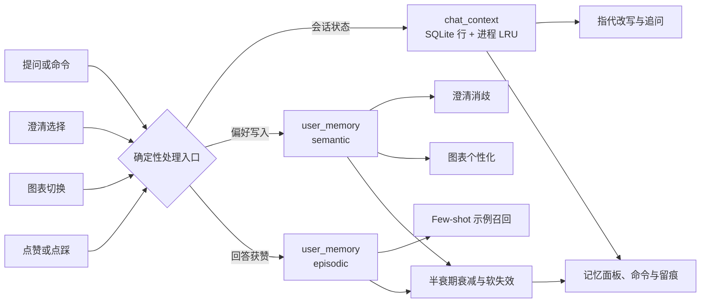

[English](MEMORY_SYSTEM.md) | [简体中文](MEMORY_SYSTEM.zh-CN.md)

# InsightChat 记忆系统

本文是 InsightChat 记忆子系统的权威公开说明，涵盖存储内容、读写链路、用户与运维人员可以查看或清除哪些内容，以及系统边界。模块契约见[实现规格说明书](IMPLEMENTATION_SPEC.zh-CN.md)；记忆之外的权限模型见[权限控制说明](PERMISSIONS.zh-CN.md)；环境搭建与运行见[启动与执行手册](RUNBOOK.zh-CN.md)。

InsightChat 的记忆刻意保持小而确定。它不尝试记住开放域事实，也不建模用户的通用喜好。它的目的是减少重复的 BI 工作：延续当前会话的上下文、记住用户的图表与口径选择，并把该用户已确认的问题/SemQL 对复用为示例。

## 1. 范围与设计立场

子系统分为两层：

| 层级 | 回答的问题 | 生命周期 |
|---|---|---|
| 短期会话上下文 | 当前会话刚才在聊什么？ | 自上次保存起 72 小时，配合进程内缓存 |
| 长期用户记忆 | 该用户偏好或确认过什么？ | 直到被取代、删除，或置信度衰减到阈值以下 |

五条设计原则决定了其余所有行为：

- **面向 BI，而非泛化聊天。** 长期记忆只有三类：图表偏好、术语映射、个人问答对。系统没有“记住我喜欢喝茶”这类能力。
- **确定性写入。** 记忆由严格命令解析、澄清选择、图表切换和 👍 反馈写入。没有 LLM 抽取记忆，也没有 LLM 改写已存储的值。
- **按用户隔离。** 所有长期读写都按 `user_id` 过滤；会话上下文会校验所属会话。
- **增强而非旁路。** 记忆可以改变展示（图表类型）和消歧（歧义说法对应哪个指标术语），但从不执行 SQL。所有业务查询仍要经过 SemQL 校验、确定性编译、SQL 网关、行/列权限、执行超时与行数限制。
- **可见且可逻辑撤销。** 用户可以查看、删除、清空自己的记忆。取代与删除都是逻辑操作：值与事件仍保留在数据库中以供审计。

该子系统不引入向量数据库、嵌入模型、Redis，也不新增 Python 依赖。

## 2. 总体架构



| 组件 | 位置 | 作用 |
|---|---|---|
| 命令解析与编排 | `chatbi/services/chat_service.py` | 识别记忆命令、持久化上下文，把记忆接入澄清、图表与回答 |
| 记忆服务 | `chatbi/services/memory.py` | 会话上下文、长期记录、晋升、衰减、图表切换、个人问答对 |
| 存储 schema | `chatbi/semantic/schema.py` | `chat_context`、`user_memory`、`user_memory_event` 及当前版本索引 |
| REST 接口 | `chatbi/api/routes_memory.py` | 列表、显式保存、删除、清空、图表切换 |
| 记忆面板 | `chatbi/api/static/index.html` | 列表、状态标签、逐条删除、清空、图表切换按钮 |
| 反馈接入 | `chatbi/services/feedback.py` | 👍 创建、👎 撤销个人问答对 |

一次提问按以下顺序使用记忆：

1. 严格匹配的记忆命令检查先于意图识别执行。命中后直接短路，不调用 LLM，也不进入数据链路。
2. 指代改写读取会话最近的轮次。
3. Schema Linking 之后，歧义消解先看本次会话的澄清选择，再看用户生效中的术语映射。
4. SemQL 生成最多接收三条示例，其中可能包含用户的个人问答记忆。
5. 图表先由确定性规则引擎选择，再由长期图表偏好个性化。
6. 回答快照与会话上下文落库，回答同时携带 `memory_trace`。

## 3. 存储模型

三张表都位于元数据库（`META_DB_PATH`，默认 `./data/meta.db`）。应用启动时由 `init_schema()` 幂等创建；完整种子与 published 快照仍由 `scripts/init_db.py` 负责。

### 3.1 `chat_context`

| 字段 | 含义 |
|---|---|
| `session_id` | 主键，外键指向 `chat_session` |
| `user_id` | 上下文行所属用户 |
| `state_json` | 白名单内、可 JSON 序列化的会话状态 |
| `expires_at` | 绝对过期时间，每次保存都会刷新 |
| `created_at`、`updated_at` | 时间戳 |

读取时 JOIN `chat_session`，要求上下文属主与会话属主都等于调用者。保存时先校验会话属主，再写入。

### 3.2 `user_memory`

| 字段 | 含义 |
|---|---|
| `id` | 记忆 id |
| `user_id` | 所属用户 |
| `memory_type` | `semantic`（偏好）或 `episodic`（个人问答） |
| `category` | `chart_preference`、`term_mapping` 或 `query_exemplar` |
| `memory_key` | 类别内的逻辑键 |
| `value_json` | 规范化 JSON 值 |
| `confidence` | 衰减前的基础置信度 |
| `source` | `explicit`、`chart_switch`、`clarify` 或 `feedback` |
| `status` | `candidate`、`active`、`superseded` 或 `deleted` |
| `valid_from`、`valid_to` | 该版本的有效区间 |
| `last_confirmed_at` | 衰减基准，仅由再次确认刷新 |
| `last_accessed_at`、`access_count` | 使用统计，从不参与衰减 |
| `created_at`、`updated_at` | 时间戳 |

部分唯一索引（在 `user_id, category, memory_key` 上约束 `status IN ('active','candidate')`）保证同一逻辑键至多一个当前版本；历史版本不受限制。

### 3.3 `user_memory_event`

每次生命周期操作都会追加事件：`memory_id`、`user_id`、`event_type`、可选 `session_id` 与 JSON 详情。实现写入的事件类型包括 `created`、`confirmed`、`observed`、`promoted`、`applied`、`superseded`、`deleted`。没有任何 HTTP 接口或界面读取该表；它是内部审计轨迹。

## 4. 短期会话上下文

### 4.1 持久化状态白名单

只有四个状态键会序列化进 `chat_context`；第五个只存在于进程内：

| 状态 | 内容 | 进程重启后是否保留 |
|---|---|---|
| `turns` | 最近最多五轮：问题、意图、简短 SemQL 摘要 | 是 |
| `last_semql` | 最近一次 SemQL 对象 | 是，但当前没有消费方 |
| `clarify_choices` | 本次会话对术语冲突与值冲突的选择，键为 `term:<mention>` / `value:<mention>` | 是 |
| `last_answer` | 最近一次数据回答的 `answer_id` 与图表形态，用于“换图” | 是 |
| `clarify_pending` | 挂起中的澄清卡、原问题、意图、linking 结果、轮次、候选 | **否，仅进程内** |

`last_semql` 会被写入和清空，但改写、意图识别与生成都不读取它。追问继承依赖 `turns`：改写步骤看到前几轮问题加上简短 SemQL 摘要，意图识别与生成只看到前几轮问题。

### 4.2 生命周期与保护

- **TTL。** `MEMORY_SESSION_TTL_HOURS` 默认 72 小时。每次保存都会刷新 `expires_at`。进程缓存用同一 TTL 判断最后使用时间。
- **缓存。** 进程内 `OrderedDict` 最多保留 `MEMORY_CONTEXT_CACHE_SIZE` 个会话（默认 128）。淘汰优先选择没有挂起澄清的最久未用会话；如果所有缓存会话都在等待澄清，缓存可能暂时超过上限。
- **过期与损坏。** 加载时发现过期行会删除该行。JSON 损坏会记录日志、删除该行，并按空上下文处理。JSON 内非法字段会被逐个丢弃。
- **属主。** 加载要求上下文行与会话都属于当前用户。为他人会话保存上下文会抛出权限错误。
- **删除会话。** 删除聊天会话会同时清理进程缓存与 `chat_context` 行。
- **重启。** 已完成的会话状态可以恢复，因为客户端仍持有同一个 `session_id`。挂起的澄清不能恢复：卡片返回 `CLARIFY_EXPIRED`，用户需要重新提问。

### 4.3 哪些状态在哪里生效

服务端可以按会话 id 恢复上下文，但浏览器不会重建对话。`sessionId` 是 JavaScript 变量，不存 `localStorage`；点击历史项只设置该 id 并清空可见消息，界面从不拉取旧消息。因此刷新页面后，界面会从新会话开始，尽管服务端可能仍有旧上下文。

只有术语冲突与值冲突会跨轮记住。时间与粒度选择不写入 `clarify_choices`；自定义时间选项仍沿用原有的默认时间兜底。

## 5. 长期记忆

### 5.1 类别

| 类别 | `memory_type` | `memory_key` | `value` | 消费点 |
|---|---|---|---|---|
| `chart_preference` | `semantic` | 数据形态：`trend`、`category`、`proportion`、`single_metric`、`detail`、`other` | `{"chart_type": "<图型>"}` | 规则引擎之后的图表个性化 |
| `term_mapping` | `semantic` | 歧义说法，例如 `销售额` | `{"term_id": "<指标术语 id>"}` | 生成之前的歧义消解 |
| `query_exemplar` | `episodic` | 规范化问题文本（折叠空白、转小写） | `{"dataset_id", "nl_question", "semql"}` | 生成阶段的 few-shot 示例召回 |

图型即规则引擎使用的十一种名称：`line`、`multi_line`、`bar`、`bar_horizontal`、`top10_bar_horizontal`、`pie`、`treemap`、`metric_card`、`table`、`pivot_table`、`waterfall`。

### 5.2 来源、置信度与半衰期

写入路径决定来源、初始状态、基础置信度与半衰期。这些差异会直接影响行为，不只是展示差异。

| 写入路径 | 类别 | `source` | 初始状态 | 基础置信度 | 半衰期 |
|---|---|---|---|---|---|
| 对话命令 `以后趋势都用折线图` 或 `记住销售额指净销售额` | `chart_preference` / `term_mapping` | `explicit` | `active` | 1.0 | 365 天 |
| 对话命令 `换成折线图`，作用于最近一次数据回答 | `chart_preference` | `explicit` | `active` | 1.0 | 365 天 |
| 图表工具栏或 `POST /memories/chart-switch` | `chart_preference` | `chart_switch` | `active` | 0.8 | 90 天 |
| 通过 `/chat/clarify` 提交的澄清选择 | `term_mapping` | `clarify` | `candidate`，晋升后为 `active` | 0.6 → 晋升后 0.85 | 90 天 |
| 对成功数据回答点 👍 | `query_exemplar` | `feedback` | `active` | 1.0 | 90 天 |

只有 `source == "explicit"` 使用显式半衰期（`MEMORY_EXPLICIT_HALF_LIFE_DAYS`），其余来源都使用 `MEMORY_INFERRED_HALF_LIFE_DAYS`。实现中不存在 `inferred` 这个来源值。`POST /memories` 也是一条显式写入路径：它写入 `source='explicit'`、置信度 1.0，并使用 365 天半衰期。

因此同一个用户动作可能产生不同的持久性。在对话文本里说出的图表选择被视为持久意图（1.0，365 天）；点击图表工具栏做出的同一选择被视为行为证据（0.8，90 天）。两条路径返回相同的切图提示，但存储的来源和置信度不同。

### 5.3 当前版本、确认与取代

- **同值。** 现有行被确认：刷新 `last_confirmed_at`，置信度取 `max(旧值, 新值)`，`explicit` 来源不会被更弱的来源降级。确认 `active` 行保持生效；用显式语句确认候选会使其生效。
- **异值。** 旧的当前行变为 `superseded` 并写入 `valid_to`，随后插入新的当前行。这一规则与来源无关：只要值不同，澄清选择也可以取代显式映射。
- **历史。** 被取代和删除的行保留值。“忘掉”是逻辑操作，不是物理擦除。`GET /memories?include_history=true` 会返回这些记录。

### 5.4 写入时校验

`_validate_memory` 会校验类别白名单、键非空且不超过 256 字、值为非空 JSON 对象且不超过 100 KB、图表形态已知、图型已知、术语映射带 `term_id`、问答对带问题与 SemQL 对象。

图表形态与图型分别校验，但不互相约束。类型与形态不匹配的偏好可以被保存；兼容性只在使用时检查。

## 6. 澄清选择的晋升

澄清选择是唯一会产生候选记忆的路径，也是唯一自动晋升路径；显式重述相同选择也会直接激活已有候选（见 5.3）。

1. 选择先解决当前问题，并写入会话的 `clarify_choices`。
2. `TERM_CONFLICT` 的选择还会写入 `term_mapping` 候选：`source='clarify'`、`status='candidate'`、置信度 0.6，并写入带 `session_id` 的 `observed` 事件。
3. 同一会话内重复选择不会增加观察次数；计数是对 `observed` 事件执行 `COUNT(DISTINCT session_id)`。
4. 达到 `MEMORY_TERM_PROMOTE_SESSIONS` 个不同会话（默认 3）后，候选变为 `active`，置信度 0.85，并写入 `promoted` 事件。回答随后会说明：系统已根据多个会话的一致选择形成长期偏好。
5. 同一说法出现不同选择时，当前候选被取代，观察计数重新开始。

候选永远不会被消费。图表、术语和示例的消费方都要求 `status='active'`。术语候选在晋升前，唯一作用是本次会话的选择。

`VALUE_CONFLICT` 的选择只属于当前会话，永不晋升。时间与粒度选择完全不持久化。

## 7. 置信度衰减与遗忘

长期记录不会按定时器删除，而是按指数衰减有效置信度：

```text
effective_confidence = base_confidence × 0.5 ^ (未再次确认天数 / half_life_days)
```

- 基准是 `last_confirmed_at`，缺失时回退到 `created_at`。
- 阈值是 `MEMORY_MIN_CONFIDENCE`（默认 0.35）。低于阈值后，记忆不再被消费。
- `decayed` 是 `active` 行的展示标记，不是持久化状态。低于阈值的候选仍显示为候选，因为候选本来就不会生效。
- 使用记忆只更新 `last_accessed_at` 与 `access_count`，并写入 `applied` 事件；从不刷新 `last_confirmed_at`，因此记忆不能靠被使用而自我续期。
- 再次重复或明确表达该偏好会刷新 `last_confirmed_at`，恢复可用性。
- 半衰期为 0（或更小）时，对该来源类别关闭衰减。
- 没有后台衰减任务，也没有归档任务。衰减在读取和使用时计算；长期记录永远不会被物理删除。

按默认值计算，显式偏好大约 553 天后达到阈值，切图学习偏好约 107 天，晋升后的澄清映射约 115 天，个人问答对约 136 天。这些数字是公式的结果，不是另外的配置项。

遗忘分为三个层级：

| 操作 | 效果 | 历史 |
|---|---|---|
| 删除单条记忆 | `status='deleted'`，写入 `valid_to` | 值与事件保留 |
| 全部清空或按类别清空 | 所有当前行软删除 | 值与事件保留 |
| 会话上下文过期或 JSON 损坏 | `chat_context` 行被物理删除 | 聊天消息仍保留在 `chat_message` |

对话记忆命令也会写入 `user_memory_event`，但不写入 `audit_log`（见第 13 节）。

## 8. 查询链路中的消费

系统没有统一的全局解析器。常见表述“当次明确要求 → 当前会话选择 → 生效中的长期偏好 → 全局默认”是跨子系统的约定，图表、术语和示例各自独立实现。

| 子系统 | 优先级（从高到低） | 实现位置 |
|---|---|---|
| 图表类型 | 问题中的当次要求 → 该数据形态生效中的图表偏好 → 规则引擎推荐 | `chart.rules.choose` 之后的 `personalize_chart` |
| 术语 | 本次会话的澄清选择 → 仍存在于当前候选中的生效 `term_mapping` → 澄清卡 | 生成之前的 `_apply_clarify_memory` |
| SemQL 示例 | 个人问答对 → 共享示例，去重后最多三条 | 生成之前的 `pick_exemplars` |

### 8.1 图表

规则引擎总是先运行，返回图型、原因与 `available_types` 列表。记忆随后可以在这个列表内替换图型。

- **当次要求。** 问题中的图型词先于偏好解析。`不要用折线图`、`别再用折线图` 等否定表达不会被当成要求。`表格`、`透视表`、`指标卡` 这类光杆名词必须有明确展示动词，因此“这个表格里的数据是什么意思”不会被劫持。
- **当次优先。** 要求的图型在 `available_types` 内时，只对本次回答生效，并留痕说明未写入长期偏好。
- **当次不支持。** 要求的图型不可用时，保留规则推荐图表并留痕。代码直接返回，本次不会回退到已存偏好。
- **已存偏好。** 否则，同一数据形态的生效偏好只有在有效置信度不低于阈值、且图型仍在 `available_types` 内时才会应用。不兼容的已存偏好会被静默忽略，不留痕。
- **数据形态。** `query_mode=detail` 得到 `detail`；存在时间列得到 `trend`；指标名包含 `占比`、`份额`、`率` 或 `%` 得到 `proportion`；存在维度得到 `category`；恰好一个指标得到 `single_metric`；其余为 `other`。
- **范围。** 只有数据回答会做图表个性化。归因报告固定使用瀑布图/表格。
- **使用统计。** 应用偏好会增加访问统计并写入 `applied` 事件。

### 8.2 术语

生效中的术语映射在歧义消解之前加载，然后逐个歧义应用：

- 只有当说法仍然歧义、且所选术语仍在当前候选中时，术语映射才会被使用。如果语义快照已变化、术语不再适用，偏好会被忽略，正常澄清卡照常出现。
- 过时偏好只会被忽略，不会被置为失效。系统不会写入 `superseded` 或 `deleted` 事件。
- 合并选择后，如果恰好命中一个指标术语，`_post_fix_semql` 会强制锁定该指标，防止生成器悄悄换成另一个指标。
- 使用长期映射会更新访问统计。留痕会说明使用的是会话选择还是长期偏好。

### 8.3 个人问答对

- **写入。** 对成功的数据回答（`query_log.status='success'` 且 SemQL 合法）点 👍 会创建 `episodic`/`query_exemplar` 记录；点 👎 会软删除该问题对应的当前记录。
- **召回。** 只考虑同一数据集；记录必须生效且高于置信度阈值；候选问题必须与已存问题至少共享一个字符。得分为 `relevance × 0.7 + confidence × 0.3`，其中 relevance 是当前问题的去重字符在已存问题中出现的个数。没有时间新鲜度项。
- **合并。** 个人结果在前，共享 `query_exemplar` 在后；按问题加 SemQL 去重；总数最多三条。
- **留痕。** 使用到个人问答对时，回答会说明参考了 N 条已确认的个人历史问答，且仅本人可见。
- **降级。** 个人召回出错时，生成继续只使用共享示例。

## 9. 基于已存回答切换图表

三个入口共用同一实现：对话命令 `换成折线图`、界面图表工具栏、`POST /api/v1/memories/chart-switch`。

前置条件与行为：

- 回答必须存在且属于调用者。
- 目标图型必须是十一种图型之一，且在该回答已存的 `available_types` 内。该列表复用已存图表元数据，不会按当前规则引擎重新计算。
- 回答必须包含可读的结果快照（列与行）、列元数据列表与 SemQL，否则请求失败并提示重新查询。
- 切换不生成 SemQL，也不执行 SQL。它更新 `answer.chart_type` 与 `answer.chart_meta`，并返回已存的列、行、SemQL、SQL、已应用规则、摘要与行数。
- 回答快照最多保存前 200 行。如果原始结果行数更多，切换结果会置 `truncated=true`，绝不声称渲染了完整结果。
- 切换还会为计算出的数据形态学习一条 `chart_preference`。来源取决于调用方：对话命令写入 `explicit`（1.0，365 天），工具栏与 REST 写入 `chart_switch`（0.8，90 天）。

失败分支是明确的：回答不存在 → 404/1004，他人回答 → 403/1003，图型不支持或快照不完整 → 400/1400。

已知边界：归因回答不会更新或清空 `last_answer`。因此归因之后，对话“换图”命令可能作用于此前的数据回答；如果本次会话从未产生数据回答，则会提示没有可切换的图表。归因结果本身不支持切图。

## 10. 命令与界面

### 10.1 对话命令

记忆命令在意图识别之前按严格模式匹配。它们不调用 LLM，也不会意外落入数据查询。记忆命令失败时返回说明文本。

| 命令 | 效果 |
|---|---|
| `以后趋势都用折线图` | 保存趋势形态图表偏好（`explicit`，1.0，365 天） |
| `以后分类对比都用柱状图` | 保存分类对比形态图表偏好 |
| `换成折线图` / `生成折线图` | 切换最近一次数据回答，并学习该形态偏好（`explicit`） |
| `记住销售额指净销售额` | 解析唯一指标术语，保存术语映射，并写入本次会话选择 |
| `你记得我什么` / `查看我的记忆` | 列出最多十条语义记忆，并统计可用的个人问答对数量 |
| `忘掉图表偏好` | 软删除全部图表偏好 |
| `忘掉问答记忆` | 软删除全部个人问答对 |
| `忘掉销售额口径` | 软删除该说法的术语映射，并移除会话选择 |
| `忘掉全部记忆` | 软删除全部长期记忆，并重置当前会话上下文 |

值得了解的解析细节：

- 仅以 `以后` 或 `今后` 开头的普通问题仍是数据问题。偏好句还必须包含 `都用`、`都按`、`都指` 等标记。
- 图表偏好需要场景词（趋势、对比、占比或单指标）。缺少场景词时返回用法提示，而不是保存一个全局图表。
- 普通问题里的 `用折线图展示` 属于当次要求，不是命令。
- 无法识别的 `记住……` 会返回用法提示，不会被静默转成查询。
- `忘掉全部记忆` 会清空长期记忆并重置当前会话上下文。回答会说明历史消息与审计记录仍然保留。

### 10.2 记忆面板

顶栏记忆按钮打开 `我的记忆`。面板读取 `GET /memories`，对每条当前记录展示：

- 标题：形态 → 图型、说法 → 术语 id，或已确认的问题；
- 来源标签：`explicit` → `明确指定`，`chart_switch` → `切图学习`，`clarify` → `澄清学习`，`feedback` → `点赞确认`；
- 状态标签：`生效中`、`待跨会话确认`（候选）、或 `已衰减 · 不生效`（生效但低于阈值）；
- 有效置信度百分比与使用次数；
- 逐条删除按钮。

底部的 `清空长期记忆` 按钮带确认弹窗。面板具备加载、空态、错误与重试状态。

重要的界面限制：

- 面板只列出当前记录，不提供历史、按类别清空、编辑或显式创建；这些只能通过 API 或对话命令完成。
- 术语行展示原始 `term_id`，而对话列表会解析为人类可读的术语名。
- 清空按钮只删除长期记忆，不重置当前会话上下文。只有对话命令 `忘掉全部记忆` 两者都做。
- 界面从不重新加载会话的旧消息。刷新页面会丢失 `sessionId`；选择历史项会重新设置它，但会清空可见对话。

## 11. HTTP API

所有路由都在 `/api/v1` 下，且需要 Bearer 登录。服务端从 token 推导用户；客户端不能指定 `user_id`、`source` 或 `confidence`。

| 方法 | 路径 | 请求 | 行为 |
|---|---|---|---|
| GET | `/memories` | `include_history=false` | 列出调用者的当前记忆；`include_history=true` 追加被取代与已删除记录 |
| POST | `/memories` | `{category, memory_key, value}` | 显式保存图表或术语偏好；拒绝 `query_exemplar`；术语 id 会按 published 快照重新校验 |
| DELETE | `/memories/{memory_id}` | — | 软删除一条当前记忆 |
| DELETE | `/memories` | 可选 `category` | 软清空所有当前记忆，可按类别限定 |
| POST | `/memories/chart-switch` | `{answer_id, chart_type, session_id?}` | 用另一兼容图型重绘已存回答，并学习偏好 |

响应使用项目统一包 `{"code":0,"data":...}`。记忆错误映射为：对象不存在 404/1004，他人对象 403/1003，非法请求 400/1400。记忆写路由会追加名为 `memory_upsert`、`memory_delete`、`memory_clear`、`memory_chart_switch` 的 `audit_log` 记录。

说明：

- `GET /memories` 不分页，并返回完整值，包括示例的完整 SemQL。
- 图表切换的可选 `session_id` 只记录到事件元数据，不校验属主；它不影响数据访问。
- Pydantic 请求校验失败返回 FastAPI 默认的 422 响应，而不是统一错误包。
- 相关副作用接口：`POST /chat/ask` 处理记忆命令，`POST /chat/clarify` 记录术语观察，`POST /feedback` 创建或撤销个人问答对。

## 12. 安全与用户隔离

已验证的控制：

- 所有长期读写都按 `user_id` 限定，包括列表、当前版本查询、删除、清空、术语召回、示例召回与图表偏好查询。图表切换还会通过 `query_log.user_id` 校验回答属主。
- 会话上下文加载会 JOIN `chat_session` 并校验两个属主字段；保存时校验会话属主；删除会话时按会话属主清理上下文。
- 挂起的澄清只能由创建它的用户回答。选项会按当前卡片的候选校验，伪造的术语或维度值会被拒绝。
- 图表切换会校验回答的 `query_log.user_id`，且从不执行 SQL。
- REST API 从不接受客户端提供的来源、置信度或用户 id 来写记忆。
- 记忆会影响展示、消歧和示例选择，但从不执行 SQL。每个生成的查询仍要经过 SemQL 校验、编译、SQL 网关、行/列权限与执行限制。网关具体执行与不执行哪些控制，见[权限控制说明](PERMISSIONS.zh-CN.md)。

边界：

- 记忆接口只要求登录，不校验角色。纯 `viewer` 账号可以通过 API 与界面查看、删除、清空自己的记忆，尽管该账号被禁止调用 `POST /chat/ask`。
- 管理员没有跨用户记忆视图。`list_memories` 始终使用当前用户 id。
- 个人问答对是隔离的，但 👍 同时会进入既有的全局示例路径：当三个不同用户对同一问题点赞后，该问题及其 SemQL 可以在共享的 `query_exemplar` 表中转正。不要假定点赞内容永远只属于个人；只有个人记忆记录本身是私有的。
- 删除是逻辑操作。已删除与被取代的值仍保留在 `user_memory.value_json` 与事件载荷中，并会被 `include_history=true` 返回。

## 13. 留痕与审计

三种记录回答三个不同问题：

| 记录 | 写入方 | 可见途径 | 内容 |
|---|---|---|---|
| `memory_trace` 与回答假设区 | 查询与图表链路 | 回答的 `记忆使用` 折叠区与假设提示条 | 为什么应用了某条偏好或示例 |
| `user_memory_event` | 记忆服务 | 仅直接访问数据库 | `created`、`confirmed`、`observed`、`promoted`、`applied`、`superseded`、`deleted` |
| `audit_log` | 记忆 REST 路由 | 仅管理员 `GET /sys/audit-logs` | `memory_upsert`、`memory_delete`、`memory_clear`、`memory_chart_switch` |

对话记忆命令写入 `user_memory_event`，但不写入 `audit_log`，因为它们绕过了 REST 路由。`GET /sys/audit-logs` 只读取 `audit_log`，不暴露记忆事件。

典型留痕文案：

| 场景 | 文案 |
|---|---|
| 应用长期图表偏好 | `已沿用您的趋势分析图表偏好：折线图（可在记忆管理中修改）` |
| 当次图型要求 | `按您当次要求使用柱状图（未写入长期偏好）` |
| 当次图型不可用 | `当前数据不支持折线图，已保留规则推荐图表` |
| 应用长期术语偏好 | `沿用您的长期口径偏好：「销售额」按「净销售额」查询` |
| 应用会话选择 | `沿用本次会话的澄清选择：「销售额」按「毛销售额」查询` |
| 使用个人问答对 | `参考了您 1 条已确认的历史问答（仅本人可见）` |
| 澄清晋升 | `已根据您在 3 个会话中的一致选择，将「销售额」的口径记为长期偏好` |

图表偏好的留痕说“可在记忆管理中修改”，但面板没有编辑控件。新的命令或图表切换会替换该值；面板只能删除。

## 14. 降级

记忆是增强层。失败会被记录日志，主链路继续。

| 故障 | 行为 | 用户看到什么 |
|---|---|---|
| 长期术语偏好读取失败 | 仍使用会话选择；正常澄清卡可以出现 | 澄清卡，而不是自动口径 |
| 记录澄清观察失败 | 当前回答仍按所选选项继续 | 没有晋升提示 |
| 访问统计更新失败 | 仅记录日志 | 无 |
| 图表偏好读取失败 | 使用规则引擎图表 | 没有偏好留痕 |
| 个人问答对召回失败 | 使用共享示例 | 没有个人召回留痕 |
| 会话上下文保存失败 | 记录日志；已完成的回答不受影响 | 无 |
| 会话上下文加载失败 | 使用空上下文 | 追问可能需要完整表述 |
| 上下文 JSON 损坏 | 删除该行，会话从空开始 | 追问可能需要完整表述 |
| 重启后挂起澄清消失 | `CLARIFY_EXPIRED` 错误事件 | “澄清已过期，请重新提问” |
| 记忆命令抛错 | 文本回答说明记忆未完成，数据查询不受影响 | 文本回答，而非数据查询 |
| 反馈时个人问答对写入失败 | 反馈仍会保存 | 无 |

## 15. 配置

| 环境变量 | 默认值 | 作用 |
|---|---:|---|
| `MEMORY_SESSION_TTL_HOURS` | 72 | 会话上下文 TTL 与进程缓存年龄 |
| `MEMORY_CONTEXT_CACHE_SIZE` | 128 | 进程缓存的会话上下文上限 |
| `MEMORY_TERM_PROMOTE_SESSIONS` | 3 | 澄清选择晋升所需的不同会话数 |
| `MEMORY_MIN_CONFIDENCE` | 0.35 | 可被消费的最低有效置信度 |
| `MEMORY_EXPLICIT_HALF_LIFE_DAYS` | 365 | `explicit` 来源的半衰期 |
| `MEMORY_INFERRED_HALF_LIFE_DAYS` | 90 | `chart_switch`、`clarify`、`feedback` 的半衰期 |

边界情况：

- 晋升门槛为 0 或负数时，第一次观察就会晋升。
- 会话 TTL 非正数时，保存会收敛到一小时，而进程缓存仍按原始值比较。
- 半衰期为 0 或负数时，对该来源类别关闭衰减。
- 不新增 Python 包；`requirements.txt` 不变。

## 16. 测试与验证

专门的记忆覆盖位于 `tests/test_memory.py` 与 `tests/test_clarify_memory.py`。记忆测试使用独立的内存 SQLite 与伪造快照；澄清测试加载真实 published 快照。

```bash
python -m pytest tests/test_memory.py tests/test_clarify_memory.py -q
python -m pytest tests/ -q
```

测试覆盖图表偏好的应用与隔离、形态与可选图型限制、当次要求与否定表达、快照切图及其边界、损坏快照、取代/软删除/事件、访问不续期的衰减、跨会话晋升、候选变更、会话与长期优先级、过时候选、上下文往返/过期/损坏/属主、通过清缓存模拟重启、LRU 挂起保护、澄清鉴权与伪造选项、个人问答对召回/删除/隔离、按类别清空、参数校验、严格命令解析，以及自定义时间兜底。

自动化测试不覆盖所有 REST 路由、界面、`audit_log`、反馈到示例的集成、对话列表与全部遗忘路径、真实 `meta.db` 重启、并发写入、`include_history`、422 响应，以及真实 LLM/SSE 流程。全链路回归（`scripts/run_pipeline_test.py`）不会专门测试记忆，`scripts/dev_chat.py` 会走短期追问但没有记忆断言。页面级手工验收请使用[记忆系统手工验收清单](MEMORY_SYSTEM_TEST_SCRIPTS.zh-CN.md)。

注意：单元测试不调用 LLM，但导入项目要求 `.env` 中存在 `DEEPSEEK_API_KEY`，且依赖快照的测试要求已初始化的元数据库。

## 17. 已知边界

**生命周期与进程模型**

- 进程缓存与挂起澄清都是单进程状态。多 worker 或多实例不会共享它们。
- 挂起澄清不跨重启。已完成的上下文与术语/值选择可以恢复，但仅限服务端。
- 浏览器刷新会丢失 `sessionId`，界面也从不重新渲染旧消息。服务端上下文可能仍存在，但页面无法访问。
- `last_semql` 会被写入和清空，但从未被读取。上下文继承基于 `turns`。
- 只有术语与值澄清选择会跨轮持久化，时间与粒度选择不会。
- 没有后台衰减、归档或清理任务。衰减在读取时计算；过期上下文行按需删除；长期记录永远不会被物理删除。

**学习与召回**

- 过时术语偏好只会被忽略，不会被置为失效；系统不记录状态变更。
- 任意不同的值都会取代当前版本，与来源无关。澄清选择可以取代显式映射。
- 个人问答对召回基于字面字符重合，不是向量检索。它要求重合度为正，没有时间新鲜度项，与共享示例合并后最多三条。个人问答对也按推断半衰期衰减。
- 记忆只为数据回答学习图表偏好；归因回答不做个性化。
- 三个不同用户点赞后，全局示例晋升可能让被点赞的问题与 SemQL 作为共享示例提供给其他用户，尽管个人记忆记录仍是私有的。

**展示与 API**

- 图表切换最多重绘回答快照中保存的 200 行；原始结果更大时会置 `truncated=true`。
- 图表兼容性基于已存的 `available_types`，不会按当前规则引擎重新计算。
- 当次图型不受支持时，本次不会回退到已存偏好。
- 写入时校验不检查图型是否适用于其形态；兼容性只在使用时检查。
- 归因回答之后，对话换图命令可能作用于更早的数据回答，因为归因不会更新 `last_answer`。
- `GET /memories` 不分页且返回完整值。历史只能通过 API 获取，记忆事件没有读取接口或界面。
- Pydantic 校验失败返回 422，而不是项目统一错误包。
- 对话列表命令最多展示十条语义记忆，而面板会列出全部。
- 记忆面板没有编辑、历史、按类别清空或显式创建控件。图表偏好留痕提到可修改，但面板只能删除。
- 图表切换的 `session_id` 不校验属主，只影响事件元数据。

**控制与安全**

- 记忆接口只要求登录，不校验角色；纯 `viewer` 账号可以管理自己的记忆，但不能提问。
- 管理员没有跨用户记忆视图。
- 界面的清空按钮只清空长期记忆。对话命令 `忘掉全部记忆` 还会重置当前会话上下文。
- 对话记忆命令记录到 `user_memory_event`，但不记录到 `audit_log`。
- “忘掉”是逻辑操作。已删除与被取代的值仍保留在数据库与 API 历史中。

## 18. 相关文档

- [记忆系统功能特性](MEMORY_SYSTEM_FEATURES.zh-CN.md)——面向用户的能力与设计亮点简介
- [记忆系统手工验收清单](MEMORY_SYSTEM_TEST_SCRIPTS.zh-CN.md)——浏览器场景的逐步验收步骤
- [实现规格说明书](IMPLEMENTATION_SPEC.zh-CN.md)——模块契约与配置
- [权限控制说明](PERMISSIONS.zh-CN.md)——认证、角色、行/列策略与网关执行
- [启动与执行手册](RUNBOOK.zh-CN.md)——环境搭建、初始化与运行
- [项目总览与快速开始](../README.zh-CN.md)——项目简介与快速上手
