# ChatBI 产品需求文档（PRD）
## ——基于 EvoOntology / SuperSonic / WrenAI 调研的企业级对话式 BI 产品

> 文档版本：v1.0
> 阅读对象：对本项目零背景的技术人员。仅凭本文档即可独立完成开发，无需提问、无需查阅外部业务资料。
> 约定：全文中文，技术名词保留英文。所有"必须/禁止"字样均为刚性需求。

---

## 目录

- 第一章 开源项目调研对比（EvoOntology / SuperSonic / WrenAI）
- 第二章 产品概述（背景、用户、目标、范围）
- 第三章 技术选型（拍板，一句话理由）
- 第四章 总体架构（模块划分与端到端数据流）
- 第五章 语义层与 Ontology 专章（数据模型、构建维护、LLM 注入方式、版本管理）
- 第六章 核心功能详述（10 个功能，每个含：功能描述→场景→交互流程→实现机理→异常穷举→验收标准）
- 第七章 数据存储设计（核心表建表语句）
- 第八章 API 总表与错误码表
- 第九章 MVP 圈选及理由
- 第十章 Top5 技术风险与缓解
- 第十一章 假设清单

---

# 第一章 开源项目调研对比

调研方法：三个项目源码均已克隆至本地工作区（`EvoOntology/`、`supersonic/`、`WrenAI/`），以下每个结论均来自项目官方文档与源码，并注明出处（文件路径+行号/章节）。无任何臆测内容。

## 1.1 EvoOntology

### 1.1.0 项目定位（理解一切结论的前提）

EvoOntology **本身不是一个 NL2SQL 引擎，而是"面向 Data Agent 的自进化 Ontology Layer"基础设施**：它只提供语义层的存储、版本化、MCP 运行时检索、轨迹记录与进化门控；真正的 NL 理解与 SQL 生成由外部 Data Agent（Claude Code / Codex 插件，或 benchmark 里的 ReAct Agent）完成。原文："核心包只提供确定性能力；Build / Evolve 的智能放在 skill 里"（`EvoOntology/docs/architecture.md:33-34`）；"Build and Evolve intelligence lives in the plugin skills; this package provides only deterministic capabilities"（`EvoOntology/evoontology/__init__.py:12-13`）。其 NL2SQL 能力体现在 `benchmarks/bird/`（BIRD text-to-SQL 评估环境）中。

### 1.1.1 业务语义层如何构建？语义层里写了什么？

**语义层 Schema：4 类节点 + 2 类边，序列化为 5 个 JSON 记录文件。** 出处：`EvoOntology/plugins/claude-code/skills/evo-build/references/ontology-schema.md:24-49`；Python 镜像定义在 `EvoOntology/evoontology/ontology/models.py:57-196`。

**① Term（术语）**：统一抽象业务概念/指标/实体/维度/分类，不强制固定本体层级（`ontology-schema.md:69-71`）。字段：`id / name / type(concept|metric|entity|dimension|category) / definition / scope / aliases / evidence`（`ontology-schema.md:77-105`）。真实示例（`demo_test/.evoontology/versions/ontology_v0/terms.json:2-17`）：

```json
{"id": "term_net_sales", "name": "净销售额", "type": "metric",
 "definition": "已完成订单的折后销售金额合计：Σ(quantity × unit_price × discount_rate)，仅统计 status='completed' 的订单",
 "scope": "销售业绩分析；金额单位人民币元",
 "aliases": ["Net Sales", "有效销售额", "销售额"],
 "evidence": ["ev_net_sales_2024"]}
```

**② Mapping（映射）**：Term 到物理数据的可执行落地。字段：`term_id / database_source / table / column / semantic_filter / aggregation_semantics / grain / validation`（`ontology-schema.md:144-174`）。示例（`demo_test/.evoontology/versions/ontology_v0/mappings.json:2-17`）：

```json
{"id": "map_net_sales", "term_id": "term_net_sales", "database_source": "retail.db",
 "table": "order_items (JOIN orders ON order_items.order_id = orders.order_id)",
 "column": "quantity * unit_price * discount_rate",
 "semantic_filter": "仅 orders.status = 'completed' 的订单",
 "aggregation_semantics": "折后订单行金额的求和", "grain": "订单行",
 "validation": {"description": "2024 年净销售额复算为 2,205,779.84 元", "evidence": ["ev_net_sales_2024"]}}
```

**③ Relation（语义关系）**：连接 Term 与 Term，`relation_type` 只允许 5 个受控值：`association / hierarchy / composition / equivalence / derivation`（`ontology-schema.md:252-389`）。`derivation` 记录指标推导公式（如"客单价由净销售额与有效订单数推导"，`demo_test/.evoontology/versions/ontology_v0/relations.json:14-23`）。

**④ Constraint（约束）**：字段：`target / constraint_type(enum_semantics|data_quality|business_rule|unit|scope) / trigger_keywords / severity(block|warning|info) / confidence / description / evidence`（`ontology-schema.md:427-457`）。`trigger_keywords` 专为运行时发现设计（`ontology-schema.md:421`）。示例：`demo_test/.evoontology/versions/ontology_v0/constraints.json:2-22` 中的 block 级约束"净销售额仅统计 status='completed' 的订单，否则 2024 年口径会多计约 76 万元"。

**⑤ Evidence（证据）**：字段：`source / query / result / validation_method / timestamp`（`ontology-schema.md:519-538`）——即**真实执行过的探查 SQL 及其结果**，保证语义可复现（实证：`demo_test/outputs/01_exploration/exploration_observations.json:10-17`）。

**构建流程：LLM Builder Agent 驱动的半自动构建**（`EvoOntology/plugins/claude-code/skills/evo-build/SKILL.md:40-250`）：

1. **Step 0 初始化项目上下文**：确定模式、数据源、workload 来源，持久化到 `.evoontology/project.json`（SKILL.md:43-87）。
2. **Step 1 Workload 引导探查**："Do not start from data structures. Start from analytical requirements."（SKILL.md:108）——从 workload 问题中识别反复出现的概念/指标，再用只读工具探查数据环境验证每个候选 grounding，"不臆造无证据概念"（SKILL.md:131-165）。
3. **Step 2 证据落地提交**：生成五类记录 → MCP 工具 `save_version` → `validate_semantics`（确定性门禁）→ `set_active_version` 发布 `ontology_v0`（SKILL.md:236-247；实现 `EvoOntology/evoontology/runtime/ops.py:218-229`）。

之后还有**自进化**环节（`/evo-evolve`：诊断→归因→补丁→Parent/Candidate 配对评估门控→发布 vN+1，`EvoOntology/README.zh-CN.md:107-113`），属于语义层的持续维护机制。

### 1.1.2 如何抽取/解析 NL？

**结论：没有独立的意图识别、NER、槽位填充模块。NL 理解完全交给宿主 LLM Agent；语义层内部只有确定性的关键词/token 匹配。**

- **(a) 问题理解与概念抽取 = LLM 自己完成**。用户问题原文注入 system prompt，LLM 按 ReAct 模式自行决定调用哪个工具、给 `resolve_semantics` 传什么 `mentions`。Prompt 模板见 `EvoOntology/benchmarks/bird/agent/prompt_manager.py:12-70`；`resolve_semantics` 入参 `mentions`（最多 5 个）定义在 `EvoOntology/evoontology/runtime/tools.py:54-75`。
- **(b) 概念 grounding（mention → Term）= 确定性字符串匹配**（`EvoOntology/evoontology/runtime/runtime.py`）：`_match_mention`（runtime.py:331-353）优先级 = 精确 name → 精确 alias → token 子集匹配；`_tokens`（runtime.py:28-41）做小写化、分词、去停用词、简单词干化；歧义消解 `_disambiguate`（runtime.py:355-378）用 context 与候选 name/aliases/definition/scope 的重合度打分，平分返回 ambiguous。
- **(c) 概念发现 = token 重叠打分**，`browse_semantics`（runtime.py:155-219）：`score = 2*phrase_match + len(overlap_tokens)`，返回 top-N（≤6）并附 `match_rationale`，**全程无 embedding**。

全库 grep 无 intent classification / slot filling / NER / embedding 相关实现。

### 1.1.3 MDL/语义模型里写了什么？

**"MDL"一词在本项目不存在**（那是 WrenAI 的术语）。对应物是 **Mapping + Relation + Constraint**，内容远超表间关联：

1. **join 信息**：物理连接写在 `Mapping.table`（如 `"order_items (JOIN orders ON ...)"`）与 `Relation.connection_condition` 的语义化描述里。schema 明确禁止"把表 JOIN 关系存成 Semantic Relation"——"JOINs are physical table connections, not ontological relations"（`ontology-schema.md:401`）。
2. **指标口径/计算逻辑**：`Mapping.column` 含计算表达式、`semantic_filter`（过滤条件）、`aggregation_semantics`（聚合语义）、`grain`（粒度）；`derivation` 型 Relation 记录指标推导公式与依赖（`demo relations.json:25-34`）。
3. **维度枚举/业务规则/单位/时间范围**：由 Constraint 承载（如枚举语义 `orders.status: completed=已完成`、单位"人民币元"、数据覆盖范围，`demo constraints.json:23-180`）。
4. **明确边界**：禁止存 SQL 模板、查询生成指令、推理步骤——"Separation of Knowledge and Execution"（`ontology-schema.md:606-616`；`evo-build/SKILL.md:191-195`）。

### 1.1.4 索引/字典里存什么？如何构建与使用？

**没有向量索引/embedding 检索**（核心包 `pyproject.toml:14` `dependencies = []`，零第三方依赖）。"索引"就是 **workspace 里的 JSON 文件 + 内存 dict**（`EvoOntology/evoontology/ontology/store.py:22-37`）：

```
.evoontology/
├── project.json        # 项目上下文
├── active.json         # {"active_version": "ontology_vN"}  ← 版本指针
├── versions/ontology_vN/
│   ├── terms.json  mappings.json  relations.json  constraints.json  evidence.json
├── trajectories/       # 任务轨迹
└── state.json          # 进化触发 checkpoint
```

**查询时使用**：①会话初始化只注入 **manifest**（不注入全量语义）：`SemanticLayer.manifest()`（`runtime.py:96-151`）生成版本号、对象计数、工具用法说明，通过 MCP 资源暴露；②Agent 按需调 `browse_semantics(query, limit≤6)` 发现概念、`resolve_semantics(mentions≤5, context)` 把概念解析为 mappings+relations+constraints+evidence 打包返回（`runtime.py:262-329, 394-481`）。"会话初始化时只注入 manifest；具体记录按需检索"（`README.zh-CN.md:85`）。检索实现是**全量加载 + 线性扫描 token 匹配**，每次返回附 `match_rationale` 供 Agent 判断。

### 1.1.5 是否支持洞察/归因类问题？

**结论：核心语义层不做归因分析，也没有针对用户直接提问的归因（why）问题的专门实现链路。**

1. 核心包无任何归因引擎，语义层明确定位不存 agent 策略/推理流程（`ontology-schema.md:606-616`）。
2. 其 InsightBench 评估环境支持"目标驱动的迭代洞察生成"：给定 goal → LLM 推荐分析问题（`GET_QUESTIONS_TEMPLATE`，`benchmarks/insightbench/insightbench/prompts/__init__.py:57-92`）→ 生成并执行 Python 代码回答 → 提炼 insight → 生成 follow-up 问题继续下钻。follow-up **设计了** descriptive / diagnostic / prescriptive / predictive 四类（prompts:262-263），diagnostic 即"为什么"类——**但默认流程中 `follow_up_with_type` 被注释停用**（`benchmarks/insightbench/insightbench/agents.py:113-117`）。
3. 对"为什么四月销量比五月低"这种用户直接发起的归因问题：无任何专门的归因 prompt 链、下钻算法或维度分解模块，只能依赖宿主 Agent 的通用 ReAct 循环自行多步查询。
4. 旁证：InsightBench 正是其三个 benchmark 中提升最小的（+1.0，对比 BIRD +8.8、DDR +20.0，`README.zh-CN.md:169-173`）。

## 1.2 SuperSonic

### 1.2.0 项目定位与架构

SuperSonic 是腾讯开源的 ChatBI + Headless BI 平台（Java 21 + Spring Boot 3.3.9，MyBatis-Plus，JSqlParser + Apache Calcite，HanLP 分词，LangChain4j 0.36.2 接入 LLM，内置 bge-small-zh / all-minilm-l6-v2 embedding，向量库支持 in-memory/Milvus/Chroma/pgvector/Qdrant，元数据库 H2/MySQL/PostgreSQL）。出处：`supersonic/AGENTS.md:18-34`、`README.md:41-58`。

**架构分层**：
- **Headless BI（语义层）** `headless/`：`api`（语义模型 POJO）、`server`（语义建模管理 + 持久化 + REST）、`chat`（chat 侧语义层：mapper/knowledge/parser/corrector）、`core`（S2SQL→物理 SQL 翻译器 + 执行器）。
- **Chat BI（对话层）** `chat/server`：Agent、ChatQueryParser/ChatQueryExecutor、插件、记忆、结果处理器。Chat 层不做语义解析，通过 `ChatLayerService` 接口调用 headless 层。

**核心设计理念**（`README.md:24-27`）：**LLM 不直接生成物理 SQL，而是生成语义查询语句 S2SQL**；join、指标公式由语义层翻译成物理 SQL，以此降低幻觉与复杂度。

### 1.2.1 业务语义层如何构建？语义层里写了什么？

**构建方式：Web UI 配置，持久化到元数据库**（非配置文件）。表结构见 `launchers/standalone/src/main/resources/db/schema-h2.sql`。语义模型是五层结构，每层一张表：

- **Domain（主题域）** `s2_domain`（schema-h2.sql:139）。
- **Model（数据模型）** `s2_model`（schema-h2.sql:158）：`model_detail`（JSON，对应 `ModelDetail`，`headless/api/.../pojo/ModelDetail.java:17`）含 `queryType`（绑定一段 SQL 或一张物理表）、**identifiers（主键标识）、dimensions、measures、fields**；`Measure` 含 `name/agg/expr/alias/constraint`（`Measure.java:10-26`）——度量带**聚合方式与表达式**；另有 `drill_down_dimensions`（下钻维度配置）、`database_id`（绑定物理库）。
- **ModelRela（模型关系）** `s2_model_rela`（schema-h2.sql:267）：`fromModelId/toModelId/joinType/joinCondition`——表间 join 关系。
- **Metric（指标）** `s2_metric`（schema-h2.sql:214）：`name/bizName/alias（同义词）/description/type（ATOMIC、DERIVED）/typeParams（表达式 JSON）/relateDimensions/defineType（MEASURE、FIELD、METRIC）`。派生指标支持"基于度量+表达式""基于字段""基于已有指标再派生"三类定义。
- **Dimension（维度）** `s2_dimension`（schema-h2.sql:241）：`expr（维度表达式）/semanticType（DATE、ID、CATEGORY）/alias/dimValueMaps（维度值映射：技术名/展示名/查询别名三元组 `DimValueMap`）`。
- **Tag（标签）** `s2_tag` + `s2_tag_object`（schema-h2.sql:483,495）——基于 ID 类维度衍生实体标签。
- **DataSet（数据集）** `s2_data_set`（schema-h2.sql:464）：把多个 Model 的指标/维度子集圈定为查询范围，是 chat 查询的最小单元；`queryConfig` 存默认时间/聚合配置。
- **Term（业务术语）** `s2_term`（schema-h2.sql:532）：`name/description/alias/relatedMetrics/relatedDimensions`——业务黑话映射，进入词典和 LLM prompt。
- 另有 `s2_query_rule`（行/列级权限规则）等。

**结论**：语义层 = UI 配置 + 数据库存储，内容远超表结构：模型绑定物理表/SQL、度量表达式与聚合、派生指标公式、维度表达式、维度值映射、同义词、模型 join 关系、下钻维度、业务术语、默认查询配置。

### 1.2.2 如何抽取/解析 NL？

**实体抽取（SchemaMapper，SPI 注册的 6 个 mapper，见 `launchers/standalone/src/main/resources/META-INF/spring.factories:3-9`）**：

| Mapper | 机制 | 出处 |
|---|---|---|
| `KeywordMapper` | `HanlpDictMatchStrategy`（HanLP 词典前/后缀匹配）+ `DatabaseMatchStrategy`（编辑距离+包含匹配） | `headless/chat/.../mapper/KeywordMapper.java:34-51` |
| `EmbeddingMapper` | `EmbeddingMatchStrategy`（向量召回 + 可选 LLM 精排） | `mapper/EmbeddingMatchStrategy.java:63-88` |
| `QueryFilterMapper` | 数值过滤条件（如">1000"）抽取 | mapper/QueryFilterMapper.java |
| `PartitionTimeMapper` | 分区时间词识别 | mapper/PartitionTimeMapper.java |
| `TermDescMapper` | 术语映射 | mapper/TermDescMapper.java |
| `AllFieldMapper` | MapModeEnum.ALL 时把全量 schema 传给 LLM | mapper/AllFieldMapper.java |

`HanlpDictMatchStrategy`（`mapper/HanlpDictMatchStrategy.java:33-99`）：HanLP 分词 → 滑窗生成检测片段 → 前/后缀 `BinTrie` 字典树检索（`knowledge/SearchService.java:34-40`）→ 编辑距离相似度过滤（阈值 `s2-config.yaml:35-43`：name 0.30 / value 0.5）→ 按词性（nature）还原出 `dataSetId/elementType/elementId` 完成 grounding。维度值别名会替换成真实技术值（KeywordMapper.java:97-127）。

`EmbeddingMatchStrategy`（EmbeddingMatchStrategy.java:141-251）：分词过滤词性 → 分批向量召回 → 可选 LLM 二次筛选（prompt 见 EmbeddingMatchStrategy.java:46-61）。

**意图识别（查询模式分类）**：`RuleSqlParser` → `RuleSemanticQuery.resolve()`（`query/rule/RuleSemanticQuery.java:195`）按"schema 元素类型共现模式"匹配预置查询类型：`MetricGroupByQuery`（指标+维度）、`MetricFilterQuery`（指标+过滤）、`MetricTopNQuery`、`DetailDimensionQuery` 等；`QueryTypeParser` 再判定 `AGGREGATE` vs `DETAIL`。

**槽位填充**：规则路径把匹配元素填入 `SemanticParseInfo`（metrics/dimensions/dimensionFilters/dateInfo）拼出 S2SQL；辅助 parser 有 `TimeRangeParser`（时间区间）、`AggregateTypeParser`（聚合方式）。

**LLM 的角色：只生成 S2SQL，不生成物理 SQL**：
- `LLMSqlParser`（`parser/llm/LLMSqlParser.java:26`）：先由 `HeuristicDataSetResolver` 选数据集，带重试（报错时 temperature 从 0 调到 0.5）。
- `OnePassSCSqlGenStrategy`（配置 `s2.parser.strategy: ONE_PASS_SELF_CONSISTENCY`）：Self-Consistency 策略——从 chat memory 向量库召回 few-shot 样例，并行多次推理后投票选 SQL（`PromptHelper.java:33-81`）。
- Prompt 结构（`OnePassSCSqlGenStrategy.java:44-57` + `PromptHelper.buildSchemaStr()`）：`DatabaseType/Table/Metrics=[<名称 ALIAS '别名' COMMENT '描述' AGGREGATE 'sum'>]/Dimensions=[...]/Values=[<维度='值'>]` + SideInfo（当前日期、术语）——**知识库抽取结果被 grounding 进 prompt**（`LLMRequestService.getLlmReq()`，匹配数超阈值时只传映射到的元素，否则传全量）。
- 其他 LLM 环节：多轮改写 `REWRITE_MULTI_TURN`、S2SQL 纠错 `LLMSqlCorrector`、物理 SQL 纠错 `LLMPhysicalSqlCorrector`、结果数据解读 `DATA_INTERPRETER`。

### 1.2.3 语义模型（SemanticSchema）里写了什么？

Chat 查询侧运行时语义模型 `SemanticSchema`（`headless/api/.../pojo/SemanticSchema.java:14`）→ 按数据集组织为 `DataSetSchema`：`dataSet + metrics + dimensions + tags + dimensionValues + terms + queryConfig + databaseType/Version`。每个元素是 `SchemaElement`（`SchemaElement.java:24-44`）：`name/bizName/useCnt（使用热度）/type/alias（同义词）/schemaValueMaps（维度值映射）/relatedSchemaElements/defaultAgg/dataFormatType/description` 等。

**结论：不是只有表间关联。** 同时包含指标（含默认聚合）、维度（含时间/主键语义）、维度值及别名映射、同义词、业务术语、标签、使用热度、物理库类型版本。表间 join 关系在另一处（`s2_model_rela`），翻译物理 SQL 时由 core 层 `OntologyQueryParser` 消费。

### 1.2.4 索引/字典里存什么？如何构建与使用？

**字典内容**（`knowledge/DictWord.java`）：`word + nature + natureWithFrequency + alias`。词性 nature 编码归属信息：`_模型ID_元素ID_类型`，类型枚举 `DictWordType`（METRIC/DIMENSION/VALUE/DATASET/TAG/TERM/SUFFIX）。后缀词倒序存储以支持后缀匹配（`DimensionWordBuilder.java:21-24`）。词来源：指标/维度/数据集/术语的**名称+别名**，维度值的**技术值+展示名+别名**。

**构建/加载**：
- 启动与定时全量：`DictionaryReloadTask` 启动时加载，之后每分钟对比快照增量 reload → 灌入 HanLP `DynamicCustomDictionary` + `SearchService` 的前缀/后缀 `BinTrie`；`SchemaDictUpdateListener` 监听 schema 增删改事件做实时增量。维度值字典另有配置/任务表 `s2_dictionary_conf` / `s2_dictionary_task`（schema-h2.sql:391-417）。
- Embedding 索引：`MetaEmbeddingTask` 启动及每 2 小时把全部指标/维度（名称+别名）写入向量库 `meta_collection`，模型默认 bge-small-zh；`MetaEmbeddingListener` 做实时增删。

**查询时使用**：①HanLP 分词（自定义词典强制生效）切出带词性的词；②前/后缀 BinTrie 检索 + 编辑距离阈值过滤；③向量相似度召回 + LLM 精排；④nature 反解出 schema 元素 ID 完成 grounding。

### 1.2.5 是否支持洞察/归因类问题？

**结论：不支持自动归因，仅有相邻的辅助能力：**

1. **环比/同比计算**：`MetricRatioCalcProcessor`（`chat/server/.../processor/execute/MetricRatioCalcProcessor.java:59`）在聚合查询后自动追加同环比——能回答"四月销量环比如何"，但不解释原因。
2. **结果数据解读**：`DataInterpretProcessor` 用 LLM 对查询结果生成文字总结——是对已查出数据的"读后感"，不是维度下钻归因。
3. **指标下钻是"校验/约束"能力而非"洞察"能力**：`MetricDrillDownChecker`（`headless/server/.../utils/MetricDrillDownChecker.java:28-71`）在查询前校验"指标的必要下钻维度是否缺失、查询维度是否在该指标 `drillDownDimensions` 配置内"。它是治理配置，没有自动沿维度拆解找原因的引擎。
4. 代码中未发现 insight/attribution/anomaly 相关实现。

## 1.3 WrenAI

### 1.3.0 项目定位与架构（重要前置：本仓库是新一代版本）

调研仓库中的 WrenAI **不是经典版架构**（wren-ui / wren-ai-service / wren-engine / ibis-server / Qdrant）：旧版 GenBI 应用已归档到 `legacy/v1` 分支（`WrenAI/CHANGELOG.md:7-9`、`README.md:231`），本仓库为新一代"Open Context Engine"，包含：

- `core/wren` — Python CLI/SDK（PyPI 包 `wrenai`，Typer CLI）
- `core/wren-core` — Rust 语义引擎，基于 **Apache DataFusion**（`core/wren-core/core/src/mdl/mod.rs`）
- `core/wren-core-base/manifest-macro/src/lib.rs` — MDL 类型的权威定义
- `core/wren-mdl/mdl.schema.json` — manifest 的 JSON Schema
- `skills/` — 给 AI coding agent 的 Markdown 工作流
- `sdk/wren-langchain` 等 agent 框架集成

新架构核心思想：**Wren 自身不调用任何 LLM**（源码无 openai/anthropic 依赖），它提供 MDL 语义层 + 检索/校验原语（CLI 与 MCP server），生成由外部 agent（Claude Code/Cursor/MCP 客户端/LangChain）完成。文档权威表述：`docs/core/reference/architecture.md:12-23`（"Correctness is a system" 六大支柱：schema linking、value profiling、ambiguity detection、generation trace、retry/repair、eval）。

### 1.3.1 业务语义层如何构建？语义层里写了什么？

**构建流程：agent/CLI 驱动**（`core/wren/src/wren/skills_content/`）：

1. 建连接 profile（凭证走 `.env`）；`wren context init --empty` 生成 `models/`、`views/`、`relationships.yml`、`knowledge/` 脚手架（onboarding SKILL.md:86-126）。
2. **生成 MDL**（generate-mdl skill）：用 SQLAlchemy inspect / `information_schema` 内省表、列、PK、**外键**；归一化类型；为每张表写 `models/<name>/metadata.yml`；**关系从外键推导**，无外键时按命名约定推断并请用户确认（SKILL.md:210-233）。
3. **编译**：`wren context validate` → `wren context build` 把 YAML 编译成 `target/mdl.json`；引擎是嵌入式 Rust 库（PyO3/WASM），直接读 mdl.json；团队级部署走 Git Sync。
4. 建索引：`wren memory index`。

**语义层内容**（`docs/core/reference/mdl.md:11-45`）：MDL YAML（models/relationships/views/cubes）+ `knowledge/`（rules 业务规则、glossary 术语、caveats 注意事项、sql NL→SQL 对）+ 编译产物 `target/mdl.json`。

### 1.3.2 如何抽取/解析 NL？

**意图分类**：本仓库没有 GENERAL/MISLEADING_QUERY/TEXT_TO_SQL 分类器（那是 legacy wren-ai-service 的机制）。新版把意图识别委托给用户自己的 LLM agent：`wren ask --guided` 不执行任何查询，只把问题包进模板 prompt，让 LLM 自己"Identify the task type"（TASK TYPE A 数据问题 / TASK TYPE B 探索项目）（`core/wren/src/wren/ask_templates/guided.md.tmpl:1-21`）。

**SQL 生成 = skills 编排的 retrieval + generation 循环**（`skills_content/usage/SKILL.md` Workflow 1）：

1. 取 schema 上下文：`wren memory fetch -q "<question>"`——小 schema 直接给全文，大 schema 走向量检索。
2. 取 few-shot 示例：`wren memory recall -q "<question>" --limit 3`，召回历史 NL→SQL 对。
3. 复杂度评估/问题分解：多指标、多步计算（如环比）、跨段对比类问题先拆成子问题逐个查再合并。
4. 写 SQL + 校验 + 执行：针对 MDL model 名写方言中立 SQL → `wren dry-plan` 看展开后的 SQL → `wren query` 执行。
5. 回写学习：`wren memory store --nl ... --sql ...` 把确认的对写回 `knowledge/sql/`。

### 1.3.3 MDL 里写了什么？（manifest 字段清单）

**不只是表间关联**——含计算字段、视图、cube 指标/维度/层级、行列级访问控制。权威来源：`core/wren-mdl/mdl.schema.json` 与 `core/wren-core-base/manifest-macro/src/lib.rs`（二者一致）：

- 顶层：`catalog`、`schema`、`dataSource`（19 种数据源枚举）、`models`、`relationships`、`cubes`、`views`、`properties`。
- `models[]`：`name`、`tableReference` / `refSql` / `baseObject`（三选一）、`columns[]`、`primaryKey`、`rowLevelAccessControls[]`（name+condition）。
- `column`：`name`、`type`、`relationship`（join 句柄列）、`isCalculated`、`expression`（计算列表达式）、`notNull`、`isHidden`、`columnLevelAccessControl`。
- `relationships[]`：`name`、`models[2]`、`joinType`（ONE_TO_ONE/ONE_TO_MANY/MANY_TO_ONE/MANY_TO_MANY）、`condition`。
- `cubes[]`：`name`、`baseObject`、`measures[]`（name+expression+type+description）、`dimensions[]`、`timeDimensions[]`、**`hierarchies`（drill-down 路径：层级名→维度名有序列表，schema:519-530）**。
- `views[]`：`name`、`statement`（完整 SQL，可引用其他 model/view）。

**结论**：指标 = cube 的 measures；维度 = cube 的 dimensions/timeDimensions；没有独立的顶层 metric 对象（旧版 MDL 的 `metrics` 在新版被 cubes 取代）。另有 `knowledge/` 目录承载业务规则、术语表、注意事项等自由文本知识。

### 1.3.4 索引/字典里存什么？如何构建与使用？

**本仓库用 LanceDB，不是 Qdrant**（Qdrant 属 legacy 版本）。证据：`core/wren/src/wren/memory/store.py`、`docs/core/concepts/memory_system.md`。

**存什么（两张表）**：
- `schema_items`：`text`（合成描述）、`vector`、`item_type`（model/column/relationship/view/cube/measure/dimension）、`model_name`、`expression`、`is_calculated`、`mdl_hash` 等。
- `query_history`：`text`、`vector`、`nl_query`、`sql_query`、`datasource`、`tags`（含 `source:user/seed` 溯源标签）。

**源真相是 Git 里的 Markdown**（`knowledge/rules/*.md`、`knowledge/sql/*.md`），LanceDB 只是可重建的派生索引（memory_system.md:22-38）。

**构建**：`wren memory index` → 遍历 manifest，为每个 schema 元素合成一句英文描述文本（如 `Column 'status' (VARCHAR) in model 'orders': ... [calculated: ...]`，`memory/schema_indexer.py:309-360`）→ 用 `paraphrase-multilingual-MiniLM-L12-v2`（384 维）嵌入 → 写入 LanceDB；同时自动生成 seed NL-SQL 示例对。

**查询时**：①schema 上下文——`get_context()` 双策略：schema 全文 < 30000 字符时**直接返回全文**（完整结构优于碎片检索），超过阈值才走向量 ANN 检索（`store.py:313-377`）；②NL→SQL 召回——对问题做嵌入在 `query_history` 里检索 top-N 作为 few-shot（`store.py:414-436`）；③无 memory extra 时降级为 grep 词面匹配。

### 1.3.5 是否支持洞察/归因类问题？

**没有内置的归因/insight 引擎、没有 chart 推荐 API、没有 breakdown 组件**（全仓库 grep `breakdown|attribution|root.?cause|insight` 无功能代码）。支持方式是"原语 + agent 推理"：

1. **归因靠 agent 分解**：usage skill 显式把"month-over-month growth rate""baseline + change"类问题列为需要分解的场景——识别子问题→各自查→合并（`skills_content/usage/SKILL.md:107-130`）。"为什么四月销量比五月低"由 LLM agent 拆成多次维度对比查询后自行归因。
2. **breakdown 的数据原语**：cube 的 `hierarchies` 声明 drill-down 路径，`wren cube query --dimensions/--filter` 提供结构化分维度下钻查询，但没有自动 breakdown 功能。
3. **SQL 解释**：`wren dry-plan` 展示 model/join/CTE 展开后的 SQL（"generation trace"），是"解释 SQL 怎么来的"，不是自然语言洞察。
4. **图表**：GenBI dashboard 由 agent 从零写 app 代码并自行选图表，图表选择是 agent 职责而非推荐 API。

## 1.4 三项目对比表与短板分析

| 维度 | EvoOntology | SuperSonic | WrenAI（新版） |
|---|---|---|---|
| **产品形态** | 语义层基础设施（MCP server + 插件 skill），无终端产品 | 完整 ChatBI 平台（Java Web 应用，含 UI） | 语义引擎 + CLI/SDK（Open Context Engine），无终端 UI |
| **语义层构建方式** | LLM Builder Agent 按 skill 从 workload+数据证据半自动构建，JSON 文件版本化 | Web UI 人工配置，存元数据库（MySQL/H2/PG） | agent/CLI 驱动：内省数据库外键→YAML→编译 mdl.json，Git 版本化 |
| **语义层内容** | Term/Mapping/Relation/Constraint/Evidence 五类记录；指标口径、推导公式、枚举、单位、业务规则、**证据** | Domain/Model(join)/Metric(原子+派生)/Dimension/Tag/DataSet/Term；度量表达式、维度值映射、同义词、下钻维度配置 | MDL：models/columns(含计算列)/relationships/cubes(measures/dimensions/hierarchies)/views + knowledge（规则/术语/NL-SQL 对） |
| **NL 解析机制** | 无独立模块；LLM 自行理解，语义匹配为确定性 token 匹配（无 embedding） | 规则+LLM 双路：HanLP 词典匹配 + embedding 召回做 schema linking；规则 parser 做意图分类与槽位填充；LLM 生成 S2SQL（Self-Consistency 投票） | 无内置解析；委托外部 agent，skills 编排 retrieval+generation 循环 |
| **LLM 产物** | 由宿主 Agent 直接产 SQL | 语义查询语句 S2SQL（不直接产物理 SQL），语义层翻译成物理 SQL | 针对 MDL model 名的方言中立 SQL，引擎重写展开 |
| **索引/字典** | 无向量索引；JSON 文件 + manifest 注入 + 按需 browse/resolve | HanLP 自定义词典（nature 编码元素归属）+ 前/后缀 BinTrie + embedding 向量库（bge-small-zh） | LanceDB 双表（schema_items + query_history），多语言 MiniLM 嵌入；小 schema 全文注入策略 |
| **指标/维度语义** | 有（Mapping 聚合语义 + derivation 公式） | 有（Measure/Metric 表达式与聚合、维度表达式） | 有（cube measures/dimensions/hierarchies） |
| **洞察归因** | ❌ 不支持（InsightBench 的 diagnostic follow-up 默认停用） | ❌ 不支持（仅环比计算 + 数据解读 + 下钻维度校验） | ❌ 不支持（仅提供 cube 下钻原语，归因靠 agent 自行分解） |
| **权限治理** | 无 | 有（`s2_query_rule` 行/列级规则） | 有（MDL rowLevelAccessControls / columnLevelAccessControl） |
| **语义层版本管理** | 有（ontology_vN + 进化门控评估） | 无版本管理（直接改库表） | 有（Git 版本化） |

**各自短板（我们产品要超越的点）**：

1. **EvoOntology**：①无终端产品形态——没有 UI、没有 NL 解析模块，NL 理解与 SQL 生成全部依赖宿主 Agent，企业内非技术用户无法直接使用；②语义匹配仅用 token 匹配，无 embedding/向量召回，中文同义词覆盖弱；③不支持洞察归因，且其自身 benchmark 证明语义层对洞察类任务助益最小（+1.0）；④无任何权限、多用户、会话管理能力。
2. **SuperSonic**：①**无语义层版本管理**——语义模型直接改库表，改错无法回滚、无法评审；②**不支持洞察归因**——下钻维度只是查询前的校验配置，没有"自动定位贡献最高维度组合"的归因引擎；③Ontology 层缺位——术语（Term）只是"黑话→指标"的扁平映射，没有实体/关系/业务规则的结构化本体，无法表达"客单价=净销售额/有效订单数"这类带约束的推导体系之外的复杂业务知识（如指标间依赖、规则触发条件）；④规则解析路径强依赖预置查询模式（MetricGroupBy/MetricFilter 等），超出模式的问题只能靠 LLM 兜底，可解释性弱。
3. **WrenAI（新版）**：①**无终端产品**——新版砍掉了 UI，目标用户是开发者/AI agent 而非企业非技术人员；②**无内置 NL 解析与 LLM 链路**——意图识别、澄清、SQL 生成全部外包给外部 agent，产品质量取决于用户自己的 agent 能力；③不支持洞察归因，仅提供下钻原语；④指标语义弱化——旧版的顶层 metric 对象被 cube 取代，指标没有独立的版本、负责人、口径说明等治理属性；⑤权限模型只是 MDL 里的静态声明，没有用户/角色管理体系。

**三家共同的、也是我们产品机会点的结论：洞察归因（"为什么"类问题）是三个项目的共同空白——EvoOntology 没做、SuperSonic 只做了环比和下钻校验、WrenAI 把归因推给外部 agent。同时，结构化 Ontology（实体/关系/属性/业务规则）与工程化产品形态（UI、权限、多轮对话）不可兼得：EvoOntology 有本体无产品，SuperSonic 有产品无本体。我们的产品必须同时具备：完整的 Ontology 层 + 开箱即用的归因引擎 + 面向非技术用户的完整产品形态。**

---

# 第二章 产品概述

## 2.1 产品名称与定位

**产品名称**：ChatBI（内部代号 InsightChat）。

**一句话定位**：面向企业非技术人员、私有化部署的对话式 BI 平台——用户用自然语言提问，系统基于 **Ontology 业务本体 + 语义层（MDL）** 将问题翻译为可信 SQL 并从自建数仓取数，自动选图呈现；对"为什么"类问题提供**自动归因洞察**。

**与三个调研项目的差异**（即产品价值主张）：
1. 有 EvoOntology 式的结构化 Ontology（实体/关系/属性/业务规则/证据），但做成了有 UI、有权限、有会话管理的完整产品；
2. 有 SuperSonic 式的"LLM 生成语义查询而非物理 SQL"的防幻觉架构与 embedding+词典双路 schema linking，但语义层带版本管理与评审发布流；
3. 有 WrenAI 式的 manifest 编译产物 + 检索增强记忆（NL→SQL 对召回），但 NL 解析、澄清、归因全部内置，不依赖外部 agent；
4. 三家共同的空白——**自动洞察归因**——作为本产品的核心引擎实现。

## 2.2 目标用户与使用场景

| 角色 | 描述 | 核心诉求 |
|---|---|---|
| **业务用户**（主要角色） | 企业内非技术人员：销售运营、财务、市场、供应链专员等 | 用中文提问拿数，不写 SQL；问"为什么"能拿到人话解释的原因 |
| **数据分析师（语义管理员）** | 懂业务与数据的分析师 | 维护 Ontology 与语义层：定义指标口径、维度、业务规则、术语映射；审核反馈回流的问题 |
| **系统管理员** | IT/数据平台团队 | 管理数据源连接、用户与角色、行列级权限、审计日志 |
| **业务主管** | 部门负责人 | 查看洞察报告，关注异常波动归因 |

**典型场景**：
- 场景 A（查数）：销售运营问"上个月各大区的净销售额是多少"→ 得到柱状图 + 表格 + SQL 可查看。
- 场景 B（澄清）：用户问"四月的销售额怎么样"→ 系统发现"销售额"可指"净销售额"或"毛销售额"，主动追问澄清。
- 场景 C（归因）：财务问"为什么四月销量比五月低"→ 系统识别问题本身的时间比较意图（或识别到指标异常波动），自动做维度下钻归因，回答"主要因为华东区（贡献 -62%）的 A 产品线销量下滑，叠加五一促销提前至四月末"并附证据图表。
- 场景 D（治理）：分析师在管理后台把"净销售额"口径从 v1（含退款）升级到 v2（剔除退款），走评审发布后生效，旧查询历史仍可追溯旧口径。

## 2.3 产品目标与衡量指标

| 目标 | 衡量指标 | 验收口径 |
|---|---|---|
| 查数准确 | 语义正确率（用户无修改采纳率） | ≥85%（上线后 30 天内，反馈为"正确"的查询占比） |
| 归因可用 | 归因回答被点赞率 | ≥70% |
| 低门槛 | 业务用户零培训完成首次查询比例 | ≥80%（可用性测试） |
| 响应快 | P95 端到端响应 | 简单查询 ≤10s；归因分析 ≤30s |
| 可治理 | 指标口径覆盖率 | 核心指标 100% 有口径定义与负责人 |

## 2.4 范围（Scope）

**范围内（In Scope）**：自然语言查数（聚合/明细/TopN/同环比）、澄清追问、图表自动选择、多轮对话、洞察归因（波动识别→下钻归因→外部因素关联→LLM 呈现）、语义层/Ontology 管理后台、行/列/表级权限、查询历史、用户反馈回流、审计日志。

**范围外（Out of Scope，V1 不做）**：Excel/CSV 上传分析、定时报表订阅与推送、仪表盘自由搭建、移动端 App、数据预警机器人、多语言界面（仅中文）、实时流式数据（分钟级 T+1 即可）、predictive/prescriptive 类分析（预测与建议）。

# 第三章 技术选型（拍板）

**决策原则**：私有化部署、组件数尽量少、国产化生态友好、团队上手快。以下为最终拍板，每项一句话理由，不接受"A/B 各有优劣"式讨论。

| 层 | 选型 | 一句话理由 |
|---|---|---|
| 前端框架 | **React 18 + TypeScript + Vite + Ant Design 5 + ECharts 5** | 企业级中后台最成熟组合，ECharts 图表类型全覆盖且私有化无授权问题 |
| 后端框架 | **Python 3.11 + FastAPI（Uvicorn 多进程）** | LLM 生态（SDK、prompt 工程、数据处理）全部在 Python，FastAPI 自带 OpenAPI 文档与异步 IO |
| ORM/迁移 | **SQLAlchemy 2.0 + Alembic** | 与 FastAPI 生态绑定最深，Alembic 管 schema 版本 |
| 异步任务 | **Celery 5 + Redis（broker+result backend）** | 归因分析、索引构建等长任务必须异步化，Celery 是 Python 事实标准 |
| 缓存/会话 | **Redis 7** | 复用 Celery 的 Redis，存会话上下文、查询结果缓存、限流令牌桶 |
| 数仓（业务数据） | **ClickHouse 24.x（单节点起步，可升集群）** | 列存分析性能强、单机即可跑、私有化运维成本远低于 Hadoop 系，SQL 兼容度好 |
| 元数据库（应用数据） | **PostgreSQL 15** | 存语义层/用户/权限/历史等强事务数据，JSONB 支持灵活 schema |
| 向量库 | **pgvector（PostgreSQL 扩展）** | schema 元素与 NL→SQL 对的向量规模在十万级以内，pgvector 完全够用且省去独立向量库运维 |
| Embedding 模型 | **bge-large-zh-v1.5（本地部署，ONNX 推理）** | 中文检索效果第一梯队、可离线私有化、1024 维在 pgvector 上性能可接受 |
| LLM 接入 | **vLLM 部署 Qwen2.5-72B-Instruct（GPTQ-Int4），OpenAI 兼容协议**；降级模型 Qwen2.5-32B-Instruct | 私有化部署刚需、中文与 SQL 能力强、vLLM 高吞吐、OpenAI 协议可无缝切换商用 API |
| LLM 调用层 | **LangChain 0.3（仅 ChatModel/Tool 抽象，不用其 Agent 框架）** | 自研编排可控可解释，只用 LangChain 的模型抽象层避免厂商锁定 |
| NL 分词/词典 | **jieba（自定义词典模式）** | 比 HanLP(Java) 轻量，Python 原生，满足"术语强制切分"需求 |
| SQL 解析与校验 | **sqlglot 25.x** | 纯 Python、支持 ClickHouse 方言、AST 级白名单校验与 SQL 改写（注入权限谓词） |
| SQL 执行 | **clickhouse-driver（原生 TCP 协议）+ 连接池** | 官方驱动性能最好，支持只读用户与查询超时/行数限制参数 |
| 权限模型 | **RBAC（用户-角色-资源）+ 属性级策略（行过滤/列脱敏/列隐藏）下推到 SQL 改写层** | RBAC 覆盖企业组织权限需求，SQL 改写层统一强制执行使权限与生成路径解耦 |
| 归因算法 | **自研：差值贡献度分解（contribution analysis）+ 贪心维度下钻树 + 维度值异常 z-score 校验** | 算法确定可解释、不依赖 LLM 幻觉，LLM 只负责把归因结果组织成自然语言 |
| 部署 | **Docker Compose（私有化单台起步）：nginx + frontend + backend×2 + celery-worker + postgres(+pgvector) + redis + clickhouse + vllm(独立 GPU 机)** | 私有化交付最简形态，Compose 文件即部署文档 |

**硬件建议（写死进部署文档）**：应用服务器 16C64G×1；GPU 服务器 4×A10（或 2×A100）跑 vLLM 72B-Int4；ClickHouse 与应用可同机起步。

# 第四章 总体架构

## 4.1 架构总览

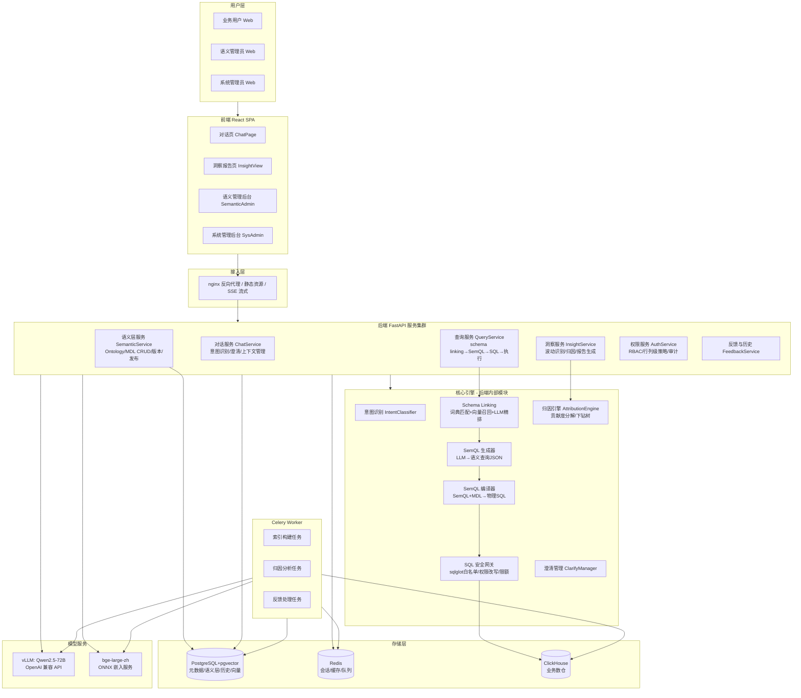

## 4.2 核心设计决策（为什么这么设计）

1. **LLM 不直接生成物理 SQL，而是生成 SemQL（语义查询 JSON）**——借鉴 SuperSonic 的 S2SQL 思路并进一步结构化：SemQL 是一个 JSON DSL，只允许引用语义层已发布的指标/维度/术语，编译器负责 join、口径、聚合、时间粒度展开。LLM 幻觉空间被压缩到"选错语义元素"，杜绝编表名/编字段/编 join。（详见 6.3）
2. **Ontology 与 MDL 分层**——Ontology 管"业务世界是什么"（实体、关系、属性、业务规则、指标口径语义），MDL 管"数据世界怎么算"（表、列、join、表达式、物理映射）；Ontology 的 Term 通过 Mapping 绑定到 MDL 元素。NL 解析先命中 Ontology（业务语言），编译时落到 MDL（数据语言）。（详见第五章）
3. **语义层版本化 + 评审发布**——借鉴 EvoOntology 的版本门控：任何修改产生 draft 版本，校验通过 + 评审发布后生效，查询按 active 版本执行，历史查询记录版本号可追溯。（详见 5.5）
4. **归因引擎是确定性算法，LLM 只做表述**——波动判定、贡献度分解、下钻树全部由 P6 用 SQL+统计完成，LLM 只把结构化的归因结果（维度、维值、贡献度、证据数据）组织成人话并生成结论；LLM 看不到原始明细数据，从机制上防止编造原因。（详见 6.6）
5. **权限在 SQL 改写层强制执行**——无论 SQL 来自 LLM 生成还是手工 API，统一经过 P5 安全网关：AST 白名单（禁 DDL/DML）→ 注入行过滤谓词 → 列脱敏/裁剪 → 超时与行数限制。权限不依赖 prompt 约束。（详见 6.8）

## 4.3 端到端数据流（查数主链路）

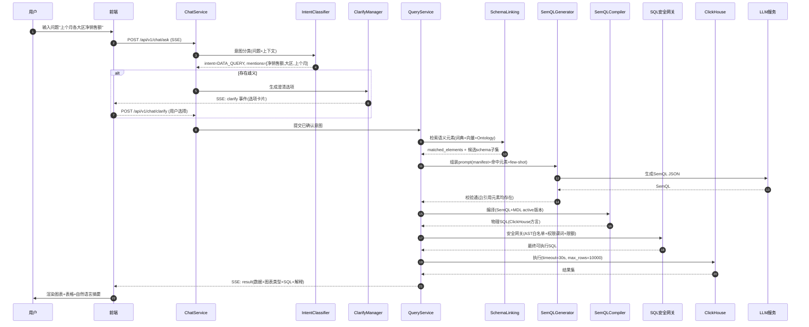

## 4.4 模块清单与职责边界

| 模块 | 所在服务 | 职责 | 不负责 |
|---|---|---|---|
| IntentClassifier | ChatService | 问题分类（查数/归因/闲聊/越权/不可答）、抽取 mentions、时间解析 | 不生成 SQL |
| ClarifyManager | ChatService | 歧义检测、澄清选项生成、澄清状态机 | 不做语义匹配本身 |
| SchemaLinking | QueryService | 词典匹配 + 向量召回 + LLM 精排，产出问题涉及的语义元素集 | 不生成 SemQL |
| SemQLGenerator | QueryService | 组装 prompt、调 LLM、解析与校验 SemQL JSON、失败重试降级 | 不编译 SQL |
| SemQLCompiler | QueryService | SemQL+MDL→物理 SQL；join 路径推导、口径展开、时间粒度处理 | 不做权限 |
| SQL安全网关 | QueryService | sqlglot AST 白名单、权限谓词注入、列裁剪脱敏、限额 | 不理解业务语义 |
| AttributionEngine | InsightService | 波动识别、贡献度分解、下钻树、外部因素关联 | 不写结论文字 |
| SemanticService | 语义管理 | Ontology/MDL CRUD、版本、校验、发布、索引进度 | 不做查询 |
| AuthService | 系统管理 | 登录（账号密码+可选 LDAP）、RBAC、行列级策略 CRUD、审计 | 不在请求路径做鉴权之外的事 |

---

# 第五章 语义层与 Ontology 专章（核心章节）

> 本章定义整个产品的"语义地基"。后续所有功能（NL 解析、SQL 生成、归因、权限）都消费本章定义的模型。开发顺序上本章对应的数据表与服务**必须先于一切功能开发**。

## 5.1 分层模型：Ontology 层 / MDL 层 / 索引层

```
┌─────────────────────────────────────────────────────────────┐
│ Ontology 层（业务世界：是什么）                                 │
│  Term(术语/指标口径) ─ Entity(业务实体) ─ Relation(语义关系)    │
│  Attribute(实体属性) ─ BusinessRule(业务规则) ─ Evidence(证据) │
└──────────────────┬──────────────────────────────────────────┘
                   │ Mapping（语义绑定，多对一）
┌──────────────────▼──────────────────────────────────────────┐
│ MDL 层（数据世界：怎么算）                                      │
│  Model(模型/物理表或SQL) ─ Column(列/计算列/度量表达式)          │
│  Relationship(join关系) ─ Metric(原子/派生指标定义)             │
│  Dimension(维度定义/值映射) ─ DataSet(数据集=查询范围)           │
└──────────────────┬──────────────────────────────────────────┘
                   │ Indexer（离线构建，可重建）
┌──────────────────▼──────────────────────────────────────────┐
│ 索引层（检索加速：怎么找到）                                     │
│  分词词典(jieba自定义词+词性编码) ─ 向量索引(pgvector: 元素文本)  │
│  NL→SQL 对索引(few-shot记忆) ─ 维度值索引(值→维度反查)           │
└─────────────────────────────────────────────────────────────┘
```

**为什么分这三层**：
- Ontology 与 MDL 分开，是因为**业务语言的变化频率和负责人与数据语言不同**：业务规则调整（如"净销售额口径剔除退款"）不应改动物理映射；数仓表重构（如换表名）不应影响业务定义。两者通过 Mapping 解耦——这是 SuperSonic（Term 只是扁平映射，无规则/无关系）和 EvoOntology（有 Ontology 无 MDL，Mapping 直接写死物理表）都没做到位的点。
- 索引层是**纯派生物**：任何时刻可以用 SemQL/MDL 全量重建，不作为源真相（借鉴 WrenAI "LanceDB 只是可重建的派生索引"的设计）。

## 5.2 Ontology 层数据模型

### 5.2.1 Entity（业务实体）

业务世界中的"主体"，如：订单、客户、门店、商品、大区。**Entity 不等于表**——一个实体可跨多张 MDL Model。

| 字段 | 类型 | 必填 | 说明 | 示例 |
|---|---|---|---|---|
| id | string | 是 | 系统生成 `ent_xxx` | `ent_customer` |
| name | string | 是 | 中文业务名 | `客户` |
| entity_type | enum | 是 | `subject`(业务主体) / `classifier`(分类实体，如大区/渠道) | `subject` |
| definition | text | 是 | 业务定义，一句话说清"什么算一个 X" | `在CRM注册且至少有一次交易的购买方` |
| aliases | string[] | 否 | 同义词，进入词典与向量索引 | `["买家","会员","account"]` |
| owner | string | 是 | 负责人（分析师账号） | `zhangsan` |
| status | enum | 是 | `draft/published/deprecated` | `published` |

### 5.2.2 Attribute（实体属性）

实体身上的可描述属性。属性分两类：**标识属性**（如客户 ID、客户等级）与**描述属性**（如客户行业、注册日期）。Attribute 通过 Mapping 绑到 MDL Dimension 或 Column。

| 字段 | 类型 | 说明 | 示例 |
|---|---|---|---|
| id | string | `attr_xxx` | `attr_customer_level` |
| entity_id | string | 所属实体 | `ent_customer` |
| name | string | 中文名 | `客户等级` |
| attr_kind | enum | `identifier / descriptor / time` | `descriptor` |
| definition | text | 业务含义 | `按近12个月消费额分级的会员等级` |
| value_domain | json | 值域说明：枚举值及业务含义，或格式/单位 | `{"enum":[{"v":"A","label":"高价值"},{"v":"B","label":"中价值"},{"v":"C","label":"低价值"}]}` |
| aliases | string[] | 同义词 | `["会员等级","等级"]` |

### 5.2.3 Term（业务术语 / 指标口径）

**Term 是 Ontology 层最重要的对象**，分两类：
- **business_term（业务黑话）**：纯概念映射，如"老客户"="首单距今>365天的客户"。
- **metric_term（指标术语）**：带完整计算口径的指标定义，如"净销售额"。

| 字段 | 类型 | 必填 | 说明 | 示例（净销售额） |
|---|---|---|---|---|
| id | string | 是 | `term_xxx` | `term_net_sales` |
| name | string | 是 | 中文名，全局唯一 | `净销售额` |
| term_type | enum | 是 | `business_term / metric_term` | `metric_term` |
| definition | text | 是 | 口径的自然语言完整描述，须可执行（能据此写出 SQL） | `已完成订单的折后销售金额合计：Σ(quantity × unit_price × discount_rate)，仅统计 status='completed' 的订单` |
| scope | text | 否 | 适用范围与边界（什么场景不适用） | `销售业绩分析；金额单位人民币元；不含内部测试单` |
| aliases | string[] | 否 | 同义词 | `["销售额","有效销售额","Net Sales"]` |
| unit | string | 否 | 单位 | `元` |
| direction | enum | 否 | `higher_better / lower_better / neutral`，归因时判断"好/坏" | `higher_better` |
| related_terms | string[] | 否 | 相关术语 id | `["term_gross_sales"]` |
| owner | string | 是 | 口径负责人 | `lisi` |
| status | enum | 是 | `draft/published/deprecated` | `published` |
| version | int | 是 | 随语义层版本递增（见 5.5） | `3` |

**口径变更规则（刚性）**：`definition` 一旦发布，**禁止原地修改**；修改必须走版本流（见 5.5），且旧版本的查询历史仍按旧口径复现。

### 5.2.4 Relation（语义关系）

连接 Ontology 对象之间的关系。`relation_type` 受控枚举（借鉴 EvoOntology 的受控词表并扩展）：

| relation_type | 含义 | 连接两端 | 用途 | 示例 |
|---|---|---|---|---|
| `hierarchy` | 层级/归属 | Entity→Entity 或 Attribute→Attribute | 下钻路径、归因维度顺序 | `门店 hierarchy 大区` |
| `composition` | 组成 | Entity→Entity | 指标分解（整体=部分之和） | `订单 composition 订单行` |
| `derivation` | 推导 | Term→Term（带 formula） | 指标间计算依赖，归因时沿公式拆解 | `客单价 = 净销售额 / 有效订单数` |
| `equivalence` | 等价 | Term↔Term | 同口径不同叫法合并 | `成交总额 equivalence 净销售额`（仅示例，实际用 aliases 优先） |
| `association` | 一般关联 | Entity↔Entity / Term↔Entity | schema linking 时扩展召回 | `客户 association 订单` |

**derivation 型 Relation 额外字段**：
```json
{
  "id": "rel_aov",
  "relation_type": "derivation",
  "from_term": "term_aov",
  "to_terms": ["term_net_sales", "term_valid_orders"],
  "formula": "term_aov = term_net_sales / term_valid_orders",
  "note": "客单价由净销售额与有效订单数推导，归因时应先拆解到分子分母"
}
```
归因引擎消费 derivation 链实现"指标公式拆解归因"（见 6.6 机理）。

**刚性约束**：MDL 的物理 join 关系**禁止**存为 Ontology Relation——"JOINs are physical table connections, not ontological relations"（设计原则同 EvoOntology `ontology-schema.md:401`）。

### 5.2.5 BusinessRule（业务规则）

影响查询语义或归因解释的强制性规则。**规则是 Ontology 区别于 SuperSonic Term 扁平映射的核心**。

| 字段 | 类型 | 说明 | 示例 |
|---|---|---|---|
| id | string | `rule_xxx` | `rule_net_sales_status` |
| target | string | 作用对象 id（Term/Attribute/Entity） | `term_net_sales` |
| rule_type | enum | `enum_semantics`(枚举语义) / `business_rule`(业务规则) / `unit`(单位) / `scope`(范围) / `data_quality`(数据质量) | `business_rule` |
| severity | enum | `block`(违反即拒绝/报错) / `warning`(提示但放行) / `info`(仅注入上下文) | `block` |
| trigger_keywords | string[] | 触发词：问题含这些词时规则必须被注入 prompt | `["净销售额","销售额"]` |
| description | text | 规则内容（人读+LLM读） | `净销售额仅统计 status='completed' 的订单；若统计全部状态，2024年口径会多计约76万元` |
| evidence_ids | string[] | 支撑证据 | `["ev_2024_status_dist"]` |

### 5.2.6 Evidence（证据）

**每条 Term 口径与每条 block 级规则必须挂至少一条 Evidence**——即真实执行过的验证 SQL 及其结果（借鉴 EvoOntology 的 Evidence 设计，`ontology-schema.md:519-538`）。

| 字段 | 说明 | 示例 |
|---|---|---|
| id | `ev_xxx` | `ev_net_sales_2024` |
| source | 数据来源描述 | `ClickHouse retail_dw` |
| query | 验证用 SQL | `SELECT status, COUNT(*) FROM orders GROUP BY status` |
| result | 执行结果摘要 | `completed 4253 / refunded 505 / cancelled 242` |
| validated_at | 验证时间 | `2024-07-01T10:00:00Z` |
| validated_by | 验证人 | `lisi` |

**构建门禁**：`metric_term` 发布时系统自动重跑其 Evidence SQL，结果与登记值偏差 >5% 则禁止发布（防止口径与数据漂移）。

## 5.3 MDL 层数据模型

### 5.3.1 Model（模型）

绑定一个物理数据源逻辑：一张物理表、或一段 SQL。

| 字段 | 类型 | 说明 |
|---|---|---|
| id | `mdl_xxx` | |
| name | 中文业务名，如 `订单` | |
| datasource_id | 绑定的 ClickHouse 数据源（数据源连接信息单独管理，见 7.1 `datasource` 表） | |
| source_type | `table / sql_query` | |
| table_ref | source_type=table 时的物理表全名 `db.table` | |
| sql_query | source_type=sql_query 时的 SQL（只允许 SELECT） | |
| primary_key | 主键列名数组（用于 join 推导与去重） | |
| time_field | 默认时间字段（归因与默认时间过滤用） | |
| description | 业务描述 | |

### 5.3.2 Column / Measure / Dimension（模型内部元素）

**Column**：`name(物理名) / display_name(中文) / data_type / expression(计算列表达式，普通列为空) / is_hidden / description / aliases`。

**Measure（度量）**：`name / display_name / agg(聚合: SUM/COUNT/AVG/MIN/MAX/COUNT_DISTINCT) / expression(被聚合表达式，如 quantity * unit_price * discount_rate) / filter(度量级过滤，如 status='completed') / format(展示格式) / aliases`。

**Dimension（维度）**：
```json
{
  "id": "dim_region",
  "model_id": "mdl_store",
  "name": "region",
  "display_name": "大区",
  "dim_type": "category | date | id",
  "expression": "region_name",
  "aliases": ["区域", "片区"],
  "value_maps": [
    {"tech_value": "HD", "display_value": "华东", "query_aliases": ["华东区", "沪苏区"]},
    {"tech_value": "HB", "display_value": "华北", "query_aliases": ["北方区"]}
  ],
  "hierarchy_path": ["大区", "省份", "城市", "门店"],
  "drill_enabled": true
}
```
- `value_maps`：技术值/展示值/查询别名三元组（借鉴 SuperSonic `DimValueMap`）。schema linking 把用户说的"华东区"映射为 `region_name='HD'`。
- `hierarchy_path`：下钻路径，**归因引擎的维度下钻顺序依据**（借鉴 WrenAI cube `hierarchies`）。

### 5.3.3 Relationship（模型间 join）

| 字段 | 说明 |
|---|---|
| from_model_id / to_model_id | 两端模型 |
| join_type | `one_to_one / one_to_many / many_to_one / many_to_many`（编译器据此决定 join 去重策略） |
| condition | 等值 join 条件，如 `orders.store_id = stores.store_id` |
| verified | bool：是否已用 SQL 验证（无孤儿行/无扇形膨胀），未验证的关系编译时告警 |

### 5.3.4 Metric（指标，MDL 侧计算定义）

Metric 是 Term(metric_term) 在 MDL 侧的**可执行实现**。二者关系：**Term 定义"口径语义"，Metric 定义"计算实现"**，通过 Mapping 1:1 绑定。

```json
{
  "id": "metric_net_sales",
  "bind_term_id": "term_net_sales",
  "metric_kind": "atomic | derived",
  "atomic": {
    "model_id": "mdl_order_items",
    "measure_expression": "order_items.quantity * order_items.unit_price * order_items.discount_rate",
    "agg": "SUM",
    "filter": "orders.status = 'completed'",
    "joins_needed": ["rel_order_items_orders"]
  },
  "derived": null,
  "grain": ["订单行"],
  "default_time_field": "orders.order_date",
  "related_dimensions": ["dim_region", "dim_product_line", "dim_channel"],
  "data_format": {"type": "currency", "unit": "元", "decimals": 2}
}
```
- `derived` 示例：`{"formula": "metric_net_sales / metric_valid_orders"}`（引用其他 metric id）。
- `related_dimensions`：该指标允许沿哪些维度拆解——**同时是归因引擎的候选维度池与查询校验依据**（借鉴 SuperSonic `drillDownDimensions`，但我们把它用于自动归因而非仅校验）。

### 5.3.5 DataSet（数据集）

面向业务主题圈定的查询范围：`{name, model_ids[], metric_ids[], dimension_ids[], default_time_range, description}`。用户提问先路由到 DataSet（见 6.3 数据集路由），限定 schema linking 与 SemQL 生成的搜索空间，降低噪声。

### 5.3.6 Mapping（Ontology ↔ MDL 绑定表）

| Mapping 类型 | 左（Ontology） | 右（MDL） | 基数 |
|---|---|---|---|
| term_metric | Term(metric_term) | Metric | 1:1 |
| term_rule_sql | BusinessRule | 规则对应的 SQL 谓词片段 | 1:1 |
| attr_dimension | Attribute | Dimension | n:1（同一维度可服务多实体） |
| entity_model | Entity | Model（主承载模型） | 1:n |
| term_dataset_scope | Term | DataSet（该术语可用的数据集范围） | n:n |

## 5.4 数据字典与业务术语映射（索引层）

### 5.4.1 数据字典（jieba 自定义词典）

**存什么**：每个词条 = `词语 + 词频 + 词性(nature)`，词性编码归属（借鉴 SuperSonic `DictWord` 的 nature 编码）：

```
格式：_{对象类型}_{对象ID}
示例：
净销售额   50000  _term_term_net_sales
销售额     30000  _term_term_net_sales        (别名指向同一对象)
华东      40000  _dimval_dim_region:HD       (维度值→维度+技术值)
华东区    20000  _dimval_dim_region:HD       (查询别名)
门店      45000  _dim_dim_store
```

词条来源（全量枚举）：
1. Term 的 `name + aliases`；
2. Entity/Attribute 的 `name + aliases`；
3. Metric/Dimension/Model/DataSet 的 `display_name + aliases`；
4. Dimension 的 `value_maps` 三元组（tech_value / display_value / query_aliases 全部入库）；
5. 业务高频词（运营活动名、产品线名），由管理员在后台手工补充（`custom_dict_entry` 表）。

**构建**：语义层版本发布时触发 Celery 任务 `rebuild_dictionary(version_id)`，全量重建 jieba 词典文件并热加载（词量在十万级内，全量重建 <1min，无需增量复杂逻辑）。

**使用**：SchemaLinking 第一步——jieba 分词（自定义词典强制生效）→ 滑窗 n-gram（n=1..4）查词典 → 按 nature 反解出语义元素 → 输出 `matched_elements`（含来源：dict/vector/llm）。

### 5.4.2 向量索引（pgvector）

**存什么**（表 `semantic_embedding`，见 7.2）：每行 = 一个语义元素的一段可检索文本 + 1024 维向量。

```
element_type: term | entity | attribute | metric | dimension | dim_value | dataset
embed_text 的构造模板（中文，串行拼接）：
  [类型] {display_name}。定义：{definition}。别名：{aliases}。
  所属：{dataset_name}/{entity_name}。值域：{value_domain摘要}。
例：
  [指标] 净销售额。定义：已完成订单的折后销售金额合计…。别名：销售额,有效销售额。所属：销售域数据集。
```

**构建**：语义层版本发布时，对 published 状态元素全量重算嵌入（bge-large-zh，本地 ONNX，万级元素 <10min）。`mdl_version` 字段记录版本，查询只检索 active 版本。

**使用**：问题分词后的短语做向量检索（cosine 相似度 ≥0.72 入候选，每类型 top5）；维度值不走向量（走词典精确匹配，避免向量误配）。

### 5.4.3 NL→SemQL 对索引（few-shot 记忆）

**存什么**（表 `query_exemplar`）：`nl_question / semql_json / dataset_id / source(seed|user_feedback|admin) / quality_score / hit_count`。
- seed：语义管理员在后台为每个 DataSet 预置 20~50 个标准问答对；
- user_feedback：用户反馈"正确"的查询自动入库（见 6.10）；
- admin：管理员手工录入。

**使用**：SemQL 生成 prompt 中注入 top-3 相似 exemplar（向量召回 + 同 dataset 过滤 + quality_score 加权）。**这是准确率提升成本最低的手段，必须做**。

## 5.5 版本管理与发布流

### 5.5.1 版本模型

- 语义层全局版本 `semantic_version`：整数递增，`{version, status: draft|validating|published|archived, created_by, published_at, changelog, parent_version}`。
- 所有 Ontology/MDL 对象带 `version` 字段：**同一版本内对象不可变**；修改 = 基于当前 published 版本创建新 draft，在 draft 副本上改。
- 任何时刻**有且仅有一个 published 版本**，查询链路只读 published。

### 5.5.2 发布流水线（刚性步骤，全部自动化）

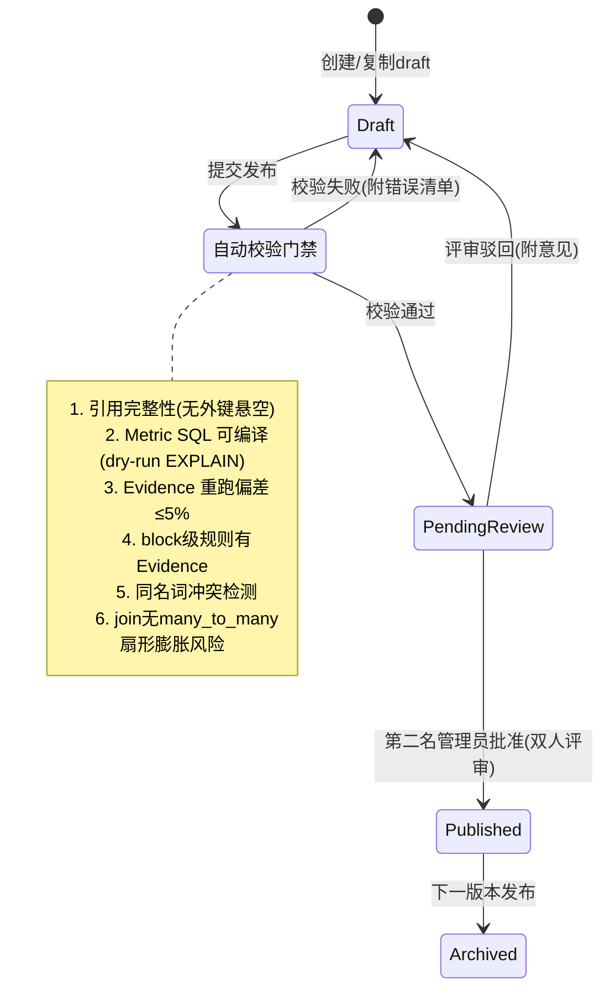

- **双人评审刚性**：发布批准人 ≠ 提交人。防止口径被单人改错。
- **发布后自动动作**：重建词典 → 重建向量索引 → 失效 Redis 中旧版本 schema 缓存 → 记录审计日志。
- **回滚**：一键将任一 archived 版本重新发布为新版本（复制 + 发布流，评审可标记为"紧急回滚"走单人审批）。

### 5.5.3 指标口径的消费侧呈现

每个指标在对话结果卡片中可展开"口径说明"浮层：`定义 / 单位 / 负责人 / 版本 / 更新时间 / Evidence 摘要`。用户对数字有疑问时一眼可查到口径出处——这是建立信任的关键交互。

## 5.6 Ontology 在 NL 解析与 SQL 生成链路中的消费方式

### 5.6.1 消费点全景

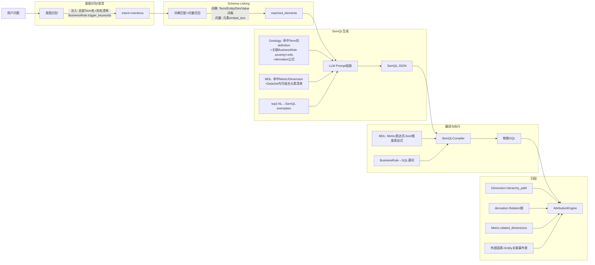

### 5.6.2 Schema 注入策略（token 预算控制）

**刚性原则：永远不把全量 schema 塞进 prompt。** 三级注入（借鉴 EvoOntology 的 manifest 思路 + WrenAI 的"小 schema 全文/大 schema 检索"双策略）：

| 级别 | 内容 | token 预算 | 触发条件 |
|---|---|---|---|
| L1 Manifest（每次必注入） | 当前路由 DataSet 的：指标清单(仅名称+一句话口径)、维度清单(仅名称)、术语冲突提示 | ≤800 | 所有 SemQL 生成 |
| L2 命中元素详情 | SchemaLinking 命中的 Term definition、Metric 表达式语义、Dimension 值映射、命中 BusinessRule 全文、derivation 公式 | ≤1500 | matched_elements 非空 |
| L3 候选扩展 | DataSet 内未命中但可与命中元素组合的元素（仅名称+类型） | ≤700 | L2 命中数 <3 或 LLM 首次生成校验失败重试时 |
| L4 全量 | DataSet 全量元素 | ≤4000 | 仅当 DataSet 元素总数 <30 时直接注入全量跳过 L2/L3 |

意图识别 prompt 只注入：**全部 Term 的 `name+aliases` 扁平清单 + trigger_keywords 列表**（≤2000 token），不含定义——意图阶段只需"认出提到了谁"，不需要"知道怎么算"。

## 5.7 语义层的初始构建与持续维护

### 5.7.1 冷启动构建流程（分析师在管理后台操作，系统辅助）

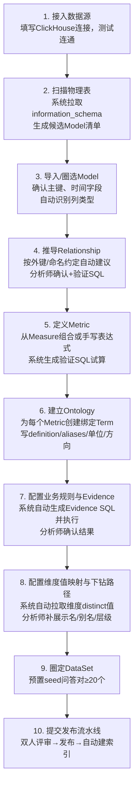

**系统辅助点（减少人工的硬功能）**：
- 步骤 4：join 建议 = 外键约束 + 列名相似度（`store_id`↔`store_id`）+ 数据试探（验证 SQL 查孤儿率/膨胀率）。
- 步骤 6：Term definition 初稿由 LLM 根据 Metric 表达式自动生成，分析师修改确认（**LLM 起草、人确认**——借鉴 EvoOntology 的 Builder Agent 半自动理念，但入口是我们的 UI 而非插件）。
- 步骤 7：Evidence SQL 由 Metric 定义自动生成（如 `SELECT {metric_expression} FROM ... WHERE {filter}` 按年汇总）。
- 步骤 8：维度 distinct 值自动拉取（限 5000 条内全量，超出仅抽样并提示管理员值映射不全的风险）。

### 5.7.2 持续维护机制

| 触发源 | 动作 |
|---|---|
| 用户反馈"错误"且归类为"口径问题" | 进入分析师待办队列（见 6.10），处理后走版本发布流 |
| 数据漂移巡检（每日 Celery 定时） | 重跑全部 Evidence SQL，偏差>5% 产生告警，关联 Term 标记"口径存疑"徽标 |
| 未识别问题收集（每周报告） | 意图识别为 UNKNOWN 或 schema linking 零命中的问题聚类，提示管理员补术语/别名 |
| 维度值巡检（每日） | 维度出现新 distinct 值且不在 value_maps 中，提示补映射 |

---

# 第六章 核心功能详述

> 每个功能按统一模板展开：功能描述 → 场景 → 交互流程 → 实现机理（端到端数据流 + API 定义附 JSON + 关键图 Mermaid）→ 异常穷举 → 验收标准（Given-When-Then）。
> 交互文案均为**上线文案**，前端须原样使用（变量用 `{}` 标注）。

## 6.1 提问与澄清追问

### 6.1.1 功能描述

用户在对话页输入自然语言问题，系统进行意图识别；当问题存在歧义（术语多义、时间缺省、粒度不明）时，系统**主动追问澄清**，以选项卡片形式让用户点选，澄清后继续查询链路。澄清最多进行 2 轮，超过则按最优猜测执行并明示假设。

### 6.1.2 场景

- 场景 1（术语歧义）：用户问"四月的销售额怎么样"——Ontology 中存在"净销售额"与"毛销售额"两个 Term 都含别名"销售额"→ 系统追问"您想查看的是哪个口径？"
- 场景 2（时间缺省）：用户问"各门店销量排名"——未给时间 → 系统按 DataSet 默认时间（上月）执行，并在结果上方明示"已按默认时间范围：{上月} 查询"，**不追问**（时间有默认值时不打断用户）。
- 场景 3（粒度歧义）：用户问"看一下销售趋势"——趋势可按日/周/月 → 追问一次。

### 6.1.3 交互流程

**触发条件**：意图识别输出 `intent=DATA_QUERY/INSIGHT_WHY` 且 `ambiguities[]` 非空。

**界面状态机**：

| 状态 | 界面表现 | 文案 |
|---|---|---|
| 加载态 | 用户消息气泡下方出现"思考中"动画（三个点循环），输入框禁用 | `正在理解您的问题…`（超过 5s 追加 `数据量较大，请稍候`） |
| 澄清态 | 系统消息气泡 + 选项卡片（单选按钮组 + "都不是，我补充说明"自由输入项 + [确认] 按钮，未选择时确认按钮置灰） | 术语歧义：`您说的"{用户原词}"可能有以下含义，请确认：` 选项 = `{Term名称}：{definition前40字}…（口径负责人：{owner}）`；时间歧义：`请问要查询哪个时间范围？` 选项 = `最近7天 / 上月 / 本季度 / 自定义`；粒度歧义：`请问按什么粒度查看？` 选项 = `按日 / 按周 / 按月` |
| 假设执行态（澄清超 2 轮或用户跳过） | 正常查询结果 + 结果卡片顶部黄色提示条 | `已按以下假设执行：{假设清单，如"销售额=净销售额、时间=上月"}。如不符合预期，可点击换一换` |
| 空态（无可澄清选项生成） | 不进入澄清，直接按假设执行 | 同上 |
| 权限不足态 | 系统消息气泡（无图表） | `您没有查询"{DataSet名称}"的权限。如需开通，请联系数据管理员{管理员名}` + [复制申请话术] 按钮 |

**异常分支**：
- 用户连续 2 次选择"都不是，我补充说明"且补充后仍歧义 → 按假设执行态处理；
- 澄清卡片发出后用户 10 分钟未响应 → 会话上下文保留，用户下次输入时视为新意图（上下文不强制延续澄清）；
- 用户在澄清等待中输入了新问题 → 放弃当前澄清，按新问题重新走意图识别。

### 6.1.4 实现机理

**端到端数据流**：

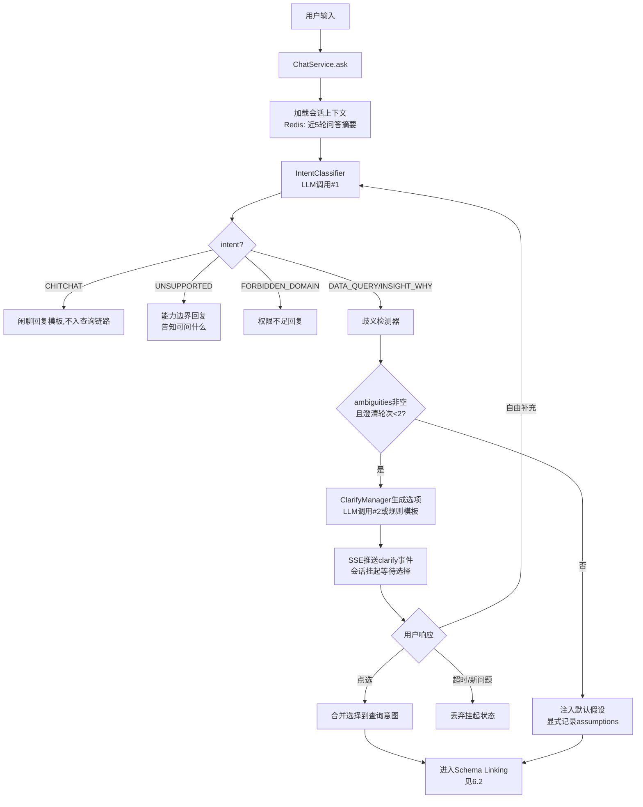

**意图识别的 LLM 设计**：
- 输入：用户问题 + 会话近 5 轮摘要 + 全部 Term 的 name+aliases 扁平清单 + 当前用户有权限的 DataSet 清单。
- 输出（强制 JSON Schema，temperature=0）：

```json
{
  "intent": "DATA_QUERY | INSIGHT_WHY | INSIGHT_ANOMALY_CHECK | CHITCHAT | UNSUPPORTED | FORBIDDEN_DOMAIN",
  "confidence": 0.0,
  "mentions": ["净销售额", "大区", "四月"],
  "time_expr": "2024-04",
  "dataset_guess": "销售域数据集",
  "ambiguities": [
    {"type": "TERM_CONFLICT", "mention": "销售额",
     "candidates": ["term_net_sales", "term_gross_sales"], "reason": "两个指标共有别名'销售额'"}
  ],
  "reasoning_brief": "用户询问某月指标,意图为数据查询"
}
```

- 意图判定规则（写死在 prompt 中）：
  - 含"为什么/原因/怎么降了/哪里出了问题"→ `INSIGHT_WHY`；
  - 含"正常吗/有没有异常/波动"→ `INSIGHT_ANOMALY_CHECK`；
  - 与数据无关（打招呼/闲聊）→ `CHITCHAT`；
  - 数据相关但超出所有可用 DataSet 主题 → `UNSUPPORTED`；
  - 提到的 Term/DataSet 存在于系统但用户无权限 → `FORBIDDEN_DOMAIN`（**注意：该判定在服务端二次校验，LLM 判定仅供参考**）。

**歧义检测器（规则，非 LLM）**——LLM 输出的 ambiguities 只是候选，服务端规则复核后才生成澄清：
1. `TERM_CONFLICT`：mention 命中 ≥2 个 published Term 的 name/aliases，且这些 Term 绑定不同 Metric → 有效歧义，追问；
2. `TIME_MISSING`：无时间表达式且 DataSet 有默认时间 → **不算歧义**，注入假设；
3. `TIME_MISSING` 且 DataSet 无默认时间 → 追问；
4. `GRAIN_MISSING`：含"趋势/走势/变化"词且无粒度词 → 追问；
5. `VALUE_CONFLICT`：维度值别名同时映射多个技术值 → 追问。

**API 定义**：

`POST /api/v1/chat/ask`（SSE 流式响应）

请求：
```json
{
  "session_id": "sess_01J8X...",
  "question": "四月的销售额怎么样",
  "client": "web"
}
```
SSE 事件序列（`event:` 字段区分）：
```
event: intent
data: {"intent":"DATA_QUERY","mentions":["销售额","四月"],"assumptions":[]}

event: clarify
data: {"clarify_id":"cl_9f2","type":"TERM_CONFLICT",
       "prompt":"您说的\"销售额\"可能有以下含义，请确认：",
       "options":[{"key":"term_net_sales","label":"净销售额：已完成订单的折后销售金额合计…（负责人：lisi）"},
                  {"key":"term_gross_sales","label":"毛销售额：全部订单的原始金额合计…（负责人：lisi）"}],
       "allow_free_text": true, "round": 1, "max_rounds": 2}

event: progress
data: {"stage":"schema_linking|generating|compiling|executing|rendering","elapsed_ms":1200}

event: result
data: {"answer_id":"ans_77a","semql":{...},"sql":"SELECT ...","chart":{...},"data":{...},
       "summary":"2024年4月净销售额为1,832.4万元…","assumptions":[]}

event: error
data: {"code":"CLARIFY_TIMEOUT","message":"...","retryable":false}
```

`POST /api/v1/chat/clarify`
```json
{"clarify_id":"cl_9f2","selected_key":"term_net_sales","free_text":null}
```
响应：直接续走查询链路，返回结构同 `ask` 的 SSE 流（重新以 `progress` 事件开始）。

**关键时序图**（澄清两轮后兜底）：

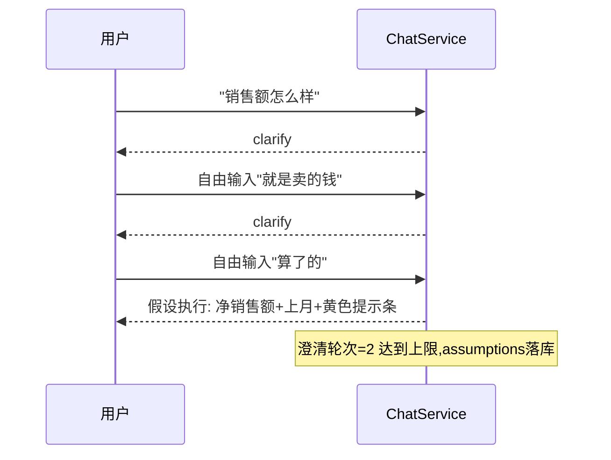

### 6.1.5 异常穷举

| # | 异常 | 系统行为 | 用户感知 |
|---|---|---|---|
| 1 | LLM 意图识别超时（>10s）或返回非法 JSON | 重试 1 次（temperature 0.2）；仍失败降级为规则意图（关键词匹配：有"为什么"→INSIGHT_WHY，否则 DATA_QUERY） | 仅响应变慢，无错误提示 |
| 2 | 规则降级后仍无法识别 | 返回固定话术 | `抱歉，我没有理解您的问题。您可以这样问我："{从seed问题中推荐2个}"` |
| 3 | 澄清选项生成 LLM 失败 | 用规则模板生成（TERM_CONFLICT 等 5 类均有预制模板） | 无感知 |
| 4 | clarify_id 过期（>30min）或不存在 | 返回错误码 `CLARIFY_EXPIRED`，前端将原问题作为新提问重新发起 | 自动重发，用户无感知 |
| 5 | 会话上下文 Redis 丢失 | 按单轮问题处理（不报错），日志记录 | 追问类问题可能理解偏差，属可接受降级 |
| 6 | 问题命中多个 DataSet | 歧义类型 `DATASET_CONFLICT`，澄清卡片列 DataSet 选项 | `您想查询哪个主题的数据？` |
| 7 | 用户提问含敏感词/注入尝试（如"删除数据"） | AST 白名单在 6.3 兜底；意图层识别 DDL/DML 意图直接拒绝 | `我只支持数据查询，不能执行修改或删除操作` |

### 6.1.6 验收标准

```gherkin
Given Ontology中"净销售额"与"毛销售额"均含别名"销售额"且均为published
When 用户提问"四月的销售额怎么样"
Then 系统返回clarify事件, 类型TERM_CONFLICT, 包含2个口径选项及负责人信息, 且round=1

Given 用户已收到1次术语澄清并选择了"都不是"补充了仍歧义的输入
When 系统第2次澄清后用户再次补充仍歧义
Then 系统不再追问, 按"净销售额+默认时间"执行, 结果卡片顶部显示黄色假设提示条

Given 当前用户对"财务域数据集"无权限
When 用户提问"上月的毛利率是多少"(该指标仅属于财务域)
Then 系统返回权限不足话术, 包含管理员联系方式与[复制申请话术]按钮, 不执行任何SQL

Given 意图识别LLM连续2次返回非法JSON
When 用户提问"为什么四月销量比五月低"
Then 系统按规则降级识别为INSIGHT_WHY并继续归因链路, 无错误提示, 日志记录降级事件

Given 用户收到澄清卡片后10分钟未操作
When 用户输入新问题"上个月订单量"
Then 系统放弃挂起的澄清, 按新问题重新意图识别, 旧clarify_id置为过期
```

## 6.2 表/字段匹配（Schema Linking）

### 6.2.1 功能描述

将用户问题中的自然语言片段（mentions）精确映射到语义层对象（Term/Metric/Dimension/维度值/Entity），产出 `matched_elements` 集合与候选 schema 子集，供 SemQL 生成使用。匹配必须**三路并行、可解释**：词典精确匹配（中文别名场景主力）+ 向量召回（语义相近但不同词）+ LLM 精排（消歧）。

### 6.2.2 场景

- "华东区的净销售额" → 词典命中：净销售额（_term_）、华东区（_dimval_dim_region:HD）；
- "卖得好不好"（无精确词命中）→ 向量召回：净销售额（0.81）、销量（0.79）→ LLM 精排选销量相关指标；
- "老客户复购率" → 词典命中"复购率"，"老客户"命中 business_term → 其定义 `首单距今>365天的客户` 注入生成 prompt。

### 6.2.3 交互流程

该功能为系统内部环节，**用户无直接交互**。间接交互点：
- 结果卡片"匹配解释"展开区：显示 `已识别：净销售额（指标）、华东（维度值，匹配自"华东区"）、2024年4月（时间）`——让用户能发现匹配错误并反馈；
- 零命中时：系统消息 `我没有找到与"{mention}"相关的数据。您是否想问：{推荐3个相似Term}？`（推荐来自向量召回 top3，即使低于阈值也用于推荐）。

### 6.2.4 实现机理

**端到端数据流**：

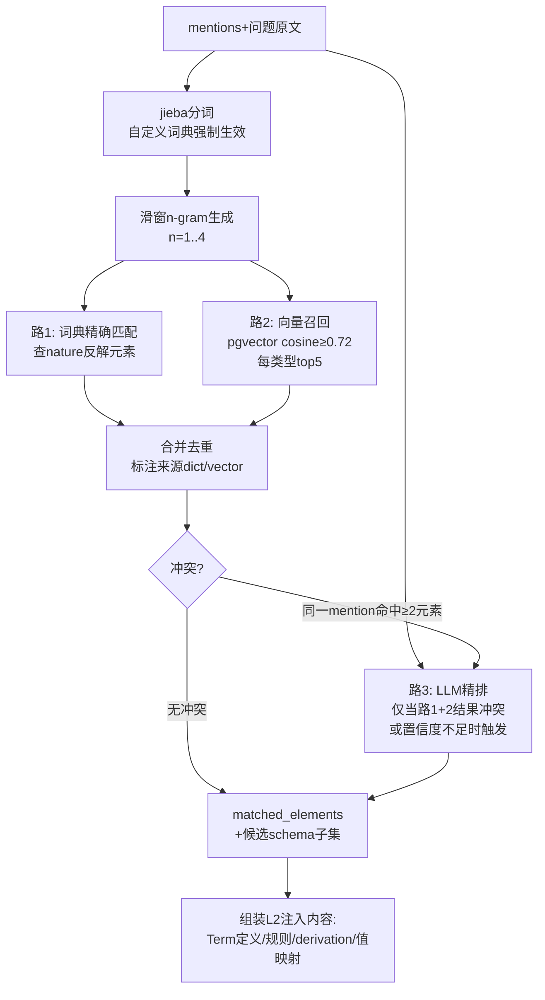

**关键规则**：
1. 词典匹配优先于向量：同一 mention 词典命中即锁定，不再向量（防止"销售额"被向量带偏到"回款额"）；
2. 维度值只走词典，不走向量（值映射错误代价高，必须精确）；
3. LLM 精排 prompt 输入 = 冲突 mention + 各候选元素 definition，输出 = 选定元素 id 或 `NEED_CLARIFY`（返回给 6.1 澄清）；
4. 匹配结果按 DataSet 过滤：只保留路由 DataSet 内的元素（跨域元素进入澄清候选）；
5. 全部匹配动作记录到 `query_log.matched_elements`，供反馈归因分析。

**API 定义**（内部 API，前端不直接调用；语义管理员调试台可用）：

`POST /api/v1/semantic/debug/link`
```json
{"question": "华东区的净销售额", "dataset_id": "ds_sales"}
```
响应：
```json
{
  "matched_elements": [
    {"mention": "净销售额", "element_type": "term", "element_id": "term_net_sales",
     "via": "dict", "score": 1.0},
    {"mention": "华东区", "element_type": "dim_value", "element_id": "dim_region",
     "tech_value": "HD", "via": "dict", "score": 1.0}
  ],
  "unmatched_mentions": [],
  "candidates_dropped": [
    {"element_id": "term_gross_sales", "reason": "dict_lock_by_term_net_sales"}
  ],
  "elapsed_ms": 46
}
```

### 6.2.5 异常穷举

| # | 异常 | 系统行为 |
|---|---|---|
| 1 | 全部 mention 零命中 | 返回向量推荐 top3 供用户重选；该问题记入"未识别问题"周报告 |
| 2 | 向量服务不可用 | 降级为纯词典匹配，日志告警；响应头 `X-Degraded: vector` |
| 3 | LLM 精排超时 | 取词典+向量分数最高者，标注 `assumption` 展示 |
| 4 | 维度值映射到已废弃维度 | 忽略并记录；若因此零命中则按#1处理 |
| 5 | 命中元素属于无权限 DataSet | 从结果中剔除；若全部剔除 → 按 6.1 权限不足态处理 |

### 6.2.6 验收标准

```gherkin
Given 词典中存在"净销售额"(_term_term_net_sales)与"华东区"(_dimval_dim_region:HD)
When 问题为"华东区的净销售额"
Then matched_elements包含2个元素, via均为dict, 维度值解析出tech_value=HD, 不触发LLM精排

Given 词典无任何命中, 向量召回"销量"(score=0.79)与"净销售额"(score=0.74)
When 问题为"卖得好不好"
Then 触发LLM精排, 若精排返回NEED_CLARIFY则进入澄清流程

Given 向量服务宕机
When 用户提问词典可命中的问题
Then 查询正常完成, 响应头带X-Degraded: vector, 日志产生WARN告警

Given "销售额"在词典中锁定命中term_net_sales
When 向量同时召回term_gross_sales(score=0.88)
Then term_gross_sales进入candidates_dropped, 原因dict_lock, 不影响结果
```

## 6.3 SQL 生成与执行（NL2SQL 机理落地）

### 6.3.1 功能描述

将已澄清、已匹配的查询意图编译为安全的物理 SQL 并执行：**LLM 生成 SemQL（语义查询 JSON DSL）→ SemQLCompiler 编译为 ClickHouse SQL → SQL 安全网关强制校验与权限改写 → 限额执行**。全链路支持失败重试与降级。

### 6.3.2 SemQL 定义（JSON DSL，全文唯一权威定义）

```json
{
  "semql_version": "1.0",
  "dataset": "ds_sales",
  "metrics": ["metric_net_sales"],
  "dimensions": ["dim_region"],
  "time": {"field": "orders.order_date", "range": "2024-04-01/2024-04-30", "grain": "month"},
  "filters": [
    {"dimension": "dim_region", "op": "in", "values": ["HD"]},
    {"dimension": "dim_channel", "op": "not_in", "values": ["TEST"]},
    {"metric": "metric_net_sales", "op": ">", "value": 10000}
  ],
  "order_by": [{"metric": "metric_net_sales", "direction": "desc"}],
  "limit": 100,
  "compare": {"type": "mom|yoy|period_vs_period", "offset": "1m"},
  "query_mode": "aggregate | detail"
}
```

**SemQL 合法性约束（Compiler 校验）**：
1. metrics/dimensions 必须存在于该 DataSet 的 published 版本；
2. 维度值必须使用该维度 `value_maps` 中的 tech_value（LLM 输出展示值时 Compiler 自动翻译，翻译失败报错 `SEMQL_INVALID_VALUE`）；
3. `time.range` 必须是闭区间字面量或相对表达式（`last_month` 等 12 个受控词，Compiler 展开为字面量）；
4. 派生指标引用时自动展开其 formula 依赖；
5. `limit` ≤10000，`query_mode=detail` 时强制 ≤1000。

### 6.3.3 Schema 注入策略与完整 Prompt 模板

按 5.6.2 三级注入。以下为 SemQL 生成的**完整 prompt 模板**（系统侧；`{}` 为注入变量，开发时原样实现于 `prompts/semql_generate.py`）：

```
# 角色
你是企业BI语义查询生成器。你的唯一任务：把用户问题翻译为SemQL JSON。
你只允许使用下方"可用语义元素"中列出的指标与维度, 禁止编造任何未列出的元素。

# 输出契约(必须严格遵守)
- 只输出一个合法JSON对象, 不要输出任何其他文字、解释或markdown代码块标记
- JSON必须符合SemQL 1.0结构: {semql_version, dataset, metrics[], dimensions[], time, filters[], order_by[], limit, compare, query_mode}
- metrics和dimensions中只能填写"可用语义元素"里的id
- 维度过滤的values必须使用该维度"值映射"中列出的tech_value
- 无法确定的内容填null, 不要猜测

# 当前环境
当前日期: {current_date}
数据库方言: ClickHouse
数据集: {dataset_name} — {dataset_description}

# 可用语义元素
## 指标(L1清单)
{metric_manifest_lines}
  格式: - {metric_id} | {名称} | {一句话口径} | 单位:{unit} | 默认聚合:{agg}
## 维度(L1清单)
{dimension_manifest_lines}
  格式: - {dimension_id} | {名称} | 类型:{dim_type} | 下钻路径:{hierarchy_path}

# 命中元素详情(L2)
{matched_details}
  格式示例:
  ## 指标 净销售额 (metric_net_sales)
  口径定义: 已完成订单的折后销售金额合计: Σ(quantity × unit_price × discount_rate), 仅统计status='completed'的订单
  必须遵守的业务规则:
  - [block] 净销售额仅统计status='completed'的订单; 否则2024年口径会多计约76万元
  推导关系: 客单价 = 净销售额 / 有效订单数
  ## 维度 大区 (dim_region)
  值映射(展示名→tech_value): 华东→HD, 华北→HB, 华南→HN
  查询别名: 华东区→HD, 北方区→HB

# 候选扩展元素(L3, 可选)
{candidate_extension_lines}

# 参考示例(与当前问题语义相近的历史问答)
{exemplars}
  格式示例:
  问题: 上个月各渠道销量
  SemQL: {"semql_version":"1.0","dataset":"ds_sales","metrics":["metric_qty"],...}

# 会话上下文(如有)
{conversation_context}
  格式: 前一轮: 问题=... 使用的SemQL摘要=metrics[...]×dimensions[...]

# 用户问题
{question}

# 再次提醒
只输出SemQL JSON。遇到歧义已在之前的澄清环节解决, 此处不要反问, 按最合理解释输出。
```

**返回解析**：
1. 正则提取首个 `{` 到配对的 `}`（兼容 LLM 偶发的 ```json 包裹）；
2. `json.loads` → 失败则重试（见 6.3.6）；
3. JSON Schema 校验 → 元素存在性校验（对照注入清单，LLM  hallucinate 出的 id 直接判失败）；
4. 通过后交 Compiler。

### 6.3.4 编译：SemQL → 物理 SQL

Compiler 步骤（`semql_compiler.py`，纯确定性代码，无 LLM）：

1. **指标展开**：atomic metric → `{agg}({measure_expression})`，携带 `filter` 转为 `{agg}If(expr, filter)`（ClickHouse 方言）或 `CASE WHEN`；derived metric → 递归展开 formula；
2. **join 路径推导**：收集 metrics/dimensions 涉及的全部 Model → 在 Relationship 图上跑 BFS 找最小连接子图 → many_to_many 关系报 `COMPILE_FANTRAP_RISK` 拒绝执行（提示管理员检查模型）；join 顺序按 one_to_many 方向防止行数膨胀；
3. **时间处理**：`time.range` 受控词展开（以请求时刻为准）；`compare.mom` → 生成两个时间段子查询后 FULL JOIN 计算环比；
4. **business_term 内联**：命中 business_term（如"老客户"）→ 其定义对应的 SQL 谓词（Mapping: term_rule_sql）内联为 WHERE 条件；
5. **block 级规则强制**：命中 Term 关联的 block 规则若未被 SemQL 满足（如未排除测试渠道），Compiler **自动补谓词**并记录到 `applied_rules`（结果卡片展示"已应用规则：{description}"）；
6. 输出：SQL 文本 + `compile_trace`（每个 SemQL 字段到 SQL 片段的映射，供调试与"SQL 解释"功能）。

编译产物示例（对应上文 SemQL 示例）：
```sql
SELECT region_name AS "大区",
       sumIf(order_items.quantity * order_items.unit_price * order_items.discount_rate,
             orders.status = 'completed') AS "净销售额"
FROM retail_dw.order_items
JOIN retail_dw.orders ON order_items.order_id = orders.order_id
JOIN retail_dw.stores ON orders.store_id = stores.store_id
WHERE orders.order_date BETWEEN '2024-04-01' AND '2024-04-30'
GROUP BY region_name
ORDER BY "净销售额" DESC
LIMIT 100
```

### 6.3.5 SQL 安全网关（DDL/DML 拦截与注入防护、限额）

**所有 SQL（无论来源）执行前必须过网关，顺序固定**：

1. **AST 白名单**（sqlglot 解析）：
   - 仅允许单条 SELECT（WITH…SELECT 允许）；
   - 禁止节点：`Insert/Update/Delete/Drop/Alter/Create/Truncate/Grant/Set/Kill/Optimize/ATTACH/DETACH/EXISTS TABLE` 等（完整清单见代码 `sql_gateway.py: FORBIDDEN_NODES`）；
   - 禁止函数：`file(), url(), s3(), hdfs(), remote(), cluster(), numbers() 超大调用, sleep*(), database()/currentUser() 出现在SELECT列表`（信息探测与文件/网络函数）；
   - 禁止系统库：`system.*`、`information_schema.*`；
   - 解析失败（非合法 SQL）→ 拒绝。命中任何禁止项 → 拒绝并报 `SQL_FORBIDDEN`，**不重试**（若是 LLM 生成则走生成失败链路）。
2. **权限改写**（见 6.8）：注入行过滤谓词、裁剪/脱敏列。
3. **资源限额**：包装为子查询强制 `LIMIT {min(semql.limit, 10000)}`；执行参数 `max_execution_time=30s`、`max_rows_to_read` 按 DataSet 配置（默认 5 亿）、`readonly=2`（ClickHouse 只读模式，驱动层再保险）；
4. **注入防护的根本设计**：用户自然语言**永远不会被字符串拼进 SQL**——所有过滤值经 SemQL 结构化传递，Compiler 用参数化绑定（`clickhouse-driver` 的 `%(v)s` 参数）；维度值先经 value_maps 白名单翻译。因此传统 SQL 注入无入口；网关白名单是纵深防御第二道。

### 6.3.6 失败重试与降级

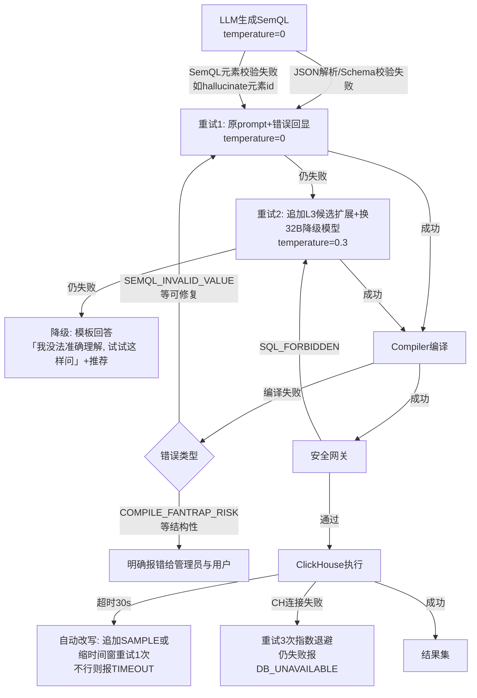

### 6.3.7 API 定义

`POST /api/v1/query/run`（内部链路，一般由 6.1 的 SSE 流串联；独立暴露给调试台）

```json
{"question": "华东区四月净销售额", "dataset_id": "ds_sales", "session_id": "sess_01J8X"}
```
响应 200：
```json
{
  "answer_id": "ans_77a",
  "semql": {"semql_version":"1.0","metrics":["metric_net_sales"],"dimensions":["dim_region"],
             "time":{"range":"2024-04-01/2024-04-30","grain":"month"},
             "filters":[{"dimension":"dim_region","op":"in","values":["HD"]}],
             "query_mode":"aggregate"},
  "sql": "SELECT region_name ... LIMIT 100",
  "applied_rules": ["[block] 净销售额仅统计status='completed'的订单"],
  "columns": [{"name":"大区","type":"String"},{"name":"净销售额","type":"Float64","unit":"元"}],
  "rows": [["华东", 5231400.0]],
  "row_count": 1, "elapsed_ms": 1820,
  "semantic_version": 7,
  "assumptions": []
}
```

### 6.3.8 异常穷举

| # | 异常 | 错误码 | 用户文案 |
|---|---|---|---|
| 1 | LLM 三次生成均失败 | `LLM_GENERATE_FAILED` | `这个问题有点复杂，我暂时无法准确理解。您可以：1）换个说法；2）试试这样问："{seed推荐}"` |
| 2 | SemQL 引用不存在的元素 | `SEMQL_INVALID_REF`（触发重试，最终失败转#1） | 同#1 |
| 3 | 维度值翻译失败 | `SEMQL_INVALID_VALUE`（重试时把值映射表再注入） | 同#1 |
| 4 | join 路径不存在 | `COMPILE_NO_JOIN_PATH` | `您问的内容涉及的数据暂未关联，已通知数据管理员处理`（自动建管理员工单） |
| 5 | fan-trap 风险 | `COMPILE_FANTRAP_RISK` | 同#4 |
| 6 | 命中禁止 SQL 节点 | `SQL_FORBIDDEN` | `该查询包含不允许的操作，已被拦截`（安全事件审计） |
| 7 | 执行超时 | `QUERY_TIMEOUT` | `查询超时了。建议缩小时间范围或减少维度后重试` |
| 8 | 结果 0 行 | 非错误 | 空态：`该条件下没有数据。{如有已应用规则则提示"注意已应用规则：X"} 您可以调整条件重试` |
| 9 | 结果截断（达到 limit） | 非错误，带标记 | 结果卡片底部：`仅展示前{N}条，共约{估算}条。需要完整数据请[导出](权限校验)` |
| 10 | ClickHouse 不可用 | `DB_UNAVAILABLE` | `数据服务暂时不可用，请稍后再试`（告警运维） |

### 6.3.9 验收标准

```gherkin
Given SemQL含filter "华东区"(展示值)且dim_region的value_maps含"华东→HD"
When Compiler编译
Then 生成SQL中过滤条件为region的tech_value='HD', 且compile_trace记录该翻译

Given LLM第1次返回非法JSON, 第2次返回合法SemQL
When 用户提问"上月各大区净销售额"
Then 查询成功, query_log记录retry_count=1, 用户无感知

Given 攻击性问题"查一下数据; DROP TABLE orders"
When 走完整查询链路
Then 意图层或安全网关拦截, 返回"我只支持数据查询"或"包含不允许的操作", 审计日志记录安全事件, 不执行任何SQL

Given 用户无门店维度行权限(行策略: region='HB')
When Compiler生成无WHERE的SQL
Then 安全网关注入AND region='HB', 最终SQL含该谓词

Given 查询执行超过30s
When ClickHouse返回超时
Then 系统重试1次(追加SAMPLE或缩时间窗), 仍超时返回QUERY_TIMEOUT及优化建议文案

Given 结果集为0行且应用了block规则"仅completed订单"
When 返回结果
Then 空态文案中包含"注意已应用规则: 仅统计已完成订单"提示
```

---

## 6.4 图表自动选择

### 6.4.1 功能描述

查询完成后，系统根据**结果集的数据特征**（列类型、行数、维度/指标个数、是否含时间轴、是否含对比列）自动选择最合适的图表类型渲染；用户可手动切换图表，系统记住本次会话内的手动偏好。

### 6.4.2 数据特征 → 图表映射表（刚性规则，前端+后端共用同一份配置 `chart_rules.json`）

判定按优先级从上到下，命中即停：

| # | 数据特征（判定条件） | 图表类型 | 交互说明 |
|---|---|---|---|
| 1 | 单行单列（1个指标值，无维度） | **指标卡**（大数字+单位+环比箭头） | 有 compare 列时展示环比涨跌幅（绿升红降，指标 direction=lower_better 时颜色反转） |
| 2 | 时间维度×1个指标（时间粒度=日/周/月，行数≥3） | **折线图** | X 轴时间；compare 列存在时叠加虚线对比期 |
| 3 | 时间维度×1个指标×1个分类维度 | **多系列折线图** | 分类数 ≤8；>8 时取 top8 其余合并"其他" |
| 4 | 分类维度×1个指标，分类数 ≤12 | **柱状图**（横向条形图，当分类名平均长度>6字） | 按指标降序 |
| 5 | 分类维度×1个指标，分类数 >12 | **Top10 横向条形图** + 其余合并"其他" | 标注"共{N}类，展示Top10" |
| 6 | 分类维度×1个指标 且语义含"占比/份额"（指标 format=percent 或问题含占比词） | **饼图**（分类数 ≤7），>7 用矩形树图 | 饼图显示百分比标签 |
| 7 | 分类维度A×分类维度B×1个指标 | **分组柱状图**（A 为主轴，B 为系列，B 分类数 ≤5），B>5 时改热力图 | — |
| 8 | 2 个指标×1个分类维度 | **双轴柱状+折线图** | 主指标柱、次指标线 |
| 9 | query_mode=detail | **明细表格**（分页，每页 50 行） | 列宽自适应，数值右对齐 |
| 10 | 任何图表都不适用（如>2 个指标×>2 个维度） | **透视表格** | 指标为列 |
| 11 | 归因结果（6.6 专用） | **瀑布图**（贡献度分解）+ 下钻树视图 | 见 6.6 |

**所有查询结果同时附带可切换的表格视图**——图表是呈现增强，表格是兜底，任何图表渲染失败降级为表格。

### 6.4.3 交互流程

- **加载态**：图表区域骨架屏（灰色块闪烁），文案 `正在生成图表…`；
- **空态**（0 行数据）：不渲染图表，展示 6.3.8#8 空态文案 + 空表格图标；
- **切换**：结果卡片右上角图表类型图标组（仅显示对当前数据特征合法的图表类型，非法置灰并 tooltip `当前数据不适合{图表名}`）；
- **手动覆盖**：用户切换后，本会话内同类数据特征的结果沿用用户选择（存 sessionStorage，不落库）。

### 6.4.4 实现机理

后端在 `result` 事件中下发 `chart` 字段（**后端拍板图表类型，前端只渲染**——避免前后端规则不一致）：

```json
{
  "chart": {
    "type": "bar_horizontal",
    "x_field": "大区", "y_fields": ["净销售额"],
    "series_field": null,
    "reason": "rule_4: 分类维度×1指标, 分类数8≤12, 平均名称长度7>6",
    "available_types": ["bar", "bar_horizontal", "pie", "table"],
    "echarts_option_hint": {"sort": "desc", "label": {"show": true, "formatter": "{c} 元"}}
  }
}
```


### 6.4.5 异常穷举

| # | 异常 | 系统行为 |
|---|---|---|
| 1 | 时间维度值乱序 | 渲染前按时间升序重排 |
| 2 | 指标值含 null | 折线图断点处理，柱状图显示 0，表格显示 `-` |
| 3 | 超大数值 | 自动千分位；≥1 亿显示为 `X.XX亿`，≥1 万显示 `X.X万`（tooltip 显示原值） |
| 4 | chart_rules.json 加载失败 | 前端内置同等默认规则兜底，告警 |
| 5 | 分类维度含空字符串/超长字符串 | 空串显示 `(空)`；超 20 字符截断加 `…`（tooltip 全文） |

### 6.4.6 验收标准

```gherkin
Given 查询结果为1行1列(净销售额1832.4万)且带mom对比列
When 前端收到result事件
Then 渲染指标卡, 显示"净销售额 1,832.4万"与环比箭头及百分比

Given 查询结果为12个月×净销售额(时间维度月粒度)
When 无compare列
Then 后端下发chart.type=line, reason以rule_2开头

Given 查询结果为15个省份×净销售额
When 图表渲染
Then 渲染Top10横向条形图, 其余合并为"其他", 图表下方标注"共15类, 展示Top10"

Given 用户手动将柱状图切换为饼图
When 同一会话内下一个查询结果同样命中rule_4
Then 结果默认渲染饼图, available_types不变

Given ECharts渲染抛出异常
When 前端捕获异常
Then 自动降级渲染表格视图, 不显示错误页面
```

## 6.5 多轮对话上下文

### 6.5.1 功能描述

会话内支持指代消解与上下文继承：用户可追问"那华北呢""换成按周看""再加上订单量"等省略表达，系统正确继承上一轮的指标、维度、时间、过滤条件，仅修改用户显式变更的部分。

### 6.5.2 场景

- 指代替换：Q1"上月各大区净销售额" → Q2"那华北呢" = 继承全部，仅把维度值过滤改为华北；
- 维度追加：Q2"再加上渠道维度" = 原 dimensions + 渠道；
- 时间变更：Q2"换成今年一季度" = 仅改 time.range；
- 指标追加：Q2"订单量也看一下" = metrics 追加；
- 全新话题：Q2"库存周转怎么样"（跨 DataSet）→ 上下文不继承，开新查询。

### 6.5.3 交互流程

- 无特殊界面，沿用对话流；结果卡片的"匹配解释"区会体现继承内容，如 `已识别：净销售额（指标）、华北（继承自上文的大区维度）、2024年4月（继承自上文时间）`；
- 继承错误时的纠正入口：用户在结果卡片点"不对，重新理解"→ 该问题重新走**无上下文**链路。

### 6.5.4 实现机理

**上下文存储**（Redis，key=`ctx:{session_id}`，TTL 2h）：
```json
{
  "turns": [
    {"question": "上月各大区净销售额", "semql": {...}, "answer_id": "ans_77a", "intent": "DATA_QUERY"}
  ],
  "last_semql": {...},
  "last_dataset": "ds_sales",
  "clarify_pending": null
}
```

**改写链路**：意图识别前先跑**指代改写器**（LLM，temperature=0）：输入 = 当前问题 + 近 5 轮 `turns` 摘要（问题+SemQL 的 metrics/dimensions/time 摘要，不注入完整 SemQL）；输出 = 改写后的完整独立问题 + `inherits: bool`。改写示例："那华北呢" → "2024年4月华北区的净销售额是多少"。改写后问题走标准链路；`inherits=true` 时 Schema Linking 会继承 `last_semql` 的元素 id 作为先验（命中词典冲突时优先上下文一致的解释）。

**新话题判定**：改写器同时输出 `topic_changed: bool`（依据：mention 元素与 last_dataset 无交集且命中其他 DataSet）；`true` 则清空继承。

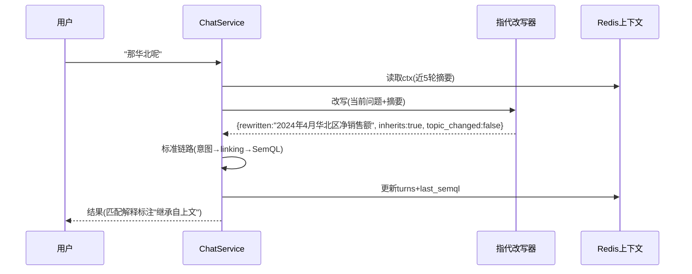

### 6.5.5 异常穷举

| # | 异常 | 系统行为 |
|---|---|---|
| 1 | 上下文 Redis 丢失/过期 | 按单轮处理；匹配解释不标"继承"；日志记录降级 |
| 2 | 改写器输出仍含指代（"那个""它"） | 二次改写 1 次；仍有指代 → 按单轮处理 |
| 3 | 继承的元素在新版本中已废弃 | 丢弃该继承项，按新话题处理，提示 `上一轮查询用到的"{名称}"已更新口径，本次按新口径查询` |
| 4 | 上下文跨 DataSet 污染 | topic_changed 判定失败时，SemQL 校验阶段发现元素不属同一 DataSet → 报错回落为新话题重跑 |
| 5 | 上下文轮数超 20 | 仅保留近 5 轮 + 最早 1 轮（保留初始话题锚点） |

### 6.5.6 验收标准

```gherkin
Given 上一轮查询为"2024年4月各大区净销售额"
When 用户追问"那华北呢"
Then 改写器输出"2024年4月华北区的净销售额", inherits=true, 结果仅含华北数据

Given 同上上下文
When 用户追问"再加上订单量"
Then SemQL.metrics包含metric_net_sales与metric_order_cnt, 其余条件不变

Given 同上上下文
When 用户追问"库存周转天数是多少"(属供应链DataSet)
Then topic_changed=true, 不继承任何上一轮条件, 按新话题查询

Given 上下文已过期(Redis中不存在)
When 用户追问"那华北呢"
Then 系统按单轮处理, 若"华北"可独立理解则查询, 否则进入澄清"您想查询哪个指标?"
```

## 6.6 洞察归因（核心刚性功能）

### 6.6.1 功能描述

当用户提出"为什么"类问题（如"为什么四月销量比五月低"）或主动对某指标发起"归因分析"时，系统执行**完整的确定性归因链路**：异常/波动识别 → 维度下钻归因（定位贡献度最高的维度组合）→ 指标公式拆解（derivation 链）→ 外部因素关联 → LLM 组织自然语言结论与可视化呈现。LLM 只负责表述，**归因事实全部来自计算**。

### 6.6.2 场景

- 场景 1（显式 why）："为什么四月销量比五月低"→ 识别比较期（四月 vs 五月），对"销量"做差值归因。
- 场景 2（结果卡片一键归因）：用户查看"各月净销售额趋势"图，点击某月数据点的 [分析波动原因] 按钮 → 对该月 vs 上月归因。
- 场景 3（异常检测驱动）：用户问"上月销量正常吗"→ 系统先做波动识别，若判定异常则自动追加归因，否则回答"处于正常波动区间（±X%内）"。

### 6.6.3 交互流程

**触发条件**：intent=`INSIGHT_WHY` / `INSIGHT_ANOMALY_CHECK`，或用户在结果卡片点击 [分析波动原因]。

**界面状态**：

| 状态 | 表现与文案 |
|---|---|
| 加载态 | 归因分析为异步任务（可能 10~30s），对话流中显示分步进度：`正在确认对比口径…`→`正在计算各维度贡献…`→`正在关联业务事件…`→`正在生成结论…`（SSE progress 事件驱动） |
| 结果态 | 洞察报告卡片（见 6.6.5 结构）：结论段 + 贡献度瀑布图 + 下钻树 + 外部因素标注 + 证据明细折叠区 + [反馈] 按钮 |
| 空态（未检出显著原因） | `在{X}个维度上未发现能解释主要波动的因素。{指标}的变化较为分散（最大单因素贡献仅{Y}%）。建议：{推荐查看的维度}` |
| 权限不足态 | 归因涉及无权限维度时，该维度从归因中剔除并在报告底部明示 `受权限限制，以下维度未纳入分析：{维度名列表}` |

**澄清特例**：用户问"为什么销量下降了"但未给比较期 → 默认"最近一个完整月 vs 上一完整月"，注入假设并明示。

### 6.6.4 实现机理（完整处理链路）

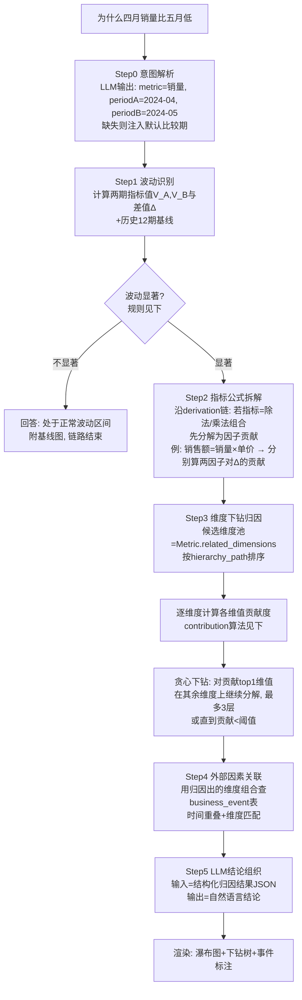

**Step1 波动识别（确定性规则）**：
- 输入：指标 M、对比期 A、基期 B（问题指定或默认 A=最近完整月、B=A 的前一月）。
- 计算：`Δ = V_A - V_B`，`pct = Δ/V_B`；同时计算该指标过去 12 个同粒度周期的环比序列，得均值 μ 与标准差 σ。
- 显著判定（满足任一）：`|pct| ≥ 显著阈值`（环境变量 `INSIGHT_SIGNIFICANT_PCT`，默认 **5%**）或 `|pct - μ| ≥ kσ`（`INSIGHT_SIGMA_K`，默认 **2**）。
- 输出：`{V_A, V_B, Δ, pct, baseline: {μ, σ, series[12]}, is_significant}`。

**Step3 维度下钻归因算法（核心，确定性）**：

候选维度池 = `Metric.related_dimensions`（语义层配置），按 DataSet 内顺序遍历，每个维度 D 执行一次分组查询：

```sql
-- 对维度D, 一次查询同时拿到两期各维值的指标值
SELECT {D}, sumIf(M_expr, time IN periodA) AS v_a, sumIf(M_expr, time IN periodB) AS v_b
FROM ... WHERE (time IN periodA OR time IN periodB) AND {公共过滤}
GROUP BY {D}
```

**贡献度定义**（差值分解法，可解释且总和守恒）：
- 维值 d 的贡献：`contrib(d) = v_a(d) - v_b(d)`；
- 维度 D 的解释力：`coverage(D) = Σ|contrib(d)| top3 / |Δ|`（top3 维值绝对贡献之和占总差值的比例）；
- 选出解释力最高的维度 D*（要求 `coverage(D*) ≥ 50%`，否则判定"变化分散"，进入空态逻辑）。

**贪心下钻树**：
1. 第 1 层：D* 的 top3 贡献维值（如 华东 contrib=-820万， 占 Δ 的 62%）；
2. 第 2 层：对每个 top 维值（贡献占比 ≥20% 者），固定该维值为过滤条件，在**剩余维度**上重复上述计算，找下一层主因（如 华东→A产品线 contrib=-610万）；
3. 第 3 层：同上，维度按 hierarchy_path 优先（大区→省份→城市→门店）；
4. 停止条件：层数=3，或该节点 `|contrib| / |Δ| < 10%`，或剩余维度为空。

**维度值异常校验（防止"低基数陷阱"）**：每个 top 维值附 `z_score = (v_a(d) - mean_d) / std_d`（该维值历史 12 期），`|z|<1` 且基数 <总盘子 1% 的维值标注"低基数波动，参考意义有限"。

**Step2 公式拆解（derivation 链）**：若指标 M 的 derivation formula 为 `M = X / Y`（如客单价），用对数分解近似：`ln(M_A/M_B) = ln(X_A/X_B) - ln(Y_A/Y_B)`，两因子贡献比 = `ln(X_A/X_B) : -ln(Y_A/Y_B)`；先报告"客单价下降主要源于净销售额下降（贡献 78%）而非订单数变化（贡献 22%）"，再对主因子继续做 Step3 维度归因。

**Step4 外部因素关联**：
- 数据源：`business_event` 表（管理后台维护：活动/价格调整/门店开关/系统故障/节假日，字段见 7.2：`event_name, event_type, start_date, end_date, related_dimension, related_value, impact_note`）；
- 匹配规则（确定性）：`时间重叠`（event 区间与 A 期或 A~B 区间相交）且（`related_dimension 为空`（全局事件）或 `related_dimension/related_value ∈ 归因路径上的维度组合`）；
- 命中事件作为"佐证线索"而非"因果结论"呈现；系统内置中国法定节假日表（每年由管理员导入一次，CSV），节假日错位（如五一促销提前）自动参与关联。

**Step5 LLM 结论组织**：

LLM 输入（**只有结构化 JSON，无原始明细数据**，从机制上防编造）：
```json
{
  "metric": {"name": "销量", "direction": "higher_better", "unit": "件"},
  "period": {"A": "2024-04", "B": "2024-05"},
  "values": {"V_A": 152300, "V_B": 187400, "delta": -35100, "pct": -18.7},
  "baseline": {"mom_mean": 0.02, "mom_std": 0.06, "is_significant": true},
  "formula_split": null,
  "drill_tree": [
    {"level": 1, "dimension": "大区", "top": [
       {"value": "华东", "contrib": -21800, "contrib_pct": 62.1, "v_a": 45200, "v_b": 67000, "z_score": -2.8},
       {"value": "华南", "contrib": -8900, "contrib_pct": 25.4, "z_score": -1.9}],
     "coverage": 0.87},
    {"level": 2, "path": ["华东"], "dimension": "产品线", "top": [
       {"value": "A产品线", "contrib": -16200, "contrib_pct_of_parent": 74.3}]}
  ],
  "events": [
    {"name": "五一促销提前至4月25日启动", "type": "campaign", "overlap": "periodA",
     "related": {"dimension": "大区", "value": "华东"}, "note": "华东区主会场"}
  ],
  "low_base_warnings": []
}
```

LLM prompt（系统侧完整模板，实现于 `prompts/insight_narrate.py`）：
```
# 角色
你是BI洞察报告撰写人。你只能基于下方"归因事实JSON"写作, 禁止使用JSON之外的任何数据,
禁止推测JSON中没有的原因。写作对象是业务人员, 语言直白, 避免统计学术语。

# 写作结构(严格遵守)
1. 结论(≤2句): 什么指标、在什么期间、变化多少、是否显著
2. 主要原因(≤3条): 按贡献度降序, 每条格式"维度值+变化量+占总变化百分比", 如下钻有第二层则补一句细分
3. 业务事件佐证(若有events): "时间上重合的业务事件: ...", 必须加"仅供参考, 不代表因果关系"
4. 低基数提示(若有low_base_warnings)
5. 建议下一步(1条): 从归因路径推荐一个可继续追问的问题

# 归因事实JSON
{attribution_json}

# 输出
直接输出报告正文, 不要标题, 不要复述JSON, 总字数≤250字。
```

**端到端执行编排**：归因链路为 Celery 异步任务 `run_attribution(answer_ref)`，每步通过 SSE progress 事件上报；Step3 的每个维度分组查询并发执行（维度池 ≤8，ClickHouse 并发无压力），总预算 30s，超时则返回已完成层级的部分结果并标注。

### 6.6.5 结果呈现（洞察报告卡片结构）

1. **结论段**：LLM 生成的自然语言报告；
2. **波动基线图**：近 12 期指标折线 + 本期高亮 + ±2σ 区间带；
3. **贡献度瀑布图**：从 V_B 到 V_A，按 top 维值贡献逐段分解（正贡献绿、负贡献红）；
4. **下钻树视图**：层级节点 = 维度值，节点大小 = |contrib|，点击节点可对该节点组合发起新查询（跳标准查数链路）；
5. **外部因素标注**：基线图上以旗帜图标标注事件时间区间，hover 显示事件详情；
6. **证据明细折叠区**：各维度贡献度原始表格（可导出 CSV）；
7. **反馈按钮**：👍/👎（见 6.10）。

### 6.6.6 API 定义

`POST /api/v1/insight/attribute`
```json
{
  "session_id": "sess_01J8X",
  "metric_id": "metric_qty",
  "period_a": "2024-04-01/2024-04-30",
  "period_b": "2024-05-01/2024-05-31",
  "base_filters": [{"dimension": "dim_channel", "op": "not_in", "values": ["TEST"]}],
  "source_answer_id": "ans_77a"
}
```
响应 202（异步）：`{"task_id": "attr_55b"}`

`GET /api/v1/insight/attribute/{task_id}` →
```json
{
  "status": "completed",
  "report": {
    "narrative": "4月销量15.2万件, 环比5月下降18.7%, 超出正常波动范围(±2σ)。主要原因是: 1) 华东区销量减少2.2万件, 占总降幅62%, 其中A产品线贡献华东降幅的74%; 2) 华南区减少0.9万件, 占25%。时间上重合的业务事件: 五一促销提前至4月25日启动(华东主会场), 仅供参考, 不代表因果关系。建议继续追问: A产品线在华东各城市的销量变化。",
    "is_significant": true,
    "values": {"V_A": 152300, "V_B": 187400, "delta": -35100, "pct": -18.7},
    "baseline_series": [{"period":"2023-05","value":160100}, "..."],
    "waterfall": [{"label":"5月","value":187400,"type":"base"},
                  {"label":"华东","value":-21800,"type":"factor"},
                  {"label":"华南","value":-8900,"type":"factor"},
                  {"label":"其他","value":-4400,"type":"factor"},
                  {"label":"4月","value":152300,"type":"total"}],
    "drill_tree": [{"level":1,"dimension":"大区","top":[{"value":"华东","contrib":-21800,"contrib_pct":62.1,"z_score":-2.8}]}],
    "events": [{"name":"五一促销提前","type":"campaign","start_date":"2024-04-25","end_date":"2024-05-05","related":{"dimension":"大区","value":"华东"}}],
    "excluded_dimensions_by_permission": [],
    "semantic_version": 7
  }
}
```

### 6.6.7 异常穷举

| # | 异常 | 系统行为 | 文案/错误码 |
|---|---|---|---|
| 1 | 指标无 related_dimensions 配置 | 无法归因 | `该指标暂未配置可分析维度，已通知数据管理员`（自动工单） |
| 2 | 对比期数据为空（任一） | 链路终止 | `{期间}没有{指标}数据，无法进行归因。请确认数据是否已入库` |
| 3 | 所有维度 coverage<50% | 空态 | 见 6.6.3 空态文案 |
| 4 | 维度基数过大（distinct>10000） | 该维度取 top20 维值参与，其余合并"其他"并标注 | 报告脚注：`{维度名}取值过多，仅分析Top20` |
| 5 | 归因任务总超时（30s） | 返回已完成部分 | `分析时间较长，以下为部分结果` |
| 6 | LLM 结论生成失败 | 用规则模板拼接结论（固定句式：结论+top3 原因） | 无感知降级，`X-Degraded: narrative` |
| 7 | 指标为 derived 但 derivation Relation 缺失 | 跳过 Step2，直接 Step3，日志告警 | 无感知 |
| 8 | 用户无部分维度权限 | 剔除并明示（见 6.6.3 权限不足态） | — |
| 9 | 历史基线不足 6 期（新指标） | 仅用 pct≥显著阈值（默认5%）规则判定，报告标注"基线数据不足，显著性仅供参考" | — |
| 10 | business_event 表为空 | 跳过 Step4 | 报告中该节不渲染 |

### 6.6.8 验收标准

```gherkin
Given 指标"销量"4月=152300件, 5月=187400件, 历史12期环比μ=2% σ=6%
When 用户问"为什么四月销量比五月低"
Then 系统判定显著(|-18.7%|≥10%), 执行完整归因链路, 报告含结论段/瀑布图/下钻树/基线图

Given 归因计算中华东区contrib=-21800, 总Δ=-35100
When 生成瀑布图数据
Then 华东排第一factor, contrib_pct=62.1, 且各factor之和=Δ(允许±0.5%舍入误差并入"其他")

Given 华东区在第1层贡献占比62.1%≥20%
When 执行第2层下钻
Then 以"大区=华东"为过滤, 在剩余维度上分解, A产品线contrib占华东降幅74.3%时出现在drill_tree第2层

Given business_event表存在"五一促销"(2024-04-25~05-05, related=大区/华东)
When 归因路径包含大区=华东
Then 报告events节包含该事件, 且narrative中含"仅供参考, 不代表因果关系"

Given 指标近12期环比μ=2% σ=6%, 本期pct=5%
When 用户问"上月销量正常吗"
Then 判定不显著, 回答"处于正常波动区间", 不执行下钻归因, 附基线图

Given 用户对"渠道"维度无权限
When 执行归因
Then 渠道维度不参与计算, 报告底部显示"受权限限制, 以下维度未纳入分析: 渠道"

Given LLM结论服务宕机
When 归因计算已完成
Then 用规则模板输出结论(结论+top3原因固定句式), 响应头X-Degraded: narrative
```

---

## 6.7 语义层 / Ontology 管理后台

### 6.7.1 功能描述

面向语义管理员（数据分析师）的 Web 后台，承载第五章全部对象的 CRUD、版本发布、索引监控、Evidence 管理、外部事件维护。所有修改走 draft→校验→双人评审→发布 流水线（5.5.2）。

### 6.7.2 后台信息架构（页面清单与关键交互）

| 页面 | 功能 | 关键交互与文案 |
|---|---|---|
| 数据源管理 | ClickHouse 连接的增删改测 | [测试连接] 按钮；失败显示具体错误（如 `连接超时(10s): 请检查主机与端口`）；密码字段只写不读 |
| 模型管理 | Model/Column/Measure/Dimension CRUD | 从物理表导入时逐列勾选；维度编辑含 value_maps 表格编辑器（技术值/展示名/查询别名三列，[自动拉取值] 按钮执行 distinct 查询回填） |
| 关系管理 | Relationship 定义与验证 | [验证关系] 按钮：执行孤儿率/膨胀率 SQL，显示 `孤儿行0条 ✓ / 扇形膨胀风险 ✗（一对多join后行数×3.2）` |
| 指标管理 | Metric CRUD + 绑定 Term | 表达式编辑器带 [试算] 按钮（执行 `SELECT expr FROM model LIMIT 10` 预览）；派生指标 formula 用指标选择器拼装，禁止手写 id |
| Ontology 管理 | Term/Entity/Attribute/Relation/BusinessRule CRUD | Term 编辑器含：定义、别名（标签输入）、单位、方向、scope、关联规则；[AI 起草定义] 按钮调 LLM 按绑定 Metric 生成 definition 初稿（弹窗确认后填入，明示 `AI生成，请人工核对`） |
| 版本中心 | draft 管理、发布流水线、历史版本对比与回滚 | 版本对比 = 左右 diff 视图（新增/修改/删除的对象清单）；[发布] 触发校验门禁，失败展示错误清单逐条可跳转；[回滚] 需填理由 |
| Evidence 中心 | Evidence 列表、重跑、巡检告警 | 偏差>5% 的行红色高亮 + [处理] 跳转对应 Term |
| 索引监控 | 词典/向量/NL→SemQL 对索引状态与重建 | 显示每类索引的条目数、最后构建时间、构建耗时；[立即重建] 按钮 |
| 事件管理 | business_event CRUD + 节假日导入 | 节假日 [导入CSV]（模板提供下载） |
| 调试台 | 输入问题查看意图/linking/SemQL/SQL 全链路中间产物 | 只读，不产生查询历史 |

**通用交互约定**：列表页均有搜索+状态筛选+分页（每页 20）；删除已发布对象弹窗确认 `"{名称}"正在被当前版本引用，删除将在下一版本生效，确认删除？`；所有页面操作写审计日志；无权限访问后台的用户菜单不渲染入口（前端隐藏+后端 403 双保险）。

**空态**：首次进入且无数据时，各管理页显示引导卡片（三步说明 + [开始配置] 按钮跳 5.7.1 流程对应步骤）。

### 6.7.3 实现机理与关键 API

版本流水线状态机见 5.5.2 Mermaid 图。校验门禁实现于 `semantic/validator.py`，6 项校验全部通过才能进入 PendingReview。

关键 API（完整清单见第八章）：
- `POST /api/v1/semantic/versions` 基于当前 published 创建 draft：`{"changelog": "调整净销售额口径"}` → `{"version": 8, "status": "draft"}`
- `POST /api/v1/semantic/versions/8/submit` → 触发异步校验 → `{"check_task_id": "chk_12"}`
- `GET /api/v1/semantic/versions/8/checks` → `{"status":"failed","items":[{"rule":"evidence_recheck","target":"term_net_sales","result":"fail","detail":"Evidence重算偏差7.2%>5%"}]}`
- `POST /api/v1/semantic/versions/8/approve`（评审人）/ `POST .../reject {"reason":"..."}`
- `POST /api/v1/semantic/versions/8/rollback {"target_version":7,"reason":"口径回退"}`

发布后钩子（Celery chain）：`rebuild_dictionary` → `rebuild_embeddings` → `invalidate_schema_cache` → `notify_subscribers`。

### 6.7.4 异常穷举

| # | 异常 | 系统行为 |
|---|---|---|
| 1 | 校验门禁任一项失败 | 停留 draft，错误清单逐条附跳转链接；禁止跳过 |
| 2 | 提交人尝试批准自己的版本 | 403 `SELF_APPROVE_FORBIDDEN`，文案 `发布需由另一名管理员评审` |
| 3 | 索引重建失败 | 版本保持 published 但标记 `index_stale=true`，查询链路自动降级（向量不可用→纯词典），后台红色告警 + [重试] |
| 4 | 编辑 draft 时另一管理员发布新版本 | draft 基线过期提示：`当前草稿基于v7，最新已发布v8。[合并变更]/[放弃草稿]` |
| 5 | 删除被引用的对象（如删除有 Term 绑定的 Metric） | 阻止并列出引用方：`无法删除：被以下对象引用：term_net_sales（Term）、ds_sales（数据集）` |
| 6 | Evidence 重跑时数仓不可用 | 该校验项标记 `skipped`，需评审人手动确认风险后才可批准（弹窗二次确认） |

### 6.7.5 验收标准

```gherkin
Given 管理员A创建draft v8并修改了term_net_sales的definition
When A点击[发布]且校验全部通过
Then 版本进入PendingReview, A自己的[批准]按钮置灰并提示"发布需由另一名管理员评审"

Given 版本v8处于PendingReview
When 管理员B点击[批准]
Then v8变published, 自动触发词典重建/向量重建/缓存失效, 审计日志记录两人操作

Given 指标metric_net_sales的Evidence登记值为2205779.84, 重算值为2390000(偏差8.4%)
When 版本提交校验
Then 校验失败, 错误清单含"term_net_sales: Evidence重算偏差8.4%>5%"且可跳转Evidence中心

Given 管理员尝试删除被ds_sales引用的Metric
When 点击删除
Then 弹出阻止提示并列出全部引用方, 不发生删除

Given draft基于v7编辑中, 另一管理员发布了v8
When 当前管理员打开draft
Then 页面顶部显示基线过期提示与[合并变更]/[放弃草稿]按钮
```

## 6.8 行 / 列 / 表级权限

### 6.8.1 功能描述

RBAC + 数据级策略三层管控：**表级**（能否访问某 DataSet/Model）、**行级**（只能看某些维度值的数据，如"华东区经理只看华东"）、**列级**（敏感列隐藏或脱敏，如"成本""客户手机号"）。权限在 SQL 安全网关**改写层强制执行**，与查询生成路径解耦。

### 6.8.2 权限模型（拍板）

```
User ──n:n── Role ──n:n── Policy
Policy 类型:
  dataset_policy:  {dataset_id, effect: allow}                    -- 表级
  row_policy:      {model_id, dimension_id, allowed_values[tech_value]}  -- 行级
  column_policy:   {model_id, column_name, action: hide|mask, mask_rule: phone|name|custom_regex}  -- 列级
内置角色: admin(全部) / semantic_admin(语义后台) / analyst(查数+反馈) / viewer(仅查看分享结果)
```

**多策略合并规则**：同一用户多个 Role 的行策略对同一维度**取并集**；不同维度分别注入；列策略冲突时 **mask 优先于 hide 的放宽操作不存在**——严格级别 mask>allow，hide 与 mask 冲突取 mask（更安全者优先）。

### 6.8.3 交互流程

- 管理端（系统管理员）：用户管理页分配角色；策略管理页按 DataSet/Model 配置行/列策略，行策略的 allowed_values 从维度 value_maps 多选（避免手填 tech_value 出错）；
- 用户端：
  - 无 DataSet 权限 → 6.1.3 权限不足态；
  - 行级限制 **不提示**（用户不知道其他区存在），查询结果天然只含授权数据；匹配解释区显示 `数据范围：华东区`（明示自身范围，防止误以为全量）；
  - 列级 hide：结果中无该列，若问题显式问该列（"各客户的手机号"）→ 拒绝文案 `您没有查看"{列名}"的权限`；列级 mask：显示脱敏值 `138****5678`。

### 6.8.4 实现机理

**行级**：网关改写阶段，对 SQL 涉及的每个 Model，查当前用户生效的 row_policy → 生成谓词 `{dimension_column} IN ({allowed_values})` 注入 WHERE（多维度 AND）；子查询/CTE 逐层注入（sqlglot AST 遍历所有 FROM 引用了受控 Model 的作用域）。
**列级**：查询计划阶段（SemQL 编译时）从可用维度/列清单中剔除 hide 列——LLM 根本看不到这些列，避免"问了再拒"的坏体验；mask 列在网关切换表达式：`phone → concat(left(phone,3),'****',right(phone,4))`（按 mask_rule 模板）。
**归因链路**：AttributionEngine 的候选维度池先经权限过滤（6.6.7#8）；分组查询 SQL 同样过网关。
**缓存隔离**：查询结果缓存 key 含 `policy_hash`（用户生效策略集的哈希），策略变更后旧缓存即刻不可命中。


### 6.8.5 异常穷举

| # | 异常 | 系统行为 |
|---|---|---|
| 1 | 行策略 allowed_values 为空（配置错误） | 视为"无数据权限"，注入 `1=0` 并告警管理员，**绝不退化为全量放行** |
| 2 | 策略引用的维度已废弃 | 策略标记失效，视同#1 处理；后台策略页红色标记 |
| 3 | 维度值映射变更导致 allowed_values 中的 tech_value 失效 | 每日巡检检测，标记失效策略通知管理员 |
| 4 | mask 规则与列类型不匹配（如对数值列套 phone 规则） | 保存策略时校验阻止：`mask规则phone仅适用于字符串列` |
| 5 | 用户在自由输入中探测无权限列名 | LLM 不可见即无法生成；即使手写 API 传 SemQL 引用 hide 列 → 校验 `COLUMN_FORBIDDEN` |

### 6.8.6 验收标准

```gherkin
Given 用户u1的角色含row_policy: region IN ('HD')
When u1查询"上月各门店净销售额"
Then 执行SQL含WHERE region='HD', 结果仅含华东门店, 匹配解释显示"数据范围: 华东区"

Given u1同时拥有角色A(region IN('HD'))与角色B(region IN('HB'))
When u1查询大区数据
Then SQL谓词为region IN ('HD','HB')(并集)

Given 列phone配置了mask(phone规则)
When u1查询含手机号的明细
Then 结果中手机号显示为138****5678格式

Given 列cost配置了hide
When u1提问"各商品的毛利润"(毛利润公式依赖cost)
Then 系统在SemQL阶段判定依赖被禁列, 返回"您没有查看\"成本\"的权限, 毛利润指标暂不可用"并记录审计

Given u1的行策略被管理员误配置为allowed_values=[]
When u1发起任何查询
Then 返回空结果(注入1=0), 后台产生配置告警, 不出现全量数据
```

## 6.9 查询历史

### 6.9.1 功能描述

完整保存每个用户的提问与系统回答（问题、SemQL、SQL、结果摘要、图表类型、语义层版本、耗时、重试次数），用户可回溯/重跑/再次归因；管理员可审计。

### 6.9.2 场景与交互

- 对话页左侧边栏：会话列表（按时间倒序，标题=首问前 20 字）；会话内任意历史消息可 [重新运行]（按**当前** published 语义版本重跑，结果卡片标注 `当前口径(v8)与原始查询时口径(v7)可能不同`）与 [按原口径复现]（指定 semantic_version=v7 重跑，只读对比模式）；
- 加载态：历史会话首次打开时骨架屏；
- 空态：无历史时侧边栏显示 `暂无历史对话，从下方输入第一个问题吧`；
- 权限态：用户只能看自己的历史；admin 审计视图可看全部但不可见被列级 mask 的原始值（审计视图同样过脱敏）。

### 6.9.3 实现机理与 API

- 写路径：每次查询完成异步落 `query_log` 与 `answer` 表（7.2），不阻塞 SSE；
- 结果集不落库（体积考虑），只存 columns+前 200 行快照（`answer.result_snapshot`）用于历史回看展示；[重新运行] 才重新查数仓；
- API：`GET /api/v1/history/sessions?limit=20&cursor=...`、`GET /api/v1/history/sessions/{id}`、`POST /api/v1/history/answers/{answer_id}/rerun {"use_original_version": false}`。

### 6.9.4 异常穷举

| # | 异常 | 系统行为 |
|---|---|---|
| 1 | 历史查询引用的语义版本已 archived 超保留期（默认保留 10 版） | [按原口径复现] 置灰，tooltip `原口径版本已归档清理` |
| 2 | 重跑时 DataSet 权限已回收 | 403 按权限不足态处理 |
| 3 | result_snapshot 缺失（早期数据） | 历史消息仅显示问题与 SQL，提示 `结果快照不可用，可点击重新运行` |
| 4 | 历史分页游标失效 | 返回空页+`cursor_invalid` 标记，前端自动回到第一页 |

### 6.9.5 验收标准

```gherkin
Given 用户在v7口径下查询过"净销售额"且语义层已发布v8
When 用户点击该历史消息的[重新运行]
Then 按v8执行, 结果卡片顶部标注"当前口径(v8)与原始查询时口径(v7)可能不同"

Given 同上历史消息
When 用户点击[按原口径复现]
Then 系统指定semantic_version=7执行, 结果以只读对比模式展示

Given 用户A的会话列表
When 用户B(非admin)尝试用A的session_id调API
Then 返回403 FORBIDDEN, 审计日志记录越权尝试
```

## 6.10 用户反馈回流

### 6.10.1 功能描述

每条查询结果与归因报告可反馈 👍/👎（👎 必选原因标签）；反馈形成"分析师待办队列"，被确认"正确"的查询自动沉淀为 few-shot exemplar，形成准确率自提升闭环。

### 6.10.2 交互流程

- 结果卡片底部 👍/👎 图标；点 👎 弹出原因单选：`数据不对 / 理解错我的意思 / 图表不合适 / 归因不可信 / 其他`，选"其他"出现文本框（≤200 字）；提交后 toast `感谢反馈，我们会持续改进`；
- 👍 直接提交，toast `感谢认可`；
- 反馈后图标变为已选状态，可改选（覆盖原反馈，保留修改记录）；
- 分析师待办队列（管理后台"反馈处理"页）：列表 = 👎 反馈（时间倒序），每条含原问题、SQL、用户标签、截图快照；处理动作：`标记为口径问题（跳转 Term 编辑）/ 补充别名（快速加 alias）/ 标记为误解（加入 exemplar 黑名单）/ 无需处理`；
- 👍 反馈自动处理：对应 NL→SemQL 对进入 exemplar 候选池，同问题 3 个不同用户 👍 或分析师手动确认后转正（`source=user_feedback, quality_score` 递增）。

### 6.10.3 实现机理与 API

`POST /api/v1/feedback`
```json
{"answer_id": "ans_77a", "vote": "down", "reason_tag": "wrong_data", "comment": "数据和我报表对不上"}
```
→ 落 `feedback` 表 → Celery 任务分流：`down` → 待办队列 + 若 `reason_tag=wrong_data` 则自动重跑该 answer 的 Evidence 关联校验；`up` → exemplar 候选池。

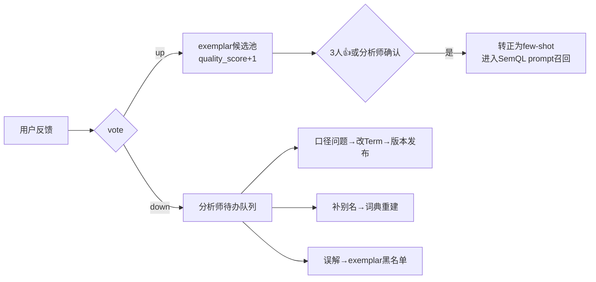

### 6.10.4 异常穷举

| # | 异常 | 系统行为 |
|---|---|---|
| 1 | 对同一 answer 重复反馈 | 覆盖更新，`feedback_history` 保留全部变更 |
| 2 | 反馈的 answer 已删除 | 404 `ANSWER_NOT_FOUND`，前端隐藏反馈按钮 |
| 3 | exemplar 候选池膨胀（>5000/dataset） | 按 quality_score×hit_count 淘汰末位 |
| 4 | 恶意刷反馈（同用户 >50 次/小时） | 限流 429，文案 `操作太频繁，请稍后再试` |
| 5 | 👎 队列积压 >100 条 | 每周一邮件/站内信提醒 semantic_admin 角色 |

### 6.10.5 验收标准

```gherkin
Given 用户对某查询结果点👎并选"数据不对"
When 提交反馈
Then 待办队列出现该条(含原问题/SQL/标签), 且自动触发关联Evidence重跑

Given 某NL→SemQL对已被3个不同用户点👍
When 第3个👍落库
Then 该对自动转正(source=user_feedback), 转正时同步计算embedding写入query_exemplar, 立即参与few-shot召回

Given 用户先点👍后改点👎选"图表不合适"
When 查看反馈记录
Then 最终vote=down, feedback_history含2条变更记录, 待办队列含该条

Given 同用户1小时内提交第51次反馈
When 调POST /api/v1/feedback
Then 返回429 RATE_LIMITED
```

---

# 第七章 数据存储设计（核心表建表语句）

## 7.1 设计约定

- 元数据全部存 PostgreSQL 15（含 pgvector 扩展）；业务数据存 ClickHouse（业务表结构由客户数仓决定，本文给出示例）；
- 所有元数据表公共字段：`id VARCHAR(32) PK`（前缀+ULID，如 `term_01J8X…`）、`created_at TIMESTAMPTZ DEFAULT now()`、`updated_at TIMESTAMPTZ DEFAULT now()`、`created_by VARCHAR(32)`；
- 语义层对象表均带 `version INT` + `status` 字段：draft 版本与 published 版本共存于同一张表，查询时按 `(对象id, version)` 定位——**同一对象跨版本多行**，这是版本化的物理实现；
- 删除一律逻辑删除（`status='deprecated'`），不做物理 DELETE。

## 7.2 PostgreSQL 建表语句

```sql
-- ========== 0. 扩展 ==========
CREATE EXTENSION IF NOT EXISTS vector;

-- ========== 1. 用户与权限 ==========
CREATE TABLE app_user (
    id            VARCHAR(32) PRIMARY KEY,          -- usr_xxx
    username      VARCHAR(64) UNIQUE NOT NULL,
    display_name  VARCHAR(64) NOT NULL,
    password_hash VARCHAR(128) NOT NULL,            -- bcrypt
    email         VARCHAR(128),
    dept          VARCHAR(64),
    status        VARCHAR(16) NOT NULL DEFAULT 'active',  -- active/disabled
    created_at    TIMESTAMPTZ NOT NULL DEFAULT now(),
    updated_at    TIMESTAMPTZ NOT NULL DEFAULT now()
);

CREATE TABLE role (
    id          VARCHAR(32) PRIMARY KEY,            -- role_xxx
    code        VARCHAR(32) UNIQUE NOT NULL,        -- admin/semantic_admin/analyst/viewer/custom
    name        VARCHAR(64) NOT NULL,
    description TEXT
);

CREATE TABLE user_role (
    user_id VARCHAR(32) NOT NULL REFERENCES app_user(id),
    role_id VARCHAR(32) NOT NULL REFERENCES role(id),
    PRIMARY KEY (user_id, role_id)
);

-- 三类策略统一存一张表, policy_type 区分
CREATE TABLE data_policy (
    id            VARCHAR(32) PRIMARY KEY,          -- pol_xxx
    role_id       VARCHAR(32) NOT NULL REFERENCES role(id),
    policy_type   VARCHAR(16) NOT NULL,             -- dataset/row/column
    dataset_id    VARCHAR(32),                      -- policy_type=dataset 时必填
    model_id      VARCHAR(32),                      -- row/column 时必填
    dimension_id  VARCHAR(32),                      -- row 时必填
    allowed_values JSONB,                           -- row 时必填: ["HD","HB"] (tech_value)
    column_name   VARCHAR(64),                      -- column 时必填
    column_action VARCHAR(8),                       -- hide/mask
    mask_rule     VARCHAR(32),                      -- phone/name/custom_regex
    status        VARCHAR(16) NOT NULL DEFAULT 'active',  -- active/invalid
    created_at    TIMESTAMPTZ NOT NULL DEFAULT now(),
    updated_at    TIMESTAMPTZ NOT NULL DEFAULT now()
);
CREATE INDEX idx_policy_role ON data_policy(role_id, policy_type) WHERE status='active';

-- ========== 2. 数据源 ==========
CREATE TABLE datasource (
    id           VARCHAR(32) PRIMARY KEY,           -- ds_xxx
    name         VARCHAR(64) NOT NULL,
    db_type      VARCHAR(16) NOT NULL DEFAULT 'clickhouse',
    host         VARCHAR(128) NOT NULL,
    port         INT NOT NULL DEFAULT 9000,
    database     VARCHAR(64) NOT NULL,
    username     VARCHAR(64) NOT NULL,
    password_enc VARCHAR(256) NOT NULL,             -- AES-GCM加密存储, 密钥来自部署环境变量
    options      JSONB,                             -- {max_execution_time, max_rows_to_read, readonly}
    status       VARCHAR(16) NOT NULL DEFAULT 'active',
    created_at   TIMESTAMPTZ NOT NULL DEFAULT now(),
    updated_at   TIMESTAMPTZ NOT NULL DEFAULT now()
);

-- ========== 3. 语义层版本 ==========
CREATE TABLE semantic_version (
    version      INT PRIMARY KEY,
    status       VARCHAR(16) NOT NULL,              -- draft/validating/pending_review/published/archived
    parent_version INT,
    changelog    TEXT,
    submitted_by VARCHAR(32) REFERENCES app_user(id),
    approved_by  VARCHAR(32) REFERENCES app_user(id),
    check_report JSONB,                             -- 校验门禁结果明细
    published_at TIMESTAMPTZ,
    created_at   TIMESTAMPTZ NOT NULL DEFAULT now()
);
-- 有且仅有一个published: 用部分唯一索引保证
CREATE UNIQUE INDEX uq_semver_published ON semantic_version(status) WHERE status='published';

-- ========== 4. Ontology 层 ==========
CREATE TABLE ont_term (
    id          VARCHAR(32) NOT NULL,
    version     INT NOT NULL REFERENCES semantic_version(version),
    name        VARCHAR(64) NOT NULL,
    term_type   VARCHAR(16) NOT NULL,               -- business_term/metric_term
    definition  TEXT NOT NULL,
    scope       TEXT,
    aliases     JSONB NOT NULL DEFAULT '[]',
    unit        VARCHAR(16),
    direction   VARCHAR(16),                        -- higher_better/lower_better/neutral
    related_terms JSONB DEFAULT '[]',
    owner       VARCHAR(32) NOT NULL REFERENCES app_user(id),
    status      VARCHAR(16) NOT NULL DEFAULT 'draft',
    created_at  TIMESTAMPTZ NOT NULL DEFAULT now(),
    updated_at  TIMESTAMPTZ NOT NULL DEFAULT now(),
    PRIMARY KEY (id, version)
);
CREATE UNIQUE INDEX uq_term_name_version ON ont_term(name, version);

CREATE TABLE ont_entity (
    id          VARCHAR(32) NOT NULL,
    version     INT NOT NULL REFERENCES semantic_version(version),
    name        VARCHAR(64) NOT NULL,
    entity_type VARCHAR(16) NOT NULL,               -- subject/classifier
    definition  TEXT NOT NULL,
    aliases     JSONB NOT NULL DEFAULT '[]',
    owner       VARCHAR(32) NOT NULL REFERENCES app_user(id),
    status      VARCHAR(16) NOT NULL DEFAULT 'draft',
    created_at  TIMESTAMPTZ NOT NULL DEFAULT now(),
    updated_at  TIMESTAMPTZ NOT NULL DEFAULT now(),
    PRIMARY KEY (id, version)
);

CREATE TABLE ont_attribute (
    id          VARCHAR(32) NOT NULL,
    version     INT NOT NULL REFERENCES semantic_version(version),
    entity_id   VARCHAR(32) NOT NULL,
    name        VARCHAR(64) NOT NULL,
    attr_kind   VARCHAR(16) NOT NULL,               -- identifier/descriptor/time
    definition  TEXT,
    value_domain JSONB,                             -- {"enum":[{"v":"A","label":"高价值"}]}
    aliases     JSONB NOT NULL DEFAULT '[]',
    status      VARCHAR(16) NOT NULL DEFAULT 'draft',
    created_at  TIMESTAMPTZ NOT NULL DEFAULT now(),
    PRIMARY KEY (id, version)
);

CREATE TABLE ont_relation (
    id            VARCHAR(32) NOT NULL,
    version       INT NOT NULL REFERENCES semantic_version(version),
    relation_type VARCHAR(16) NOT NULL,             -- hierarchy/composition/derivation/equivalence/association
    from_id       VARCHAR(32) NOT NULL,             -- Term/Entity/Attribute id
    to_ids        JSONB NOT NULL,                   -- 目标id数组
    formula       TEXT,                             -- derivation 专用
    note          TEXT,
    status        VARCHAR(16) NOT NULL DEFAULT 'draft',
    created_at    TIMESTAMPTZ NOT NULL DEFAULT now(),
    PRIMARY KEY (id, version)
);

CREATE TABLE ont_business_rule (
    id               VARCHAR(32) NOT NULL,
    version          INT NOT NULL REFERENCES semantic_version(version),
    target_id        VARCHAR(32) NOT NULL,
    rule_type        VARCHAR(16) NOT NULL,          -- enum_semantics/business_rule/unit/scope/data_quality
    severity         VARCHAR(8)  NOT NULL,          -- block/warning/info
    trigger_keywords JSONB NOT NULL DEFAULT '[]',
    description      TEXT NOT NULL,
    evidence_ids     JSONB DEFAULT '[]',
    status           VARCHAR(16) NOT NULL DEFAULT 'draft',
    created_at       TIMESTAMPTZ NOT NULL DEFAULT now(),
    PRIMARY KEY (id, version)
);

CREATE TABLE ont_evidence (
    id           VARCHAR(32) NOT NULL,
    version      INT NOT NULL REFERENCES semantic_version(version),
    source_desc  TEXT,
    query_sql    TEXT NOT NULL,
    result_summary TEXT NOT NULL,
    validated_at TIMESTAMPTZ NOT NULL,
    validated_by VARCHAR(32) NOT NULL REFERENCES app_user(id),
    created_at   TIMESTAMPTZ NOT NULL DEFAULT now(),
    PRIMARY KEY (id, version)
);

-- ========== 5. MDL 层 ==========
CREATE TABLE mdl_model (
    id            VARCHAR(32) NOT NULL,
    version       INT NOT NULL REFERENCES semantic_version(version),
    name          VARCHAR(64) NOT NULL,
    datasource_id VARCHAR(32) NOT NULL REFERENCES datasource(id),
    source_type   VARCHAR(16) NOT NULL,             -- table/sql_query
    table_ref     VARCHAR(128),
    sql_query     TEXT,
    primary_key   JSONB NOT NULL DEFAULT '[]',
    time_field    VARCHAR(64),
    description   TEXT,
    status        VARCHAR(16) NOT NULL DEFAULT 'draft',
    created_at    TIMESTAMPTZ NOT NULL DEFAULT now(),
    updated_at    TIMESTAMPTZ NOT NULL DEFAULT now(),
    PRIMARY KEY (id, version)
);

CREATE TABLE mdl_column (
    id           VARCHAR(32) NOT NULL,
    version      INT NOT NULL REFERENCES semantic_version(version),
    model_id     VARCHAR(32) NOT NULL,
    name         VARCHAR(64) NOT NULL,              -- 物理列名
    display_name VARCHAR(64) NOT NULL,
    data_type    VARCHAR(32) NOT NULL,
    expression   TEXT,                              -- 计算列表达式, 普通列为NULL
    is_hidden    BOOLEAN NOT NULL DEFAULT FALSE,
    description  TEXT,
    aliases      JSONB NOT NULL DEFAULT '[]',
    PRIMARY KEY (id, version)
);

CREATE TABLE mdl_measure (
    id          VARCHAR(32) NOT NULL,
    version     INT NOT NULL REFERENCES semantic_version(version),
    model_id    VARCHAR(32) NOT NULL,
    name        VARCHAR(64) NOT NULL,
    display_name VARCHAR(64) NOT NULL,
    agg         VARCHAR(16) NOT NULL,               -- SUM/COUNT/AVG/MIN/MAX/COUNT_DISTINCT
    expression  TEXT NOT NULL,
    filter_sql  TEXT,
    format      JSONB,                              -- {"type":"currency","unit":"元","decimals":2}
    aliases     JSONB NOT NULL DEFAULT '[]',
    PRIMARY KEY (id, version)
);

CREATE TABLE mdl_dimension (
    id             VARCHAR(32) NOT NULL,
    version        INT NOT NULL REFERENCES semantic_version(version),
    model_id       VARCHAR(32) NOT NULL,
    name           VARCHAR(64) NOT NULL,
    display_name   VARCHAR(64) NOT NULL,
    dim_type       VARCHAR(16) NOT NULL,            -- category/date/id
    expression     TEXT NOT NULL,
    aliases        JSONB NOT NULL DEFAULT '[]',
    value_maps     JSONB NOT NULL DEFAULT '[]',     -- [{"tech_value":"HD","display_value":"华东","query_aliases":["华东区"]}]
    hierarchy_path JSONB,                           -- ["大区","省份","城市","门店"]
    drill_enabled  BOOLEAN NOT NULL DEFAULT TRUE,
    PRIMARY KEY (id, version)
);

CREATE TABLE mdl_relationship (
    id            VARCHAR(32) NOT NULL,
    version       INT NOT NULL REFERENCES semantic_version(version),
    from_model_id VARCHAR(32) NOT NULL,
    to_model_id   VARCHAR(32) NOT NULL,
    join_type     VARCHAR(16) NOT NULL,             -- one_to_one/one_to_many/many_to_one/many_to_many
    condition     TEXT NOT NULL,                    -- "orders.store_id = stores.store_id"
    verified      BOOLEAN NOT NULL DEFAULT FALSE,
    PRIMARY KEY (id, version)
);

CREATE TABLE mdl_metric (
    id                 VARCHAR(32) NOT NULL,
    version            INT NOT NULL REFERENCES semantic_version(version),
    bind_term_id       VARCHAR(32),                 -- 1:1绑定 ont_term(metric_term)
    metric_kind        VARCHAR(8) NOT NULL,         -- atomic/derived
    model_id           VARCHAR(32),                 -- atomic 必填
    measure_expression TEXT,                        -- atomic 必填
    agg                VARCHAR(16),                 -- atomic 必填
    filter_sql         TEXT,
    joins_needed       JSONB DEFAULT '[]',
    formula            TEXT,                        -- derived 必填: "metric_a / metric_b"
    grain              JSONB DEFAULT '[]',
    default_time_field VARCHAR(64),
    related_dimensions JSONB NOT NULL DEFAULT '[]', -- 归因候选维度池
    data_format        JSONB,
    status             VARCHAR(16) NOT NULL DEFAULT 'draft',
    PRIMARY KEY (id, version)
);

CREATE TABLE mdl_dataset (
    id                 VARCHAR(32) NOT NULL,
    version            INT NOT NULL REFERENCES semantic_version(version),
    name               VARCHAR(64) NOT NULL,
    description        TEXT,
    model_ids          JSONB NOT NULL,
    metric_ids         JSONB NOT NULL,
    dimension_ids      JSONB NOT NULL,
    default_time_range VARCHAR(32),                 -- last_month/last_7d/...
    status             VARCHAR(16) NOT NULL DEFAULT 'draft',
    PRIMARY KEY (id, version)
);

-- Ontology ↔ MDL 绑定
CREATE TABLE ont_mdl_mapping (
    id           VARCHAR(32) NOT NULL,
    version      INT NOT NULL REFERENCES semantic_version(version),
    mapping_type VARCHAR(24) NOT NULL,  -- term_metric/term_rule_sql/attr_dimension/entity_model/term_dataset_scope
    ont_id       VARCHAR(32) NOT NULL,
    mdl_id       VARCHAR(32) NOT NULL,  -- term_rule_sql时存SQL谓词片段
    extra        JSONB,
    PRIMARY KEY (id, version)
);

-- ========== 6. 索引层 ==========
CREATE TABLE semantic_embedding (
    id           BIGSERIAL PRIMARY KEY,
    element_type VARCHAR(16) NOT NULL,   -- term/entity/attribute/metric/dimension/dataset
    element_id   VARCHAR(32) NOT NULL,
    version      INT NOT NULL,           -- 语义层版本, 检索时过滤active
    embed_text   TEXT NOT NULL,
    embedding    vector(1024) NOT NULL,
    created_at   TIMESTAMPTZ NOT NULL DEFAULT now()
);
CREATE INDEX idx_embed_version ON semantic_embedding(version, element_type);
CREATE INDEX idx_embed_vector ON semantic_embedding USING hnsw (embedding vector_cosine_ops);

CREATE TABLE dict_entry (                 -- 手工补充词条(自动词条由发布流水线从语义对象生成, 不落此表)
    id         VARCHAR(32) PRIMARY KEY,
    word       VARCHAR(64) NOT NULL,
    nature     VARCHAR(64) NOT NULL,      -- _term_xxx / _dimval_dim_region:HD / _custom
    freq       INT NOT NULL DEFAULT 10000,
    created_at TIMESTAMPTZ NOT NULL DEFAULT now(),
    UNIQUE (word, nature)
);

CREATE TABLE query_exemplar (
    id            VARCHAR(32) PRIMARY KEY,
    dataset_id    VARCHAR(32) NOT NULL,
    nl_question   TEXT NOT NULL,
    semql_json    JSONB NOT NULL,
    embedding     vector(1024),
    source        VARCHAR(16) NOT NULL,   -- seed/user_feedback/admin
    quality_score INT NOT NULL DEFAULT 0,
    hit_count     INT NOT NULL DEFAULT 0,
    is_active     BOOLEAN NOT NULL DEFAULT TRUE,
    created_at    TIMESTAMPTZ NOT NULL DEFAULT now()
);

-- ========== 7. 对话与查询历史 ==========
CREATE TABLE chat_session (
    id         VARCHAR(32) PRIMARY KEY,   -- sess_xxx
    user_id    VARCHAR(32) NOT NULL REFERENCES app_user(id),
    title      VARCHAR(64),
    created_at TIMESTAMPTZ NOT NULL DEFAULT now(),
    updated_at TIMESTAMPTZ NOT NULL DEFAULT now()
);
CREATE INDEX idx_session_user ON chat_session(user_id, updated_at DESC);

CREATE TABLE chat_message (
    id           VARCHAR(32) PRIMARY KEY, -- msg_xxx
    session_id   VARCHAR(32) NOT NULL REFERENCES chat_session(id),
    role         VARCHAR(8) NOT NULL,     -- user/assistant
    content      TEXT NOT NULL,
    intent       VARCHAR(24),
    clarify_info JSONB,
    created_at   TIMESTAMPTZ NOT NULL DEFAULT now()
);
CREATE INDEX idx_msg_session ON chat_message(session_id, created_at);

CREATE TABLE query_log (
    id               VARCHAR(32) PRIMARY KEY,   -- qlog_xxx
    session_id       VARCHAR(32) NOT NULL,
    user_id          VARCHAR(32) NOT NULL,
    question         TEXT NOT NULL,
    rewritten_question TEXT,
    intent           VARCHAR(24),
    matched_elements JSONB,
    semql_json       JSONB,
    final_sql        TEXT,
    applied_rules    JSONB,
    assumptions      JSONB,
    semantic_version INT,
    policy_hash      VARCHAR(64),
    retry_count      INT NOT NULL DEFAULT 0,
    degraded         VARCHAR(64),               -- vector/narrative/intent 逗号分隔
    status           VARCHAR(16) NOT NULL,      -- success/failed/timeout/forbidden
    error_code       VARCHAR(32),
    elapsed_ms       INT,
    created_at       TIMESTAMPTZ NOT NULL DEFAULT now()
);
CREATE INDEX idx_qlog_user ON query_log(user_id, created_at DESC);
CREATE INDEX idx_qlog_status ON query_log(status, error_code) WHERE status <> 'success';

CREATE TABLE answer (
    id              VARCHAR(32) PRIMARY KEY,    -- ans_xxx
    query_log_id    VARCHAR(32) NOT NULL REFERENCES query_log(id),
    chart_type      VARCHAR(24),
    chart_meta      JSONB,
    columns_meta    JSONB,
    result_snapshot JSONB,                      -- 前200行
    row_count       INT,
    summary_text    TEXT,
    created_at      TIMESTAMPTZ NOT NULL DEFAULT now()
);

CREATE TABLE insight_report (
    id             VARCHAR(32) PRIMARY KEY,     -- attr_xxx (task_id即report_id)
    user_id        VARCHAR(32) NOT NULL,
    session_id     VARCHAR(32),
    metric_id      VARCHAR(32) NOT NULL,
    period_a       VARCHAR(32) NOT NULL,
    period_b       VARCHAR(32) NOT NULL,
    status         VARCHAR(16) NOT NULL,        -- running/completed/partial/failed
    report_json    JSONB,
    narrative      TEXT,
    semantic_version INT,
    elapsed_ms     INT,
    created_at     TIMESTAMPTZ NOT NULL DEFAULT now()
);

-- ========== 8. 反馈与事件 ==========
CREATE TABLE feedback (
    id          VARCHAR(32) PRIMARY KEY,
    answer_id   VARCHAR(32),                    -- 与 insight_report_id 二选一
    insight_id  VARCHAR(32),
    user_id     VARCHAR(32) NOT NULL,
    vote        VARCHAR(4) NOT NULL,            -- up/down
    reason_tag  VARCHAR(24),                    -- wrong_data/wrong_intent/bad_chart/untrusted_insight/other
    comment     VARCHAR(256),
    status      VARCHAR(16) NOT NULL DEFAULT 'pending',  -- pending/processing/resolved/dismissed
    created_at  TIMESTAMPTZ NOT NULL DEFAULT now(),
    updated_at  TIMESTAMPTZ NOT NULL DEFAULT now()
);
CREATE INDEX idx_feedback_pending ON feedback(status, created_at DESC) WHERE vote='down';

CREATE TABLE feedback_history (
    id          BIGSERIAL PRIMARY KEY,
    feedback_id VARCHAR(32) NOT NULL REFERENCES feedback(id),
    old_vote    VARCHAR(4), new_vote VARCHAR(4),
    old_tag     VARCHAR(24), new_tag VARCHAR(24),
    changed_at  TIMESTAMPTZ NOT NULL DEFAULT now()
);

CREATE TABLE business_event (
    id                VARCHAR(32) PRIMARY KEY,
    event_name        VARCHAR(128) NOT NULL,
    event_type        VARCHAR(16) NOT NULL,     -- campaign/price_change/store_change/system_issue/holiday/custom
    start_date        DATE NOT NULL,
    end_date          DATE NOT NULL,
    related_dimension VARCHAR(32),              -- NULL=全局事件
    related_value     VARCHAR(64),              -- tech_value
    impact_note       TEXT,
    created_by        VARCHAR(32) NOT NULL,
    created_at        TIMESTAMPTZ NOT NULL DEFAULT now()
);
CREATE INDEX idx_event_date ON business_event(start_date, end_date);

CREATE TABLE audit_log (
    id         BIGSERIAL PRIMARY KEY,
    user_id    VARCHAR(32) NOT NULL,
    action     VARCHAR(48) NOT NULL,            -- login/publish_version/update_policy/query_forbidden/...
    target     VARCHAR(128),
    detail     JSONB,
    ip         VARCHAR(45),
    created_at TIMESTAMPTZ NOT NULL DEFAULT now()
);
CREATE INDEX idx_audit_time ON audit_log(created_at DESC);
```

## 7.3 ClickHouse 侧（示例业务表，仅供开发联调）

真实业务表由客户数仓提供；开发环境用以下示例（与全文示例一致）：

```sql
CREATE DATABASE IF NOT EXISTS retail_dw;

CREATE TABLE retail_dw.orders (
    order_id   String,
    store_id   String,
    customer_id String,
    status     LowCardinality(String),   -- completed/refunded/cancelled
    order_date Date,
    channel    LowCardinality(String)    -- ONLINE/OFFLINE/TEST
) ENGINE = MergeTree ORDER BY (order_date, order_id);

CREATE TABLE retail_dw.order_items (
    order_id      String,
    product_line  LowCardinality(String),
    quantity      UInt32,
    unit_price    Decimal(10,2),
    discount_rate Decimal(4,2)
) ENGINE = MergeTree ORDER BY (order_id);

CREATE TABLE retail_dw.stores (
    store_id    String,
    store_name  String,
    region_name LowCardinality(String),  -- HD/HB/HN... (tech_value)
    province    String,
    city        String
) ENGINE = MergeTree ORDER BY store_id;
```

# 第八章 API 总表与错误码表

## 8.1 API 总表

认证：除 `/auth/login` 外全部需 `Authorization: Bearer <JWT>`（JWT 有效期 8h，含 user_id 与 roles）。统一前缀 `/api/v1`。统一响应包：`{"code":0,"data":{...}}` 或 `{"code":<错误码>,"message":"...","trace_id":"..."}`（SSE 通道内直接以 error 事件下发）。

| 模块 | 方法&路径 | 说明 | 角色 |
|---|---|---|---|
| 认证 | POST /auth/login | 账号密码登录，返回 JWT | 公开 |
| 认证 | POST /auth/logout；GET /auth/me | 登出；当前用户信息+权限 | 登录 |
| 对话 | POST /chat/ask | 提问（SSE 流） | analyst+ |
| 对话 | POST /chat/clarify | 澄清响应（续 SSE 流） | analyst+ |
| 对话 | POST /chat/sessions；GET /chat/sessions | 新建会话（返回 session_id 与标题）；会话列表（cursor 分页） | analyst+ |
| 对话 | DELETE /chat/sessions/{id} | 删除会话 | 本人 |
| 查询 | POST /query/run | 独立查询（调试台） | semantic_admin |
| 洞察 | POST /insight/attribute | 发起归因（202 异步） | analyst+ |
| 洞察 | GET /insight/attribute/{task_id} | 归因结果轮询/SSE | analyst+ |
| 历史 | GET /history/sessions；GET /history/sessions/{id} | 历史 | 本人 |
| 历史 | POST /history/answers/{id}/rerun | 重跑（可指定原口径） | 本人 |
| 反馈 | POST /feedback；GET /feedback/queue | 提交反馈；待办队列 | analyst+ / semantic_admin |
| 反馈 | POST /feedback/{id}/resolve | 处理反馈（4 种动作） | semantic_admin |
| 语义-Ontology | GET/POST/PUT/DELETE /semantic/terms、/entities、/attributes、/relations、/rules、/evidences | CRUD（作用于 draft 版本） | semantic_admin |
| 语义-MDL | .../semantic/models、/columns、/measures、/dimensions、/relationships、/metrics、/datasets、mappings | CRUD | semantic_admin |
| 语义-版本 | POST /semantic/versions；POST /semantic/versions/{v}/submit、/approve、/reject、/rollback；GET /semantic/versions/{v}/checks、/diff | 版本流水线 | semantic_admin（approve 需非提交人） |
| 语义-调试 | POST /semantic/debug/link；POST /semantic/debug/intent | 调试台 | semantic_admin |
| 索引 | GET /semantic/index/status；POST /semantic/index/rebuild | 索引监控与重建 | semantic_admin |
| 事件 | GET/POST/PUT/DELETE /semantic/events；POST /semantic/events/import-holidays | 业务事件与节假日 | semantic_admin |
| 系统 | GET/POST/PUT /sys/users、/roles、/policies；POST /sys/datasources/test | 用户/角色/策略/数据源 | admin |
| 系统 | GET /sys/audit-logs | 审计（分页+过滤） | admin |

## 8.2 错误码表

| code | HTTP | 含义 | 触发位置 | 用户文案要点 |
|---|---|---|---|---|
| 0 | 200 | 成功 | — | — |
| 1001 | 401 | 未登录或 token 过期 | 全局 | `登录已过期，请重新登录` |
| 1003 | 403 | 无接口权限 | 全局 | `您没有该操作的权限` |
| 1004 | 404 | 资源不存在 | 全局 | — |
| 1429 | 429 | 触发限流 | 反馈/提问 | `操作太频繁，请稍后再试` |
| 2001 | 400 | 意图识别失败（兜底后仍失败） | 6.1 | `我没有理解您的问题`+推荐问法 |
| 2002 | 400 | 澄清已过期 | 6.1 | 前端自动重发原问题 |
| 2003 | 403 | 无 DataSet 权限 | 6.1/6.8 | `您没有查询"{名}"的权限` |
| 2101 | 500 | LLM 三次生成 SemQL 失败 | 6.3 | `暂时无法准确理解`+推荐问法 |
| 2102 | 400 | SemQL 引用不存在的元素 | 6.3 | 重试，最终同 2101 |
| 2103 | 400 | 维度值无法翻译为 tech_value | 6.3 | 重试，最终同 2101 |
| 2201 | 400 | 无可达 join 路径 | 6.3 | `涉及的数据暂未关联，已通知管理员` |
| 2202 | 400 | fan-trap 风险 | 6.3 | 同 2201 |
| 2203 | 403 | 命中禁止 SQL（DDL/DML/危险函数） | 6.3 | `包含不允许的操作，已被拦截` |
| 2204 | 403 | 引用被 hide 的列 | 6.8 | `您没有查看"{列名}"的权限` |
| 2301 | 504 | 查询超时（重试后仍超时） | 6.3 | `查询超时，建议缩小时间范围` |
| 2302 | 503 | ClickHouse 不可用 | 6.3 | `数据服务暂时不可用` |
| 3001 | 400 | 指标未配置归因维度 | 6.6 | `该指标暂未配置可分析维度` |
| 3002 | 400 | 对比期数据为空 | 6.6 | `{期间}没有数据，无法归因` |
| 3003 | 200 | 波动不显著（非错误的业务返回） | 6.6 | `处于正常波动区间` |
| 3004 | 504 | 归因任务超时（返回部分结果） | 6.6 | `分析时间较长，以下为部分结果` |
| 4001 | 409 | 语义版本基线过期 | 6.7 | `草稿基于v{n}，最新已发布v{m}` |
| 4002 | 403 | 自提交自批准 | 6.7 | `发布需由另一名管理员评审` |
| 4003 | 409 | 对象被引用无法删除 | 6.7 | 列出引用方 |
| 4004 | 422 | 版本校验门禁失败 | 6.7 | 返回错误清单 |
| 5000 | 500 | 未捕获内部错误 | 全局 | `系统开小差了，请稍后再试`（附 trace_id） |

**限流规则（写死）**：提问 30 次/分钟/用户；归因 5 次/分钟/用户；反馈 50 次/小时/用户；登录 10 次/分钟/IP（超限锁定 10 分钟）。

---

# 第九章 MVP 圈选及理由

## 9.1 MVP 范围（第一版上线必须做）

| 优先级 | 功能 | 入选理由 |
|---|---|---|
| P0 | 语义层与 Ontology 管理后台（5.7 冷启动流程 + 版本发布流） | 没有语义层一切免谈；版本双人评审是"可信"的根基 |
| P0 | 提问+澄清追问（6.1） | 核心交互入口；澄清是中文业务歧义场景的正确性保障 |
| P0 | Schema Linking 三路匹配（6.2） | 准确率地基 |
| P0 | SemQL 生成+编译+安全网关+执行（6.3 全链路） | 核心价值链路 |
| P0 | 图表自动选择（6.4，仅规则 1/2/4/5/9/10：指标卡/折线/柱/Top10/表格/透视） | 覆盖 80% 查询形态；其余规则二期 |
| P0 | 行/列/表级权限（6.8） | 企业私有化硬门槛，不能二期补（后补权限=推翻查询链路） |
| P0 | 查询历史（6.9，不含"按原口径复现"） | 基本可用性 |
| P1（MVP 内含） | **洞察归因（6.6，含波动识别+下钻归因+瀑布图+LLM 结论；外部因素关联简化为仅匹配 business_event 表）** | 本产品的差异化卖点，**必须在 MVP**；公式拆解（derivation 分解）放二期 |
| P1 | 用户反馈回流（6.10，👍/👎+待办队列+👍沉淀 exemplar） | 准确率自提升闭环，越早积累越好 |
| P1 | 多轮对话上下文（6.5，仅指代替换与时间变更两类） | 高频追问形态；维度/指标追加二期 |

## 9.2 明确不进 MVP 的（及理由）

| 功能 | 理由 |
|---|---|
| derivation 公式拆解归因 | 依赖完整 derivation 图谱，冷启动期配置不全，二期 |
| 节假日自动关联 | 依赖节假日表运营，二期（事件表已可手工录入大促） |
| "按原口径复现"历史 | 依赖多版本并存查询，工程量大，二期 |
| 明细导出 CSV/Excel | 涉及导出权限与水印，二期 |
| LDAP/SSO 登录 | MVP 账号密码即可，二期对接 |
| 数据漂移巡检/未识别问题周报 | 运营增强，二期 |
| 分享/订阅/仪表盘 | Out of Scope（2.4） |

## 9.3 MVP 验收门槛

- 在示例零售数据集（7.3）+ 客户 1 个真实 DataSet（指标 ≥10、维度 ≥8、seed 问答对 ≥30）上；
- 语义正确率（内部评测集 100 题，人工判分）≥85%；
- 归因链路在 10 个预设 why 问题上全部产出结构正确的报告；
- 全链路 P95：查数 ≤10s，归因 ≤30s。

---

# 第十章 Top5 技术风险与缓解

| # | 风险 | 影响 | 缓解措施（落地动作） |
|---|---|---|---|
| 1 | **LLM 生成 SemQL 不稳定**（hallucinate 元素 id、JSON 格式错、长问题漏条件） | 语义正确率不达标 | ① SemQL 是受限 DSL 而非自由 SQL，元素 id 白名单校验+错误回显重试（6.3.6）；② few-shot exemplar 召回（5.4.3）；③ 三级 schema 注入控制 prompt 规模（5.6.2）；④ 内部评测集回归：每次语义版本发布与每次 prompt 修改都跑 100 题评测，正确率下降 >2pp 禁止上线 |
| 2 | **归因维度组合爆炸 / 高基数维度拖垮查询** | 归因超时、ClickHouse 压力大 | ① 候选维度池 = Metric.related_dimensions（≤8 个，语义层治理）；② 高基数维度 top20+其他（6.6.7#4）；③ 下钻最多 3 层、每层仅对贡献≥20% 节点展开；④ 归因 SQL 统一过网关限额；⑤ 任务级 30s 预算+部分结果降级（6.6.7#5） |
| 3 | **中文业务黑话覆盖不足导致零命中** | 用户挫败、采纳率低 | ① 词典+向量双路召回+LLM 精排三路兜底（6.2）；② 未识别问题周报驱动别名补录（5.7.2）；③ 👎 反馈快速加别名通道（6.10.2）；④ 冷启动时强制 seed 问答对 ≥20，覆盖高频问法 |
| 4 | **72B 私有化模型推理慢/显存不足** | 响应超时、硬件成本超支 | ① GPTQ-Int4 + vLLM 连续批处理，意图/改写等轻任务路由到 32B 模型（双模型路由：意图识别/指代改写/精排用 32B，SemQL 生成/结论组织用 72B）；② 全部 LLM 调用设独立超时与降级路径（规则兜底，见各功能异常表）；③ 压测基线：单机 4×A10 下 72B-Int4 首 token ≤2s、20 并发 |
| 5 | **语义层口径配置错误或漂移，动摇全站数据可信度** | 业务事故 | ① Evidence 强制绑定+发布门禁重跑（偏差>5% 禁发）；② 双人评审；③ 版本化+一键回滚；④ 每日巡检告警（5.7.2）；⑤ 结果卡片"口径说明"浮层让用户可自查、可反馈（5.5.3） |

---

# 第十一章 假设清单（替用户做的业务假设，请逐条核对）

> 以下假设均已在正文中按"拍板"落地；如与实际业务不符，指出条目编号即可调整。

1. **数据时效**：数仓数据为 T+1 或更差，系统不做实时数据与"数据未入库"之外的时效提示；默认时间类问题（"最近/这个月"）按请求时刻的自然日/自然月解释。
2. **主语言**：用户提问与系统回复均为简体中文；不考虑英文界面与英文提问。
3. **组织与权限**：企业已有"大区/部门"式的数据分权需求，按"角色=数据范围"建模即可满足；不要求按单个用户逐人配行权限（技术上支持，产品上不提供入口）。
4. **归因比较期默认**：用户未指定时，默认"最近一个完整月 vs 上一完整月"；周/日粒度问题同理取最近完整周期。
5. **显著性阈值**：波动显著判定用 `|环比|≥10% 或超出历史12期±2σ` 两条规则，归因空态阈值为"top3 维值覆盖率≥50%"——均为拍板值，运营后可调（做成配置项 `insight.thresholds`）。
6. **归因外部因素范围**：仅关联管理后台手工维护的 business_event 与节假日表；不接外部新闻/天气 API。
7. **归因结论的因果表述**：系统永远把外部事件表述为"时间重合的线索"而非因果，文案已固化。
8. **指标方向性**：Term.direction（higher_better/lower_better）由分析师配置；未配置时归因报告不评价"好坏"只陈述"变化"。
9. **用户规模**：并发对话用户 ≤50，日查询量 ≤5000；据此拍板 pgvector 而非独立向量库、单机 ClickHouse 起步。
10. **数仓方言**：目标数仓为 ClickHouse；若实际为其他引擎（如 StarRocks/Doris），Compiler 的方言层需适配（架构上已隔离在 `compiler/dialect.py`，但不属本承诺范围）。
11. **认证**：MVP 用本地账号密码（bcrypt），LDAP/SSO 二期。
12. **结果缓存**：同 question 规范化文本+同 policy_hash+同语义版本+数据同日期的查询命中缓存（TTL 1h）；假设业务可接受 1 小时内的结果复用。
13. **对话保存**：会话与查询历史永久保留（不自动清理）；用户可手动删会话。
14. **审计保留期**：audit_log 保留 180 天，超期归档导出（运维脚本，不在应用内）。
15. **"销量"等词义**：假设示例域中"销量"映射到"已完成订单的商品件数合计"；实际每个高频词都必须由分析师在冷启动时确认口径，系统不在没有 Term 的情况下猜算指标。
16. **硬件可用**：客户可提供 4×A10（或等效）GPU 服务器用于 72B-Int4；若只有 2×A10，则降级方案为 SemQL 生成也用 32B（正确率预期降 3~5pp，已在风险#4 备案）。
17. **导出与截图**：MVP 不提供数据导出；归因其证据明细 CSV 导出二期。
18. **空结果不算失败**：0 行结果按正常空态呈现，不触发重试（规则改写导致的空结果通过"已应用规则"提示让用户自查）。

---

# 附录 A 零背景开发者自检 FAQ（"读到这想问人"问题清单）

> 本节是成文后以"对项目零背景的开发者"视角逐章复检的产物：把所有"文档没说清、需要找人问"的点集中拍板。开发中遇到文档其他章节未覆盖的问题，先查本节。

## A.1 工程与代码约定

**Q1：代码仓库结构怎么组织？**
单一 monorepo，结构如下（与本文档模块一一对应）：
```
chatbi/
├── frontend/                 # React18+TS+Vite+AntD5+ECharts5
│   └── src/pages/{chat, insight, semantic-admin, sys-admin}/
├── backend/
│   ├── app/main.py           # FastAPI入口
│   ├── app/api/v1/           # 路由层(与8.1 API表同名)
│   ├── app/services/         # chat/query/insight/semantic/auth/feedback
│   ├── app/core/             # intent/linking/semql_gen/compiler/sql_gateway/attribution
│   ├── app/prompts/          # 全部LLM prompt模板(python模块, 带版本注释)
│   ├── app/models/           # SQLAlchemy模型(与7.2表同名)
│   ├── alembic/              # 迁移
│   └── tests/                # pytest
├── worker/                   # Celery入口(复用backend代码, 独立容器)
├── deploy/                   # docker-compose.yml, nginx.conf, env模板
└── eval/                     # 100题评测集与回归脚本
```

**Q2：ID 怎么生成？** ULID（`ulid-py`），带业务前缀（`term_01J8X…`）；ULID 单调可排序，避免 UUID 无序导致索引碎片化。

**Q3：API 分页协议？** cursor 分页：请求 `?limit=20&cursor=<上一页最后一条的created_at_id>`；响应 `{"items":[...],"next_cursor":"...","cursor_invalid":false}`。游标失效时返回 `cursor_invalid=true` 且 items 为空，前端回第一页（6.9.4#4）。

**Q4：时区与"上月"如何解释？** 数据库全部存 UTC TIMESTAMPTZ；业务时间语义（"上月/昨天/近7天"）一律按 `Asia/Shanghai` 在服务端展开为字面量日期区间后再进入 SemQL；前端展示时间转本地。相对时间受控词表（12 个）：`today/yesterday/this_week/last_week/this_month/last_month/this_quarter/last_quarter/this_year/last_year/last_7d/last_30d`。

**Q5：SSE 怎么实现？** 后端用 `sse-starlette` 的 `EventSourceResponse`；事件格式 `event: <type>\ndata: <json>\n\n`；nginx 配置 `proxy_buffering off; proxy_read_timeout 300s;`；前端用 `fetch` + ReadableStream 解析（不用 EventSource，因为要带 Authorization 头与 POST body）。断线策略：SSE 断开后前端对 `answer_id/task_id` 调 GET 轮询兜底一次，仍失败则提示重试。

**Q6：配置项如何管理？** 全部走环境变量（12-factor），`deploy/.env` 模板含：`POSTGRES_DSN / REDIS_DSN / CLICKHOUSE_DSN(系统内置示例用) / JWT_SECRET / AES_KEY(数据源密码加密) / LLM_BASE_URL_72B / LLM_BASE_URL_32B / LLM_API_KEY / EMB_BASE_URL / INSIGHT_THRESHOLDS`。应用内不写死任何连接信息。

**Q7：首次启动初始化？** Alembic 迁移后执行 `python -m app.bootstrap`：创建内置 4 角色、创建初始 admin（用户名 `admin`，密码从 `ADMIN_INIT_PASSWORD` 环境变量读，首次登录强制改密）、导入 7.3 示例数据（`--with-demo` 时）、创建默认节假日表空表。

## A.2 模型服务细节

**Q8：LLM 任务-模型路由表（拍板，不可随意改）**：

| 任务 | 模型 | temperature | 超时 | 失败降级 |
|---|---|---|---|---|
| 意图识别（6.1） | 32B | 0 | 10s | 重试1次(0.2)→规则意图 |
| 指代改写（6.5） | 32B | 0 | 8s | 二次改写→按单轮处理 |
| Schema 精排（6.2） | 32B | 0 | 8s | 取词典/向量最高分 |
| 澄清选项生成（6.1） | 32B | 0 | 8s | 规则模板 |
| SemQL 生成（6.3） | **72B** | 0→0→0.3 | 20s | 6.3.6 三级重试链 |
| 归因结论组织（6.6） | 72B | 0.3 | 15s | 规则模板拼接 |
| 口径定义 AI 起草（6.7） | 72B | 0.3 | 15s | 无（按钮报错重试） |
| 结果数据摘要（结果卡片一句话） | 32B | 0.3 | 8s | 不展示摘要 |

**Q9：模型文件从哪来（离线环境）？** 部署文档附下载清单（在内网有网机器下载后拷贝）：`Qwen2.5-72B-Instruct-GPTQ-Int4`、`Qwen2.5-32B-Instruct-GPTQ-Int4`（HuggingFace/ModelScope 官方仓库）、`bge-large-zh-v1.5`（转 ONNX，`optimum-cli export onnx`）。vLLM 启动命令与推荐参数写在 `deploy/vllm/README.md`（72B：`--tensor-parallel-size 4 --max-model-len 8192 --gpu-memory-utilization 0.92`）。

**Q10：Embedding 服务形态？** 独立微服务容器（FastAPI + onnxruntime，加载 bge-large-zh ONNX，CPU 4C 即可，批大小 32），暴露 `POST /embed {"texts":[...]} → {"vectors":[[1024维]]}`；backend 与 worker 通过 `EMB_BASE_URL` 内网调用；接口超时 5s，批量嵌入走异步任务。

## A.3 关键机制补遗

**Q11：jieba 词典如何热更新？** 发布流水线重建任务把词条写成文件 `/data/dict/custom_dict_v{n}.txt`（UTF-8，`词语 词频 词性` 三列）；backend 各进程与 worker 监听 Redis 频道 `dict:reload`，收到消息调 `jieba.load_userdict()` 重载（秒级，无锁切换：先加载到新 Tokenizer 再替换引用）。词典文件随版本号命名，回滚版本时同步回滚词典文件指针。

**Q12：澄清挂起状态存哪？** Redis `clarify:{clarify_id}`，TTL 30 分钟，内容 = 原始意图 JSON + 歧义项 + 轮次；过期即 `CLARIFY_EXPIRED`（6.1.5#4）。

**Q13：LLM 返回的 SemQL 中 time.range 是相对词怎么办？** 意图识别阶段已把相对时间展开为字面量区间注入 prompt（`当前日期+展开结果`都在 prompt 里），SemQL 契约要求字面量；Compiler 仍兼容 12 个受控相对词做二次展开（双保险，见 6.3.2 约束 3）。

**Q14：语义层对象在查询链路的读取方式？** 后端启动时 + 收到 `sem:version_changed` Redis 消息后，把 published 版本全量对象加载为**内存快照**（对象总量万级，内存 <200MB），查询链路只读快照不走 DB；快照含版本号，每次响应回写 `semantic_version`。这保证一次查询内语义一致，且发布瞬间无半新半旧状态。

**Q15：归因并发度与 ClickHouse 压力？** 单个归因任务内维度分组查询并发 ≤8（asyncio.Semaphore）；全局归因任务并发 ≤5（Celery worker 并发控制）；所有归因 SQL 带 `max_execution_time=10s`（比查数的 30s 更紧）。

**Q16：结果缓存键？** `cache:q:{md5(normalized_question + dataset_id + semantic_version + policy_hash + biz_date)}`，TTL 1h；normalized = 去空格全角转半角小写；biz_date = 数仓最新数据日期（每日巡检时刷新，防止 T+1 入库后命中昨日空结果缓存）。

**Q17：前端页面路由清单？** `/login`、`/chat`（默认页，含会话侧栏）、`/chat/:sessionId`、`/insight/:taskId`（归因报告独立页，可从卡片点入）、`/admin/semantic/*`（6.7.2 各页）、`/admin/sys/*`（用户/角色/策略/数据源/审计）、`/admin/feedback`。未登录跳 `/login`；无后台角色访问 `/admin/*` 显示 403 页（`您没有该操作的权限`）。

**Q18：测试要求（Definition of Done 的一部分）？** ① SemQLCompiler、SQL 安全网关、归因算法三个模块必须有 pytest 单测，覆盖率 ≥90%（这三处是确定性代码，不允许"靠 LLM 兜底"）；② `eval/` 下 100 题回归集在 CI 可跑（用 32B 模型也可，记录分数）；③ 每个 P0 功能的 Gherkin 验收场景对应一条 API 级集成测试。

**Q19：日志规范？** 结构化 JSON 日志（`structlog`），必带 `trace_id`（每请求生成，贯穿 SSE/ Celery/ LLM 调用）、`user_id`、`semantic_version`；LLM 调用的 prompt 全文与响应全文存 `llm_call_log`（保留 30 天，供 badcase 复盘，**含敏感列时已在网关前脱敏**——LLM 只看语义层信息，不接触业务明细数据，故 prompt 本身无业务敏感数据）。

**Q20：多副本部署时内存快照/词典一致性？** 所有一致性通知都走 Redis pub/sub（`sem:version_changed`、`dict:reload`、`policy:changed`），任意副本收到即刷新本地状态；发布动作由单一副本执行，天然无并发写。

## A.4 术语表（新人必读）

| 术语 | 含义 |
|---|---|
| **Ontology（本体）** | 业务世界的结构化定义：实体/属性/术语/关系/业务规则/证据，回答"业务上这是什么" |
| **MDL（语义模型层）** | 数据世界的结构化定义：模型/列/度量/维度/join/指标/数据集，回答"数据上这怎么算" |
| **Term** | Ontology 中的术语对象，分 business_term（黑话）与 metric_term（指标口径） |
| **Evidence** | 口径的验证 SQL 与真实执行结果，发布门禁的依据 |
| **SemQL** | 本产品的语义查询 JSON DSL：LLM 的唯一产物，编译为物理 SQL |
| **Schema Linking** | 把问题中的词语映射到语义层对象的过程（词典+向量+LLM 三路） |
| **manifest** | 注入 LLM prompt 的语义清单（L1 级，只含名称与一句话说明） |
| **few-shot / exemplar** | 历史 NL→SemQL 问答对，生成时召回注入提升准确率 |
| **Attribution（归因）** | 对指标波动定位主因维度组合的确定性算法（贡献度分解+贪心下钻） |
| **coverage（解释力）** | top3 维值贡献绝对值之和占总差值的比例，≥50% 才认为该维度解释了变化 |
| **fan-trap（扇形陷阱）** | 多对多 join 导致指标重复计算；Compiler 检测并拒绝 |
| **policy_hash** | 用户生效权限策略集的哈希，用于缓存隔离 |
| **语义层版本** | Ontology+MDL 的整体版本，双人评审发布，可回滚 |

## A.5 部署清单（私有化交付物）

```
docker-compose.yml 服务清单:
  nginx            1C1G    反向代理+前端静态资源+SSE
  frontend         -       (构建产物, 由nginx挂载)
  backend ×2       4C8G    FastAPI
  worker ×1        4C8G    Celery(归因/索引/巡检)
  emb-service ×1   4C8G    bge-large-zh ONNX
  postgres ×1      4C16G   元数据+pgvector (挂载数据卷)
  redis ×1         1C2G
  clickhouse ×1    8C32G   业务数仓(若客户已有则外挂)
  vllm-72b ×1      GPU机   4×A10
  vllm-32b ×1      GPU机   可与72b同机(显存允许时--gpu-memory-utilization分配)或独立
交付物: compose文件 + .env模板 + 模型下载清单 + bootstrap脚本 + 运维手册(备份/巡检/日志位置)
```

**首次验收路径（交付当天可演示）**：bootstrap 导入 demo 数据 → admin 登录 → 后台发布示例语义版本 v1 → 对话页问"上个月各大区净销售额" → 出柱状图 → 追问"为什么华东比华北高" → 出归因报告。

---

# 全文完

> 本文档共十一章 + 附录。开发顺序建议：第五章（语义层数据模型与服务）→ 6.3（查询链路）→ 6.1/6.2（对话入口）→ 6.4/6.5 → 6.6（归因）→ 6.7/6.8/6.9/6.10 → 第九章 MVP 验收。
