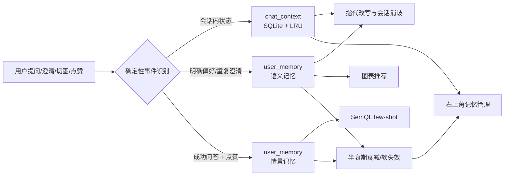

# InsightChat 用户级记忆系统设计与交付说明

> 实现范围：短期会话记忆、长期用户偏好、个人问答对、时间衰减与遗忘、用户管理、图表与澄清消费链路。
> 本文同时是实现说明、选型理由、改动清单和测试场景索引。权威模块契约见 `IMPLEMENTATION_SPEC.md`。

## 1. 选型评估与结论

| 实现思路 | 优点 | 代价/风险 | 结论 |
|---|---|---|---|
| **SQLite 结构化记忆 + 确定性规则抽取** | 复用现有 meta.db；无新依赖；用户隔离、冲突版本、衰减、审计均可测试；记忆故障可降级 | 对自由闲聊事实的泛化能力有限；个人问答对沿用字面召回 | **采用，最符合当前项目** |
| Mem0 式 LLM 事实抽取 + 向量检索 | 能抽取非结构化偏好；语义召回能力强 | 增加模型调用与向量组件；写入具有不确定性；口径偏好不应由模型自由发挥 | 当前不采用，保留检索层升级空间 |
| Zep 式时序知识图谱 | 双时间戳和事实失效能力强，适合复杂关系与时序推理 | 实体/关系抽取写放大；部署与运维复杂度远超当前单进程演示系统 | 不引入图谱，仅采用“失效不覆盖”的思想 |

**核心理由**：ChatBI 的记忆多数是结构明确的“某用户、某场景、某图表/指标口径”，不是开放域事实。确定性写入比 LLM 抽取更可靠，也更容易做到最小侵入、异常可降级和行为可审计。

## 2. 总体架构



### 2.1 数据表

所有表由 `semantic/schema.py` 幂等创建，启动时自动补齐；完整种子初始化仍使用 `scripts/init_db.py`。

- `chat_context`
  - 主键 `session_id`，同时保存 `user_id`；加载时 JOIN `chat_session` 双重校验属主。
  - `state_json` 只保存白名单状态；`expires_at` 控制短期记忆 TTL。
- `user_memory`
  - 每条记忆包含：`user_id / memory_type / category / memory_key / value_json`。
  - 生命周期字段：`status / valid_from / valid_to`。
  - 遗忘字段：`confidence / last_confirmed_at / last_accessed_at / access_count`。
  - 当前版本部分唯一索引：同一用户、类别、key 至多一个 `active/candidate`；历史版本不受限。
- `user_memory_event`
  - 记录 `created / confirmed / observed / promoted / applied / superseded / deleted`。
  - 偏好被软删或失效后，事件仍保留用于审计。

### 2.2 短期记忆

| 状态 | 保存方式 | 重启后 |
|---|---|---|
| 最近 5 轮 `turns` | SQLite + LRU | 可恢复 |
| `last_semql` | SQLite + LRU | 可恢复 |
| 会话内 `clarify_choices` | SQLite + LRU | 可恢复 |
| `last_answer`（用于“换成折线图”） | SQLite + LRU | 可恢复 |
| `clarify_pending`（含 IntentResult/LinkResult） | 仅进程内 | 澄清挂起失效，返回 `CLARIFY_EXPIRED`，用户重新提问即可 |

- 默认 TTL：72 小时；进程 LRU：128 个会话，优先淘汰没有 pending 澄清的最久未用项。
- 删除会话时同步删除持久上下文和进程缓存。
- 读取损坏 JSON、过期状态、非法字段时按空上下文恢复，不阻断提问。

### 2.3 长期记忆类别

| 类别 | 写入来源 | 生效时机 | 消费点 |
|---|---|---|---|
| `chart_preference` | 明确说“以后趋势都用折线图”；对话切图；图表工具栏切图 | 立即生效 | 图表推荐，仅允许 `available_types` 内类型 |
| `term_mapping` | 明确说“记住销售额指净销售额”；同一澄清选择在 3 个不同会话重复 | 明确写入立即生效；自动学习先 candidate，达标后 active | TERM_CONFLICT 消歧 |
| `query_exemplar` | 本人成功回答获得 👍 | 立即生效；👎 撤销 | 与全局 exemplar 合并去重，注入 SemQL few-shot |

个人问答对不会直接进入其他用户的召回；原有“3 个不同用户点赞后进入全局 exemplar”的治理机制保持不变。

## 3. 消费优先级与典型链路

统一优先级：

```text
当次明确要求 > 当前会话选择 > 有效长期偏好 > 全局默认
```

任何长期记忆候选如果已经不在当前语义版本的候选集合中，视为失效并恢复原有澄清卡，不强行套用旧口径。

### 3.1 “这个人更喜欢折线图”的完整过程

1. 用户首次得到趋势图后说“换成折线图”，或在图表工具栏选择“折线图”。
2. 系统根据 answer 的原始 `columns_meta + SemQL` 判定数据形态为 `trend`，检查 `line` 在原规则推荐的可选类型内。
3. 复用原 answer 的结果快照完成切图，**不重新生成、不重新执行 SQL**；写入 `chart_preference / trend / line`。
4. 下次该用户询问趋势问题时，规则引擎先给出默认图表，再由记忆层在可选类型内应用 `line`。
5. 结果 `memory_trace` 和假设区显示“已沿用您的趋势分析图表偏好”，用户可在右上角记忆中修改或删除。
6. 另一用户没有这条记忆，仍使用全局默认图表。

普通问题中的“用折线图展示”只影响当次结果，不写长期记忆；“不要用折线图”“别再用折线图”不会被误判为正向偏好。

### 3.2 口径选择跨会话晋升

1. 用户在澄清卡选择“销售额 → 净销售额”，先写入当前会话选择，保证“那华北呢”不重复追问。
2. 同一选择记录为 candidate，并按 `session_id` 去重计数；同一会话重复点击不会刷晋升次数。
3. 在默认 3 个不同会话做出同一选择后，candidate 晋升为 active。
4. 后续新会话出现同一 TERM_CONFLICT 时自动消歧并留痕；如果用户明确改变选择，旧当前版本软失效，新版本重新累计。

### 3.3 个人问答对

- 只接收 `query_log.status='success'` 且存在合法 SemQL 的回答。
- 点赞写入、点踩软删；召回按现有字面重合度与有效置信度排序，个人优先，与全局结果去重后取 top-3。
- 命中时结果记录“参考了您 N 条已确认的历史问答”，不暴露其他用户内容。

## 4. 时间序列遗忘机制

长期偏好使用有效置信度，而不是物理定时删除：

```text
effective_confidence = base_confidence × 0.5 ^ (未再次确认天数 / half_life_days)
```

- 显式偏好半衰期：默认 365 天。
- 行为推断偏好半衰期：默认 90 天。
- 生效阈值：默认 0.35；低于阈值后不再消费，但管理页仍显示“已衰减”。
- 衰减基准是 `last_confirmed_at`，**不是** `last_accessed_at`。系统使用记忆只更新访问统计，避免一条旧记忆因为不断被使用而自我续期。
- 用户再次明确指定或重复确认可刷新置信度；被新值取代时旧版本 `superseded + valid_to`，保留历史。
- 用户删除/清空是软删除；短期上下文过期可物理清除；历史消息与审计事件不随偏好遗忘。

## 5. 用户操作

### 5.1 对话命令

| 示例 | 行为 |
|---|---|
| `以后趋势都用折线图` | 明确保存趋势场景图表偏好 |
| `以后分类对比都用柱状图` | 保存分类对比图表偏好 |
| `换成折线图` / `生成折线图` | 切换当前 answer 并记住对应场景偏好；无图或不兼容时明确提示 |
| `记住销售额指净销售额` | 校验当前语义版本后保存术语映射 |
| `你记得我什么` | 列出本人偏好和个人问答对数量 |
| `忘掉图表偏好` | 软删全部图表偏好 |
| `忘掉销售额口径` | 软删指定术语映射，并移除当前会话对应选择 |
| `忘掉全部记忆` | 软删全部长期记忆并清空当前会话上下文；历史审计保留 |

“以后/今后”开头的普通数据问题不会被记忆命令接管。无法识别的“记住……”会返回使用提示，不会静默转成数据查询。

### 5.2 管理界面

- 右上角芯片图标进入“我的记忆”。
- 展示内容、来源、候选/生效/衰减状态、有效置信度、使用次数。
- 支持逐条删除、全部清空；具有加载、空态、错误重试和删除确认。
- 图表卡提供原规则允许的类型切换；切图失败保留原图，成功则同步更新留痕。

## 6. API

统一前缀 `/api/v1`，均需 Bearer 登录，只能操作本人记忆。

| 方法 | 路径 | 说明 |
|---|---|---|
| GET | `/memories?include_history=false` | 列出当前记忆；`include_history=true` 含历史版本 |
| POST | `/memories` | 显式保存图表/术语偏好；客户端不能指定来源、置信度或他人 user_id |
| DELETE | `/memories/{id}` | 软删一条当前记忆 |
| DELETE | `/memories?category=...` | 清空本人长期记忆，可按类别限定 |
| POST | `/memories/chart-switch` | 按 `answer_id + chart_type` 切图并学习；重新校验本人和可选图型 |

错误沿用统一格式：400/1400 参数或状态错误，401/1001 未登录，403/1003 越权，404/1004 对象不存在，500/5000 未预期错误。管理写操作同时进入 `audit_log`。

## 7. 边界与降级

- 记忆读取/写入选配组件异常时，数据查询回退到原有澄清、全局 exemplar 和图表规则；明确记忆命令则返回失败说明，不伪装成查询成功。
- 图表切换只使用本人 answer 快照，快照最多 200 行；原始行数更大时 `truncated=true`，不会声称拿到全量。
- answer 不存在、越权、快照损坏、图型不兼容、术语已失效、重复删除均有明确分支。
- 写入事务在需要时使用 `BEGIN IMMEDIATE`，避免并发双写当前版本；pending 澄清遍历使用快照，避免 LRU 并发修改异常。
- 所有业务数据查询仍走原 SemQL 编译、SQL 网关、权限与限额；记忆系统没有旁路执行 SQL 的能力。

## 8. 配置

| 环境变量 | 默认值 | 用途 |
|---|---:|---|
| `MEMORY_SESSION_TTL_HOURS` | 72 | 短期会话上下文 TTL |
| `MEMORY_CONTEXT_CACHE_SIZE` | 128 | 进程 LRU 会话容量 |
| `MEMORY_TERM_PROMOTE_SESSIONS` | 3 | 澄清选择晋升所需不同会话数 |
| `MEMORY_MIN_CONFIDENCE` | 0.35 | 长期记忆最低生效置信度 |
| `MEMORY_EXPLICIT_HALF_LIFE_DAYS` | 365 | 显式记忆半衰期 |
| `MEMORY_INFERRED_HALF_LIFE_DAYS` | 90 | 行为推断记忆半衰期 |

无需新增 Python 包，`requirements.txt` 不变。

## 9. 改动清单

### 新增

- `chatbi/services/memory.py`：两级记忆、冲突版本、衰减、图表、个人 exemplar。
- `chatbi/api/routes_memory.py`：本人记忆管理与切图 API。
- `tests/test_memory.py`：独立内存库单元测试。
- `docs/MEMORY_SYSTEM.md`：本文。

### 修改

- `chatbi/config.py`、`.env.example`：记忆配置。
- `chatbi/semantic/schema.py`：三张记忆表及索引。
- `chatbi/services/chat_service.py`：上下文持久化/LRU、长期消歧、记忆命令、图表消费、留痕。
- `chatbi/services/query_service.py`：个人与全局 exemplar 合并召回。
- `chatbi/services/feedback.py`：点赞/点踩驱动个人问答对。
- `chatbi/api/main.py`：注册路由，启动时幂等补表。
- `chatbi/api/routes_chat.py`：删除会话同步清上下文。
- `chatbi/api/static/index.html`：记忆管理、图表切换、记忆留痕。
- `docs/IMPLEMENTATION_SPEC.md`、`AGENTS.md`、`README.md`：契约与使用说明。

原有语义层、编译器、SQL 网关、归因算法、业务库和 DeepSeek 调用方式未改。

## 10. 测试场景

### 10.1 单元测试

```bash
python -m pytest tests/test_memory.py -q
python -m pytest tests/ -q
```

覆盖：用户隔离、显式覆盖、软失效、审计事件、图型兼容、当次指定、否定表达、普通“表格”文本、趋势/占比族、快照切图、空快照、越权 answer、衰减与访问不续期、3 会话晋升、重复会话去重、候选变更、长期/会话优先级、失效候选、上下文恢复/过期/损坏/越权/LRU、个人 exemplar 召回与撤销、分类清空、非法输入、严格命令解析、自定义时间兜底。

### 10.2 真实服务场景

1. **图表偏好**：趋势查询 → “换成柱状图” → 新会话同族查询自动柱状图 → 忘掉后恢复默认。
2. **术语偏好**：记住“销售额=净销售额” → 新会话询问“销售额”不再弹净/毛选择卡，SQL 使用净销售额；另一用户仍需澄清。
3. **短期恢复**：完成一轮查询后重启服务，再问“那华北呢”，仍能继承上一轮指标与时间。
4. **个人问答对**：对成功回答点赞，确认本人 exemplar 被召回；点踩后不再召回；其他用户不可见。
5. **管理与异常**：列表/删除/清空、未登录、越权 answer、非法图型、损坏快照、重复删除均返回预期状态。
6. **原回归**：`python scripts/run_pipeline_test.py`，q01–q12 全部通过。

## 11. 已知边界

- pending 澄清包含复杂 Python 对象，仍只存在进程内；服务重启后该卡片过期，已完成的会话上下文和澄清选择不受影响。
- 当前是本地单进程设计，未引入 Redis/Celery；多实例部署时应把 `_CTX` 和 pending 澄清迁移到共享存储。
- 个人问答对沿用项目现有字面召回，没有声称提供向量语义检索；后续可在 `memory.py` 内替换检索实现而不改变消费接口。
- 记忆只学习展示与口径偏好，不绕过行/列权限，也不把业务结果行共享给其他用户。

## 12. 交付验收记录（2026-10-27）

- `python scripts/init_db.py`：已有 meta.db 幂等升级成功，种子与 Evidence 复算正常。
- `python -m pytest tests/ -q`：**80 passed**。
- `python scripts/run_pipeline_test.py`：**q01–q12 全部 PASS**（35 次真实 LLM 调用，149.6 秒）。
- 真实 SSE/API 验收通过：
  - 对话切图、新会话图表偏好生效、另一用户不继承、忘掉后恢复默认；
  - “销售额=净销售额”跨会话生效，2024-05 华东结果为 **140742.24**；另一用户仍收到澄清卡；
  - 非法图型 400/1400、越权切图 403/1003、未登录 401/1001、记忆列表与删除；
  - 已有库升级后会话创建/删除正常，新增 `chat_context` 外键不影响存量操作；
  - 服务重启后“那华北呢”正确改写为 2024-04 华北净销售额，区域 HB、值 **117719.7437**；
  - 点赞生成个人 exemplar、下次查询出现个人召回留痕、点踩后撤销；反馈与全局 exemplar 已恢复事前状态。
- 无头 Chrome 实际操作通过：登录、记忆空态、页面创建/删除、图表工具栏切换、留痕实时更新、清空；**0 个 JavaScript 异常**。
- 验收创建的临时生效偏好已清理（analyst/east_mgr 当前 active/candidate 为 0），服务保持在 `127.0.0.1:8000` 运行。
